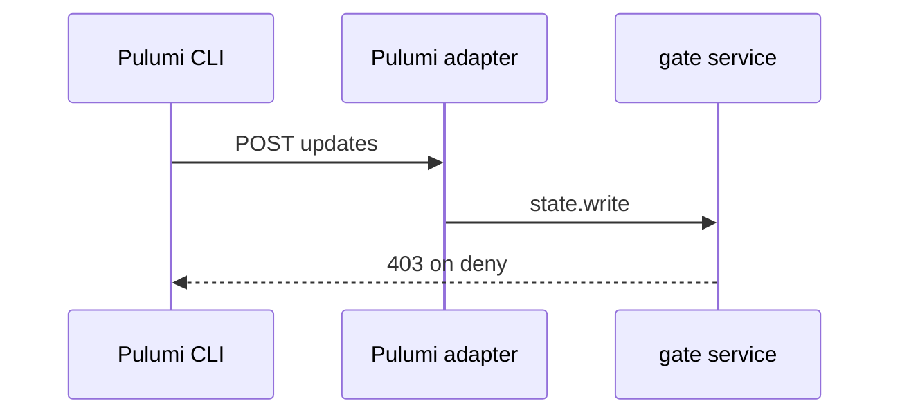
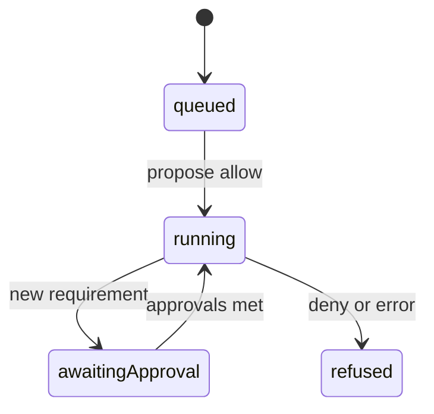
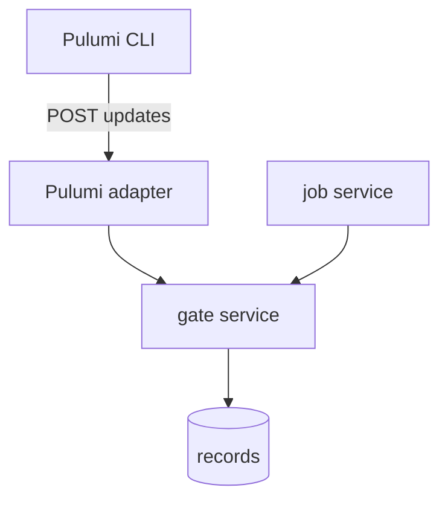

## Context

Pulumi jobs run through the job service and the runner. CLI writes enter through the Pulumi Cloud-compatible adapter. Both call the same gate service with the facts of the moment.

## Decisions

1. **Job points in the job service.** Evaluate change.propose at job start, change.planned after the preview stores the plan, change.apply before dispatch of the update phase.
2. **CLI point in the Pulumi adapter.** Check state.write in the update create handler before the store create, with operation kind update. A deny returns the Pulumi shape with code and message.
3. **No double evaluation for runner updates.** A runner update with a job-token credential meets the three change points and skips state.write.
4. **Reuse of the OpenTofu slice.** Reuse the gate service and fact producers. Add only Pulumi call sites and fact values.

## Structure

Unexported evaluator type with a constructor that loads the compiled policy set, the fact schema version and the scope chain. Only the constructor makes a value, and it refuses an unknown decision point.

## Risks

- Double evaluation of change.apply and state.write for one runner update
- Stale facts between apply evaluation and phase dispatch

## Diagrams

After this change:

States and transitions after this change:

## Quality attributes

| Attribute | Target | Unit | Scope |
| --- | --- | --- | --- |
| gate evaluation overhead | 50 | ms p95 per evaluation | Pulumi update create and job phase dispatch |

## Threat model

Data flow and trust boundaries:

| Boundary | STRIDE | Threat | Layer | Guard | Hostile test |
| --- | --- | --- | --- | --- | --- |
| Pulumi CLI to Pulumi adapter | S | A caller forges facts to pass state.write | boundary check | Adapter builds facts from server state only | Send a forged fact document; adapter ignores it |
| Pulumi CLI to Pulumi adapter | S | A caller forges facts to pass state.write | encode or contain | Unit resolved by stable ID | Send a cross-unit name; adapter resolves only its own unit |
| Pulumi CLI to Pulumi adapter | S | A caller forges facts to pass state.write | limit | Body size cap | Send an oversize body; adapter refuses |
| Pulumi CLI to Pulumi adapter | S | A caller forges facts to pass state.write | authorize at point of use | Credential checked before the engine call | Send a job-token to the create; adapter routes to the job path |
| Pulumi CLI to Pulumi adapter | S | A caller forges facts to pass state.write | fail closed | Deny answers 403 and writes an audit entry | Force a deny and check the 403 shape |

## Contracts

**gate evaluation**

- Invariant: Evaluate mode never stops a change
- Invariant: Engine error in enforce mode stops the change
- `State write at update create`: pre: Operation kind is update. Post: Deny creates no update and answers 403.

## Failure modes

| Step | Failure | Retry | State after |
| --- | --- | --- | --- |
| state.write at Pulumi update create | Store create fails after allow | CLI retries; each attempt evaluates again with its own record | No update created and no duplicate on retry |
