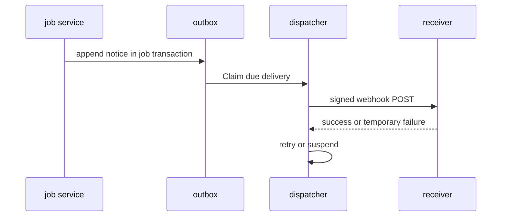
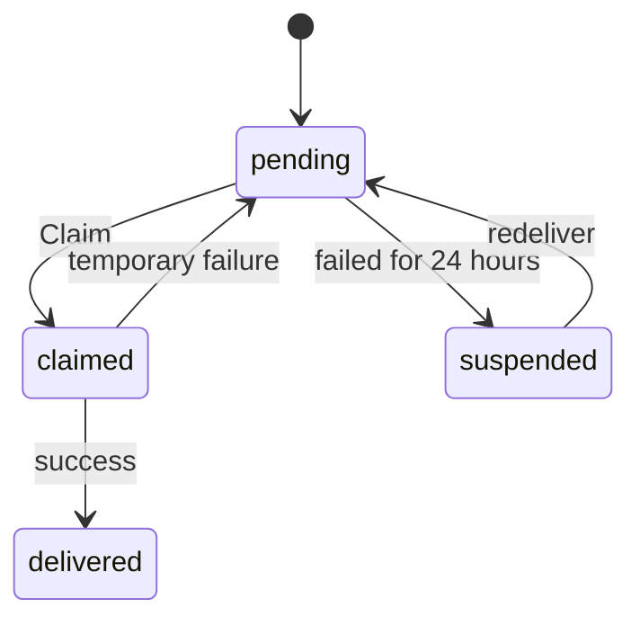
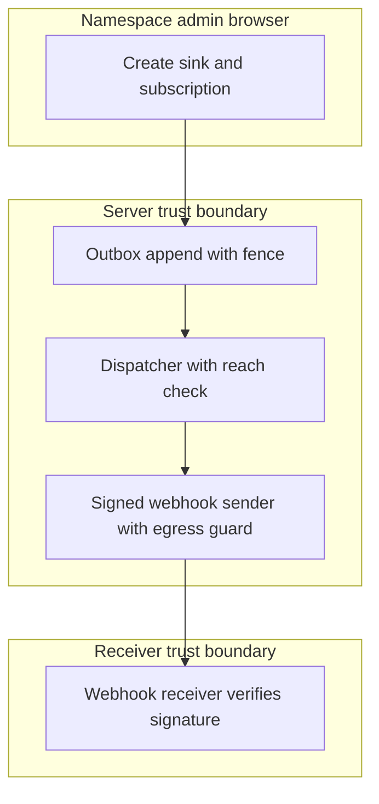

## Context

Job and token notices use the outbox, subscriptions, dispatcher and signed webhook sender owned by chat-a2-outbox-deliveries-dispatcher. The job service appends in its own transaction. The dispatcher delivers outside the write.

## Decisions

1. **Emit job and token notices from the owning job transaction.** Emit four facts from the job service and the token expiry schedule: job started, job waits for approval, job ended in a terminal state, and access token near expiry. Each append carries scope, stable unit ID or token ID, dedupe key built as type plus job ID plus state plus attempt, and links to the console page. When the outbox write fails, the owning transaction rolls back and no job state commits. A retried attempt with the same scope and dedupe key keeps one notice. Token expiry uses a durable schedule owned by the token service: one notice per token ID per warning time; a restart replays the due check and skips keys already stored; a token with a short lifetime gets only the warnings it still meets.
2. **Reuse the dispatcher of chat-a2 with no new retry rule.** Reuse the subscription filter, enqueue idempotence, Claim, retry, suspend and manual retry route of chat-a2-outbox-deliveries-dispatcher with no new rule. The dispatcher checks the creator reach before each delivery: namespace:manage-notifications and namespace:read on the scope. A new notice that arrives while suspended enqueues as pending and waits for redeliver in per-scope sequence order.
3. **Sign each webhook delivery.** Sign each webhook POST per the signature rule with the active sink secrets. Keep at most 2 active secrets per sink. Post through the egress guard with a 10 second timeout per delivery attempt, a 256 KiB body limit per POST, and a 2 KiB limit per link. Retry a temporary failure after 30 seconds, then double the wait up to 1 hour, for at most 15 attempts per delivery. Suspend after 24 hours of failed deliveries per subscription. The probe never blocks deletion of a secret.

## Structure

Unexported notify.dispatcher with constructor that takes Outbox, Subscriptions, Deliveries and Sender ports. Only the constructor builds delivery attempts, so a path without a fence, a reach check or a signature does not compile into the send path.

## Risks

- A receiver that needs ordered notices orders by sequence, because delivery order is not guaranteed.
- A suspended subscription needs an explicit manual retry after fix; the server never deletes the subscription on failure.
- Delivery history retention of 30 days bounds redelivery.

## Layers (defense in depth)

| Layer | Guard | Hostile test |
| --- | --- | --- |
| outbox append | Fit drops oversize text, bad links and secret-shaped fields before append. | Append a notification with a secret value, a plan dump and an oversize summary; the stored body holds none of them and the write succeeds. |
| service dispatch | Dispatcher rechecks creator reach before each delivery. | Remove the creator grant after subscribe, then trigger a job start; no POST leaves the server and the delivery stays pending. |
| sender egress plus signature | Sender validates the sink URL, enforces timeout and size bounds, and signs with HMAC. | Forge a POST with a wrong secret; verification fails and the notice is ignored. |

## Diagrams

After this change:

New imports of this change (each one allowed by the module rules):

- `internal/api/notifications` imports `pkg/notify`

States and transitions after this change:

## Quality attributes

| Attribute | Target | Unit | Scope |
| --- | --- | --- | --- |
| delivery retry bound | 15 attempts max with 30 seconds initial wait doubling to 1 hour | attempts and seconds | per webhook delivery |
| suspend delay | suspend after 24 hours of failure | hours | per subscription with all deliveries failing |
| delivery history retention | 30 days | days | per installation delivery store |
| signed POST size bound | 256 KiB body max and 2 KiB per link | KiB | per webhook POST |

## Threat model

Data flow and trust boundaries:

| Boundary | STRIDE | Threat | Layer | Guard | Hostile test |
| --- | --- | --- | --- | --- | --- |
| Server trust boundary | T | A forged job event tampers with the receiver state through an unsigned or replayed POST. | boundary check | Fit cuts oversize text and drops secret-shaped fields before append. | Submit a notice with a secret value and a 1 MiB summary; stored body holds none of them. |
| Server trust boundary | T | A forged job event tampers with the receiver state through an unsigned or replayed POST. | encode or contain | Body holds only names, IDs, summary, sequence and links. | End a job that used profile secrets; stored and sent body holds no secret value. |
| Server trust boundary | T | A forged job event tampers with the receiver state through an unsigned or replayed POST. | limit | 256 KiB body cap per POST, 2 KiB link cap, 10 second timeout per POST. | Point sink at a slow receiver; send times out without leak. |
| Server trust boundary | T | A forged job event tampers with the receiver state through an unsigned or replayed POST. | authorize at point of use | Dispatcher rechecks subscription creator reach at point of use. | Remove creator grant then trigger job start; no POST leaves. |
| Server trust boundary | T | A forged job event tampers with the receiver state through an unsigned or replayed POST. | fail closed | Unknown egress or decode error denies delivery and writes audit entry. | Break egress dial; delivery fails closed with pending reason. |
| Receiver trust boundary | I | A notice leaks a secret value, state, plan or log to a webhook receiver. | boundary check | Sender signs id plus timestamp with each active secret; receiver checks clock window and idempotence. | Replay a signed POST after the window; receiver refuses it. |
| Receiver trust boundary | I | A notice leaks a secret value, state, plan or log to a webhook receiver. | limit | Sink URL guard, 256 KiB body cap and 10 second timeout per POST. | Point sink at a blocked host; send fails without secret leak. |
| Receiver trust boundary | I | A notice leaks a secret value, state, plan or log to a webhook receiver. | encode or contain | Notification body holds only names, IDs, summary, sequence and links. | End a job that used profile secrets; body holds no secret value. |
| Receiver trust boundary | I | A notice leaks a secret value, state, plan or log to a webhook receiver. | authorize at point of use | Dispatcher rechecks creator reach before each delivery to this receiver. | Remove creator grant; no POST reaches this receiver. |
| Receiver trust boundary | I | A notice leaks a secret value, state, plan or log to a webhook receiver. | fail closed | Signature or egress failure denies the send and keeps delivery pending with audit entry. | Delete the only sink secret; delivery fails closed with no unsigned send. |

## Contracts

**notify.Delivery**

- Invariant: One scope and dedupe key maps to at most one notification row.
- Invariant: Each delivery names its subscription, sink, notification and attempt count.
- Invariant: A suspended subscription keeps pending rows pending with reason.
- `Enqueue`: pre: Notification committed in the owning job transaction with fence.. Post: Matching subscriptions each get one pending delivery..
- `Claim`: pre: Delivery is due and its subscription is not suspended.. Post: Claimed deliveries carry owner, lease and new version..
- `Redeliver`: pre: Caller holds manage action on the scope and receiver is fixed.. Post: Pending rows send in per-scope sequence order..

## Failure modes

| Step | Failure | Retry | State after |
| --- | --- | --- | --- |
| Job transaction append | Outbox write fails in job transaction | Owning transaction rolls back; job write retries with same dedupe key and keeps one notice. | No job state and no notice committed. |
| Dispatcher delivery | Webhook receiver down or refuses signature | Retry with backoff 30 seconds doubling to 1 hour for at most 15 attempts; suspend after 24 hours; manual redeliver in sequence order. | Delivery pending, then suspended with error class as reason. |
| Sender egress guard | Blocked sink URL at delivery time | Fail the attempt without send, retry per backoff, write audit entry. | Delivery pending with egress-blocked reason. |

## Change impact (computed from main)

Tests:

- `internal/subscriptionsvc/history_test.go` names `notify.Types`
- `pkg/store/internal/notifystore/notifystore_test.go` names `notify.Types`
- `pkg/notify/notify_test.go` names `notify.Types`

Docs pages:

- `docs/reference/typescript-client.md:15` names `notify.Types`

ADRs:

- `docs/adr/0176-one-core-two-protocol-adapters.md` names `notify.Types`
- `docs/adr/0201-the-profile-document-imports-and-expressions.md` names `notify.Types`
- `docs/adr/0171-the-provider-declaration-format.md` names `notify.Types`
