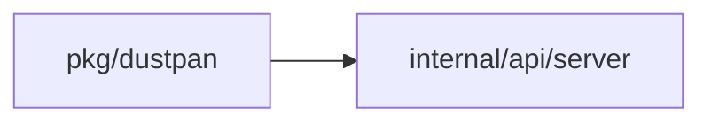

## Context

The runner API already counts suppressed handoff-refusal audit entries through the OnHandoffRefusalSuppressed callback, but the production wiring in pkg/dustpan leaves the callback nil so the count is lost.

## Decisions

1. **Wire suppressed handoff-refusal count to a fixed counter.** Wire OnHandoffRefusalSuppressed in the runner area file of pkg/dustpan to a zero-label Prometheus counter named runner_handoff_audit_suppressed_total, register with already-registered reuse so a second server in one process reuses the existing collector, share the runner_<route>_audit_suppressed_total naming pattern with the exchange denial limiter change, and document the name and help text in the metrics reference docs.

## Structure

Unexported counter holder with constructor that registers the zero-label Prometheus counter on the server metrics registry with already-registered reuse and returns an increment function used as the OnHandoffRefusalSuppressed callback.

## Risks

- Duplicate Prometheus registration panics when a second server is built in one process.
- Double count when the callback runs more than once per suppressed entry.

## Diagrams

Modules that the change touches, and their imports on main:

## Quality attributes

| Attribute | Target | Unit | Scope |
| --- | --- | --- | --- |
| metric cardinality | 1 | series max for the new counter | installation metrics output |
