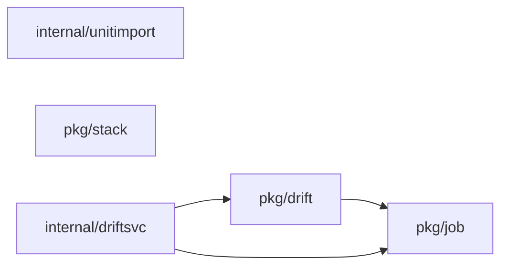

## Context

Exported signatures in pkg name types from internal after package moves, so a module outside this repository cannot name them.

## Decisions

1. **Ports in pkg and a gate on the surface.** Move Store, UnitStore, LedgerRow and UnitKey to the NEW pkg/unitimport package and keep the service in internal/unitimport. Move scopeaudit Recorder, Where and Family to a NEW pkg package or stop naming them from exported pkg signatures. Update storetest ImportPorts and the sqlite and postgres adapters to the NEW pkg types. Land the NEW gate internal/tools/sdksurface with api.txt plus a leak baseline written from the moved tree. The gate fails on a new leak and on stale api.txt.

## Structure

No unexported type removes the need for the gate because the leak is a package location rule across many packages. The guard is the NEW gate internal/tools/sdksurface with the NEW target make sdk-surface.

## Risks

- Baseline entries hide current leaks until each split removes one entry.

## Diagrams

Modules that the change touches, and their imports on main:

## Quality attributes

| Attribute | Target | Unit | Scope |
| --- | --- | --- | --- |
| none affected | Build-time SDK surface only with no runtime change. |  |  |
