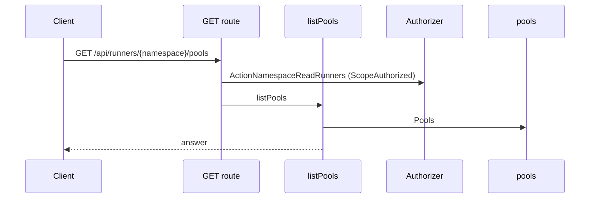
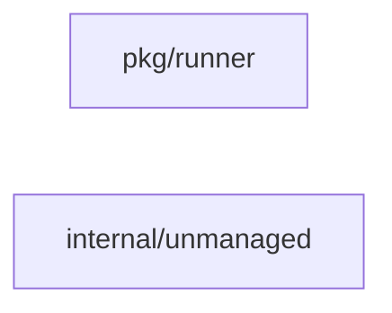

## Context

The RFC replaces the sweep runner path with a converter port in an operator pool.

## Decisions

1. **Provisional: converter runs on an operator pool.** Owner decision, 13 Nov 2026 (queue P14). The converter runs on an operator pool with its host workload identity. The server holds no cloud credential and runs no converter. The RFC sets the port shape and schedule.

## Structure

The RFC defines the unexported converter type and its constructor.

## Risks

- ADR 164 stays current until the RFC is accepted.

## Diagrams

Today: `GET /api/runners/{}/pools` on main (from the route table and the handler body, route row internal/api/runnerapi/routes.go:97, handler internal/api/runnerapi/admin.go:102).

Modules that the change touches, and their imports on main:

## Quality attributes

| Attribute | Target | Unit | Scope |
| --- | --- | --- | --- |
| none affected | No behavior change until the RFC is accepted |  |  |
