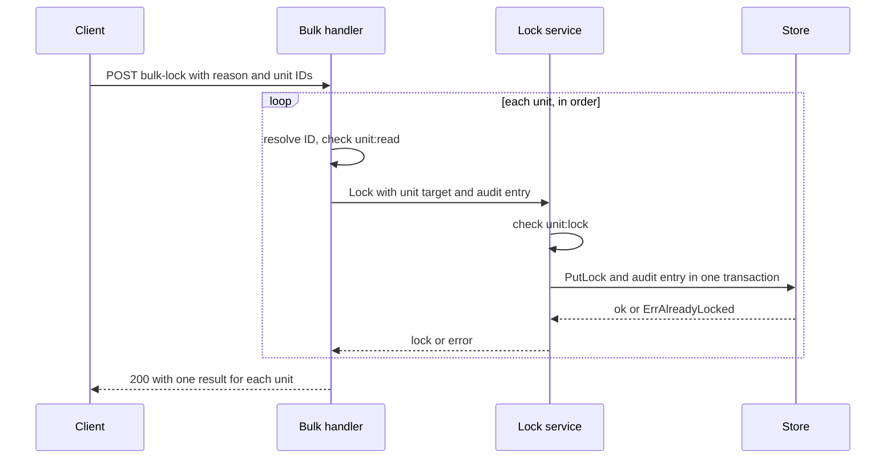
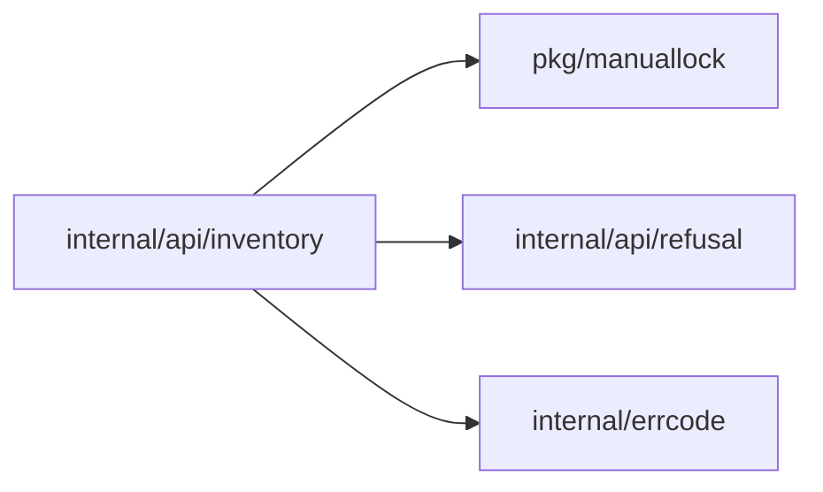
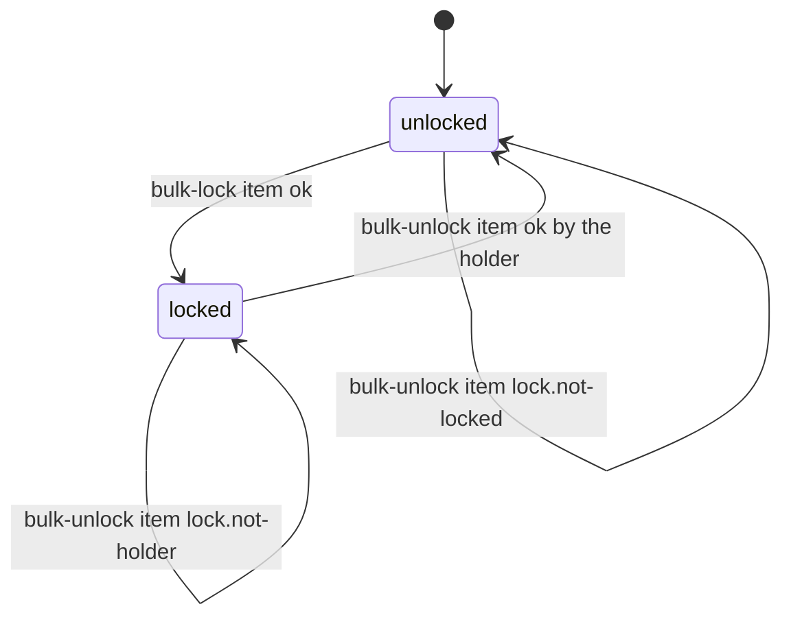
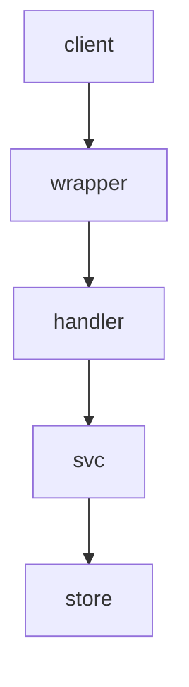

## Context

The lock service in pkg/manuallock and the single lock routes in internal/api/inventory exist. This change adds two routes that run the single lock and unlock for many units in one call. It adds no new lock rule, no new store method and no new schema.

## Decisions

1. **One path for a single call and for an item.** A new handler function `lockOne` takes a resolved unit and does what `putLock` does after it reads the reason: build the audit entry, call `Service.Lock`, map the error. `putLock`, `deleteLock` and each bulk item call the same function, so an item cannot differ from a single call. This follows the structure of `replace` in internal/api/settings/serve.go, which serves the single write and each bulk item.
2. **Each item on its own, not atomic.** The handler runs the items in request order. An item error becomes the result of that item and stops nothing. Precedent: `bulkPut` in internal/api/settings/serve.go. Reason: ADR 213 decision 5. An atomic call would make one denied unit block 99 others, and it would need one transaction over many namespace fences.
3. **Route check on the namespace, item check on the unit.** The route row has the object `namespace` of the path and the action `namespace:read`, so a caller with no access to the namespace gets the refusal of any namespace route. For each item the handler resolves the unit by its stable ID inside the namespace of the path, checks `unit:read` on it (a denial or a missing unit gives one not-found result), and then `Service.Lock` or `Service.Unlock` checks `unit:lock` on the unit at the point of use. A denial of `unit:lock` writes an audit entry of the outcome denied, as the route check of a single call does.
4. **The unit kind only.** The item names a unit by its stable ID. The handler maps the ID to the unit reference once, with the inventory lookup that the unit-by-ID route uses, and builds `manuallock.UnitTarget`. No lock row stores a name that the item gave.
5. **Keyed.** Both routes take the `Idempotency-Key` header. One record keeps the whole call (same key and another body gives 422). One record for each unit keeps the result of a unit that the call changed, as in internal/api/settings/keyed.go. A result with status 5xx or 429 is not stored. A server with no replay port answers a request with a key with 400 and the code that the settings bulk route uses.
6. **Limits.** 1 to 100 units, else 400 `lock.bulk-size` with no change. The body is at most 20480 bytes: the reason takes up to 6000 bytes when every character is written as a 12-byte surrogate pair, and 100 IDs of at most 100 characters take at most 11200 bytes with quotes, braces and commas. A longer body gives the existing body-too-large refusal. The same text rules as the single call apply to the reason (valid UTF-8, no lone surrogate escape, no control character, 1 to 500 characters). An unknown field, a second JSON value and a missing `reason` on bulk-lock give 400, and nothing changes. Bulk-unlock takes no `reason`; a body with one gives 400.
7. **No batch ID.** The answer has `results` only. See "Out of scope" in the proposal.

## Structure

The wire types are unexported and live in a new file `internal/api/inventory/locks_bulk.go`: `bulkLockBody`, `bulkUnlockBody`, `bulkItem`, `bulkResult`, `bulkError`. The count limit is an exported constant `MaxBulkLocks = 100` beside the body limit constant. `bulkResult` has a private constructor for the `ok` and the `error` form, so a result never holds both a lock and an error.

## Risks

- A call of 100 units runs 100 fenced transactions in one request. A slow store can make the request long. The latency target below covers it. The handler checks the request context before each item and stops when it ends. An item that did not run has no lock row and no audit entry, and a retry with the same key does it (fail closed).
- A unit that is renamed or deleted between the lookup and the lock gives the result of a single call in that state.
- A replay that finds the first call still running gives 409 `request.idempotency-key-in-progress`, as other keyed routes do.

## Diagrams

After this change:

Modules that the change touches, and their imports on main:

New imports of this change (each one allowed by the module rules):

- `internal/api/inventory` imports the replay-record package for the per-item records (the adapter of the settings routes imports it already).

States and transitions of one unit in a call:

## Quality attributes

| Attribute | Target | Unit | Scope |
| --- | --- | --- | --- |
| bulk latency | 2000 | ms p95 | bulk-lock of 100 unlocked units on SQLite and PostgreSQL, measured in a test with the real stores |
| store round trips per item | equal to the single PUT of the same unit | queries | counted by a wrapper around the test store; the budget is the count of the single call, measured in task 1.4, and a bulk item may not exceed it |
| body size | 20480 | bytes at most | the request body of both routes |
| units per call | 100 | units at most | both routes |

## Threat model

Data flow and trust boundaries:

Layers: the port adapter is the store (`PutLock`, `RemoveLock`), the service is `manuallock.Service`, the handler is the bulk handler. Each layer must stop its own hostile input as if the others failed. The unit tests of each layer already exist for the single call; this change adds the table of hostile cases for the handler and a test for each new guard. The guards that the service and the store already have are re-run through the bulk path in the handler table (the second row of each pair below), so a bulk path cannot skip them.

| Boundary | STRIDE | Threat | Layer | Guard | Hostile test |
| --- | --- | --- | --- | --- | --- |
| Client to server | D | A body of 100 MB or 100,000 IDs. | handler: boundary | Body limit of 20480 bytes, read with a limit before the decode. | Send 20481 bytes; the server answers the body-too-large refusal and changes nothing. |
| Client to server | D | A call with 0 or 101 units. | handler: limit | Count check before any item runs. | Send 0 and 101 units; 400 `lock.bulk-size`, and the lock list is the same. |
| Client to server | T | An unknown field, a second JSON value, a missing reason, a reason of 501 characters, a reason with a line break, a lone surrogate escape, or an invalid UTF-8 byte. | handler: boundary | The decode of the single call, with the allowlist of fields. | One case for each; 400 and no lock is written. |
| Client to server | T | An ID with a path part, a query part, a name instead of an ID, a 101-character ID or an empty ID. | handler: boundary | `ident.Valid` with the length bound on each ID before the lookup. | One case for each; the result of that item is the not-found result, and the other items run. |
| Client to server | I | An ID of a unit in another namespace, a deleted unit, or a unit that the caller cannot read, to learn that it exists. | handler: authorize at point of use | Lookup inside the namespace of the path, then `unit:read` on the unit; one not-found result for all three cases. | The three results are equal in status, code and text. |
| Client to server | E | A caller with `unit:read` and no `unit:lock` on a unit. | service: authorize at point of use | `Service.Lock` checks `unit:lock` on the unit target. | Lock as a reader; the item has 403 and no row is written. Run it through the handler and through the service alone. |
| Client to server | E | A caller with `unit:lock` on the namespace only, or on one other unit. | service: authorize at point of use | The check names the unit object. | Grant on a sibling unit; the item has 403. |
| Client to server | E | A bulk-unlock of a lock that another person holds. | service and store: fail closed | `Service.Unlock` and `RemoveLock` compare the holder in the transaction. | The item has `lock.not-holder`, and the lock stays. Run it against the store alone with a wrong holder and an empty holder. |
| Client to server | R | A denied item with no record. | handler: fail closed | A denied item writes an audit entry of the outcome denied; a locked or unlocked item writes the entry in the transaction of the write. | Count the audit entries after a mixed call: one for each item that was denied, locked or unlocked. |
| Client to server | S | A replay of a key with another body, a key that is not valid, or two key headers. | handler: boundary | The same key rules as the settings bulk route. | One case for each; 422 or 400, and no lock changes. |
| Server to store | T | A lock on a unit that a namespace fence has moved. | port adapter: fence | The store checks the fence in the transaction. | Lock with a stale fence; the item fails and no row is written. Existing store test, re-run for the bulk path. |
| Server to client | I | A result that holds the reason or the holder of a lock that the caller cannot read. | handler: boundary | An error result carries the error of the single call only; `lock.locked` is not used here. | A denied item has no holder and no reason. |

## Contract

**manuallock**

- Invariant: One active lock per object.
- Invariant: Reason is 1 to 500 characters.
- No new method. The bulk handler uses `Lock`, `Unlock` and `Get`.

**inventory adapter**

- `MaxBulkLocks = 100` (NEW constant).
- The answer of both routes: `{"results": [{"id": "<unit ID>", "status": "ok", "lock": {...}}, {"id": "...", "status": "error", "error": {"code": 409, "errorCode": "lock.already-locked", "errorArgs": {}, "message": "..."}}]}`. `lock` is the manual lock document of the single PUT and only on a bulk-lock item with status ok. The order is the order of the request.

## Failure modes

| Step | Failure | Retry | State after |
| --- | --- | --- | --- |
| Item resolve | The unit does not exist, is in another namespace or is not readable. | Caller sends the ID again after it reads the unit list. | The item has `lock.target-not-found`. The other items keep their results. |
| Item lock | The unit already has a lock. | Caller reads the lock and unlocks first, or skips. | The item has `lock.already-locked`. The old lock stays. |
| Item unlock | Another person holds the lock. | A person with `unit:manage` force-unlocks the unit. | The item has `lock.not-holder`. The lock stays. |
| Item write | The store fails with 5xx. | Retry with the same `Idempotency-Key`; the server does that item again. | The item has the 5xx result and no lock row. Other items keep their results. |
| Request context ends | The client closes the connection in the middle of a call. | Retry with the same key. | Items that ran keep their locks and their records. A retry answers them from the records and does the rest. |
| Replay while the first call runs | The first call has not ended. | Retry later. | 409 `request.idempotency-key-in-progress`; nothing runs twice. |
