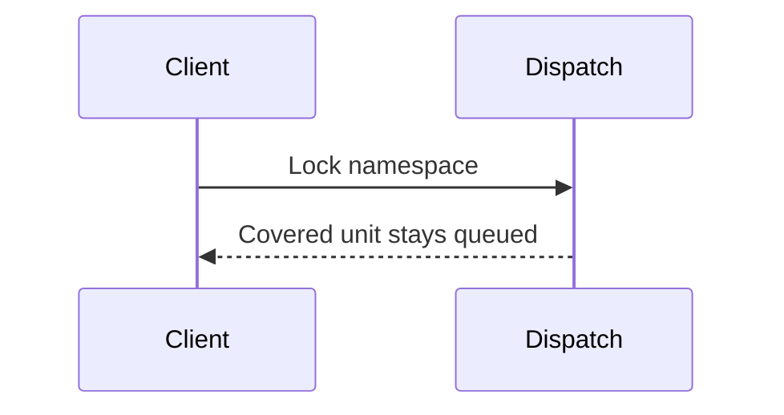
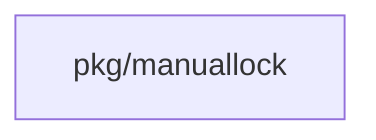
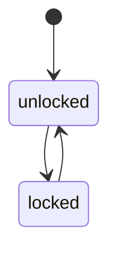
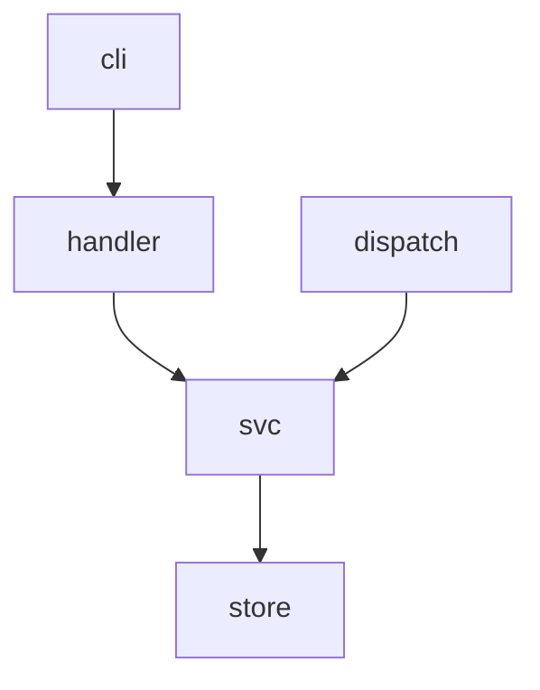

## Context

The shared core pkg/manuallock holds the check. Tool adapters, job dispatch and routes call it.

## Decisions

1. **One coverage check.** One Covered call checks unit, collection and namespace rows, with stable IDs.
2. **Dispatch check at claim.** Dispatch reads the lock in the transaction that claims the phase.

## Structure

An unexported lockSet is built only by a constructor that loads all three levels in one transaction, so no caller checks one level only.

## Risks

- A running job that has not taken its tool lock is refused if the time rule is wrong.
- A namespace lock fans out to many units.

## Diagrams

After this change:

Modules that the change touches, and their imports on main:

New imports of this change (each one allowed by the module rules):

- `internal/api/server` imports `pkg/manuallock`

States and transitions after this change:

## Quality attributes

| Attribute | Target | Unit | Scope |
| --- | --- | --- | --- |
| bulk latency | 2000 | ms p95 | bulk lock of 100 IDs on SQLite and PostgreSQL |

## Threat model

Data flow and trust boundaries:

| Boundary | STRIDE | Threat | Layer | Guard | Hostile test |
| --- | --- | --- | --- | --- | --- |
| Client to server | E | A caller without unit:lock locks a namespace. | boundary check | Reject reasons over 500 characters. | Send a 501-character reason; the server answers 400. |
| Client to server | E | A caller without unit:lock locks a namespace. | limit | Limit bulk calls to 100 IDs. | Send 101 IDs; the server answers 400. |
| Client to server | E | A caller without unit:lock locks a namespace. | authorize at point of use | Check unit:lock on the object. | Call without the grant; the server answers 403. |
| Client to server | E | A caller without unit:lock locks a namespace. | fail closed | Deny on a missing grant and audit the denial. | Omit the grant; a denial entry exists. |

## Contracts

**manuallock**

- Invariant: One active lock per object.
- Invariant: Reason is 1 to 500 characters.
- `Covered`: pre: Caller passes the namespace ID and unit reference.. Post: Answers holder and reason when any level matches..

## Failure modes

| Step | Failure | Retry | State after |
| --- | --- | --- | --- |
| Dispatch claim | A lock commits between read and dispatch. | Next claim tick. | The phase stays queued with reason locked. |
| Bulk lock | One item fails. | Caller retries that ID. | Other items keep their results. |
