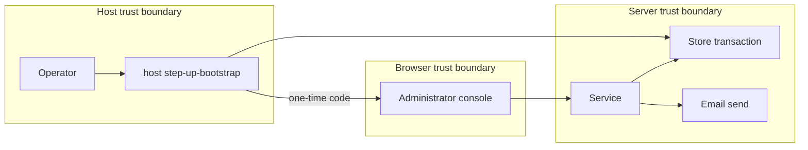

## Context

Owner decision, 13 Nov 2026 (queue P17): an SSO installation gets its first step-up key from a host command with a one-time marker, in modes 1 and 2.

## Decisions

1. **One-time marker and one transaction.** The store method checks the marker and the key count, records the key, sets the marker and writes the audit entry in one transaction. The API reads the marker under an installation read action.
2. **Email after commit.** The first audit entry says the email is due. After the commit a second audit entry records the send result. A failed send is logged with no driver text. With no address or no SMTP setting, the command prints a warning and the second entry records the skip.
3. **Challenge use.** The store marks a challenge used with one conditional update that also checks the expiry and the person. Concurrent attempts give one winner.
4. **AcceptStep lock.** The port takes the lock itself, so no caller can skip it.
5. **Admin challenge count.** A fixed counter of 10 challenges for each administrator and person pair in each hour is separate from the person counter.
6. **Admin reset.** The store method clears the keys of a person, ends the challenges in flight and writes an audit entry. The route, the action and the fresh-authentication need are those of the mfa change.

## Structure

An unexported bootstrap token type with one constructor that checks mode, migration state, off-switch value, reason text and the administrator subject. Only a value from it reaches the store method, which checks the marker.

## Risks

- A second bootstrap makes a backdoor key.
- A replayed challenge enrolls an attack key.
- A suspended sole key locks out the administrator.
- A restore of an older backup resets the marker.

## Layers (defense in depth)

| Layer | Guard | Hostile test |
| --- | --- | --- |
| host command | Checks mode, pending migration, off-switch value, reason text and subject. | Run in mode none, with a pending migration, with an unknown switch value, with a direction override in the reason and with a non-administrator subject; each refuses with no key. |
| service | Takes the lock and consumes the challenge once. | Replay a challenge, use an expired one, use one of another person and exceed the limit; each refuses. |
| store | Checks the marker and the key count in the same transaction. | Race two bootstraps; one key exists. |

## Quality attributes

| Attribute | Target | Unit | Scope |
| --- | --- | --- | --- |
| Bootstrap latency | 5 | seconds for one run of the host command | one command on a database with no pending migration |
| Challenge use | 1 | successful use for each challenge | each key-add challenge |

## Threat model

Data flow and trust boundaries:

| Boundary | STRIDE | Threat | Layer | Guard | Hostile test |
| --- | --- | --- | --- | --- | --- |
| Host trust boundary | E | A second bootstrap makes a backdoor key for an attacker with host access. | boundary check | The command checks mode, migration state, off-switch value, reason text and subject. | Run in mode none, with an unknown switch value and with a non-administrator subject; each refuses with no key. |
| Host trust boundary | E | A second bootstrap makes a backdoor key for an attacker with host access. | authorize at point of use | The store checks the marker and the key count in the transaction. | Race two bootstraps; one key exists. |
| Host trust boundary | E | A second bootstrap makes a backdoor key for an attacker with host access. | fail closed | An unknown value or a store error refuses and writes an audit entry. | Fail the store write; no key and no marker exist. |
| Browser trust boundary | S | A replayed or stolen key-add challenge enrolls an attack key. | boundary check | The store checks the expiry and the person of the challenge. | Use an expired challenge and a challenge of another person; each is refused. |
| Browser trust boundary | S | A replayed or stolen key-add challenge enrolls an attack key. | limit | One conditional update consumes the challenge once, and a counter limits challenges. | Replay a challenge and exceed the limit; each is refused. |
| Server trust boundary | R | A crash after the commit hides that the email was due. | fail closed | The first audit entry in the transaction says the email is due. | Stop the process before the send; the entry exists and no send result exists. |

## Failure modes

| Step | Failure | Retry | State after |
| --- | --- | --- | --- |
| Store transaction of the first key | The process stops before the commit. | The operator runs the command again. | No key, no marker and no audit entry exist. |
| Email send | The send fails or the process stops after the commit. | No automatic retry. The operator reads the audit entry. | The key and the marker exist, and the audit entry records the failure or the due email. |
| Challenge use | Two callers use one challenge at once. | The loser starts a new challenge. | One use succeeded and the challenge is used. |
| AcceptStep lock | Two callers accept one step at once. | The loser reads the state and stops. | One accept succeeded. |
