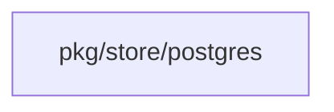
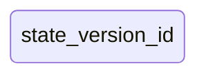
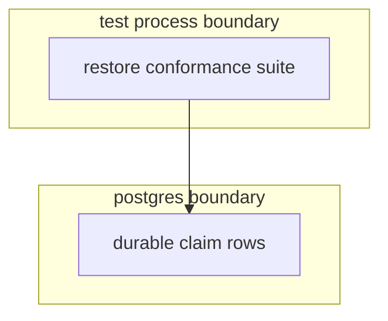

## Context

The postgres restore conformance test runs a restore through the durable runner. Under CPU load a lease renewal arrives late and the runner ends the claim.

## Decisions

1. **Test-only longer lease except where the swap fix applies.** After restore-loses-its-own-claim lands, lengthen the durable lease used by the restore conformance setup behind RunRestore to 10 minutes with renewal every 30 seconds, except the swap lock-conflict case which keeps the production lease. Keep all runner lease checks unchanged.

## Structure

No new type. The change passes a larger lease duration into the existing restore suite setup; the durable runner keeps enforcing the lease. The swap lock-conflict case keeps the production lease so the fix of restore-loses-its-own-claim stays covered.

## Risks

- A longer lease extends the suite run when renewals stall; the 60 minute go test timeout bounds the run.

## Layers (defense in depth)

| Layer | Guard | Hostile test |
| --- | --- | --- |
| limit | Test setup passes only fixed 10 minute lease and 30 second renewal; runner still enforces expiry. | Set lease to zero in the test setup and show the runner still ends the claim. |

## Diagrams

Modules that the change touches, and their imports on main:

States on main in the touched packages:

## Quality attributes

| Attribute | Target | Unit | Scope |
| --- | --- | --- | --- |
| test duration | 600 | s max | pkg/store/postgres TestRestoreConformance under load |

## Threat model

Data flow and trust boundaries:

| Boundary | STRIDE | Threat | Layer | Guard | Hostile test |
| --- | --- | --- | --- | --- | --- |
| test process boundary to postgres boundary | D | A stalled renewal holds the restore claim past its use and blocks the suite. | boundary check | Test setup allowlists fixed 10 minute lease and 30 second renewal; swap lock-conflict case keeps production lease. | Pass a zero lease in the test setup and show the runner still ends the claim. |
| test process boundary to postgres boundary | D | A stalled renewal holds the restore claim past its use and blocks the suite. | encode or contain | Lease durations pass as typed durations with placeholders only. | Inject a negative duration string and show the setup refuses it. |
| test process boundary to postgres boundary | D | A stalled renewal holds the restore claim past its use and blocks the suite. | limit | Lease capped at 10 minutes and renewal at 30 seconds; go test timeout caps the run at 60 minutes. | Stall renewals and show the run ends by timeout with no takeover claim. |
| test process boundary to postgres boundary | D | A stalled renewal holds the restore claim past its use and blocks the suite. | authorize at point of use | Test uses the existing restore conformance credential; no new grant or bypass. | Run the suite without the test credential and show postgres refuses the claim. |
| test process boundary to postgres boundary | D | A stalled renewal holds the restore claim past its use and blocks the suite. | fail closed | Late renewal fails closed with the lease deadline text and ends the restore operation. | Block all renewals and show the runner ends the claim instead of running free. |

## Failure modes

| Step | Failure | Retry | State after |
| --- | --- | --- | --- |
| Renew the restore durable claim every 30 seconds | One renewal arrives late under CPU load. | Next renewal succeeds within the 10 minute test lease; no claim retry. | Claim stays held and restore continues. |
| Run the restore work under the held claim | No renewal succeeds within the lease. | No retry; the test fails with the lease deadline text. | Runner ends the restore operation and releases the claim. |
