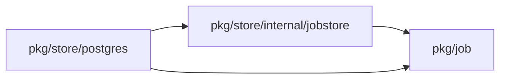
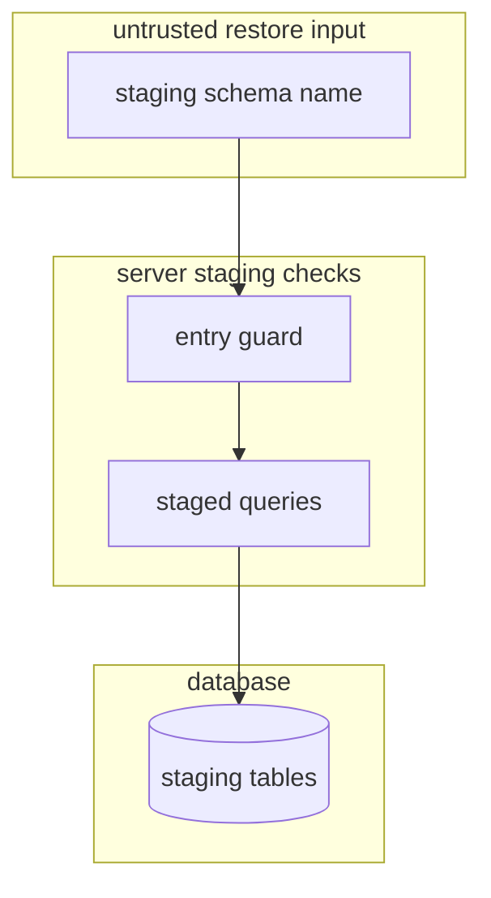

## Context

Postgres restore staging builds staged table names from a staging schema name with stagingTable. Chunk row validation exists in pkg/job and in the store. One secret blob helper has no caller.

## Decisions

1. **Single staging-name entry check.** Add one NEW function CheckStagingSchema in pkg/store/postgres/backup_item_keys.go that calls the existing checkStagingIdent at pkg/store/postgres/backup_item_keys.go:51. Call it at the start of the staged restore check path that reaches checkStagedSealedState at pkg/store/postgres/backup.go:1089, before any staged query runs. The allowlist shape is 1 to 63 chars of [a-z_][a-z0-9_]* with first char [a-z_], the shape checkStagingIdent enforces. Keep all existing checkStagingIdent calls before staged queries. The entry guard and the per-check guard are the same function, so the entry check accepts exactly what checkStagingIdent accepts.
2. **Single chunk rule.** Export one NEW helper pkg/job.CheckChunkField that owns the chunk bounds rule. Call it from the pkg/job/record.go ChunkReserve.valid path at pkg/job/record.go:392 and from jobstore.CheckChunkRow at pkg/store/internal/jobstore/record.go:772. Both callers keep their current sentinel errors and messages; the helper returns only a boolean valid flag, never an error, so no message changes. The postgres caller at pkg/store/postgres/backup_item_keys.go:232 and the sqlite caller reach it through jobstore.CheckChunkRow.
3. **Remove dead Versions helper.** After release-blocker-item-key-sealer lands, remove the ItemKeyBlobs.Versions method at pkg/secret/itemkeyblob.go:233 and update only its test callers. The removal task first re-runs `rg -n -F --glob '!*_test.go' 'ItemKeyBlobs.Versions' pkg internal cmd` to show the rewrap adds no caller. Do not change shred behavior. A later shred change re-adds it when the shred blob delete needs it.

## Structure

The staging rule stays in the unexported checkStagingIdent at pkg/store/postgres/backup_item_keys.go:51, called by the NEW CheckStagingSchema entry function in the same file. The chunk rule moves to the NEW exported helper pkg/job.CheckChunkField, called by the unexported ChunkReserve.valid at pkg/job/record.go:392 and by jobstore.CheckChunkRow at pkg/store/internal/jobstore/record.go:772.

## Risks

- A later staged query can build its own schema reference with stagingTable and bypass the entry guard because stagingTable takes a plain string. No unexported type removes this need without a rewrite of 63 call sites, so a scan test guards it: the test lists stagingTable uses outside the guarded helpers and fails when a new direct use appears.

## Diagrams

Modules that the change touches, and their imports on main:

New imports of this change (each one allowed by the module rules):

- `pkg/store/internal/jobstore` imports `pkg/job`

## Quality attributes

| Attribute | Target | Unit | Scope |
| --- | --- | --- | --- |
| none affected | No user-visible latency, storage, or rate change; internal refactor and dead-code removal only. |  |  |

## Threat model

Data flow and trust boundaries:

| Boundary | STRIDE | Threat | Layer | Guard | Hostile test |
| --- | --- | --- | --- | --- | --- |
| restore input to staged SQL | T | A hostile staging schema name escapes the staging schema and reads or writes other tables. | boundary check | NEW entry guard CheckStagingSchema calls checkStagingIdent before any staged query. | Send names with dots, quotes, dashes, empty, and 64 chars and show rejection with no query. |
| restore input to staged SQL | T | A hostile staging schema name escapes the staging schema and reads or writes other tables. | encode or contain | stagingTable quotes the checked name and never joins raw SQL. | Send embedded quotes and dots and show the built reference cannot escape staging. |
| restore input to staged SQL | T | A hostile staging schema name escapes the staging schema and reads or writes other tables. | limit | Staged import touches only tables in the checked staging schema. | Show a hostile name cannot address tables outside staging. |
| restore input to staged SQL | T | A hostile staging schema name escapes the staging schema and reads or writes other tables. | authorize at point of use | checkStagingIdent stays at each point of use including checkStagedSealedState. | Call each staged check directly with a hostile name and show refusal. |
| restore input to staged SQL | T | A hostile staging schema name escapes the staging schema and reads or writes other tables. | fail closed | Invalid staging name returns an error and runs no staged query. | Send empty and overlong names and show denial with no side effect. |
