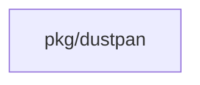
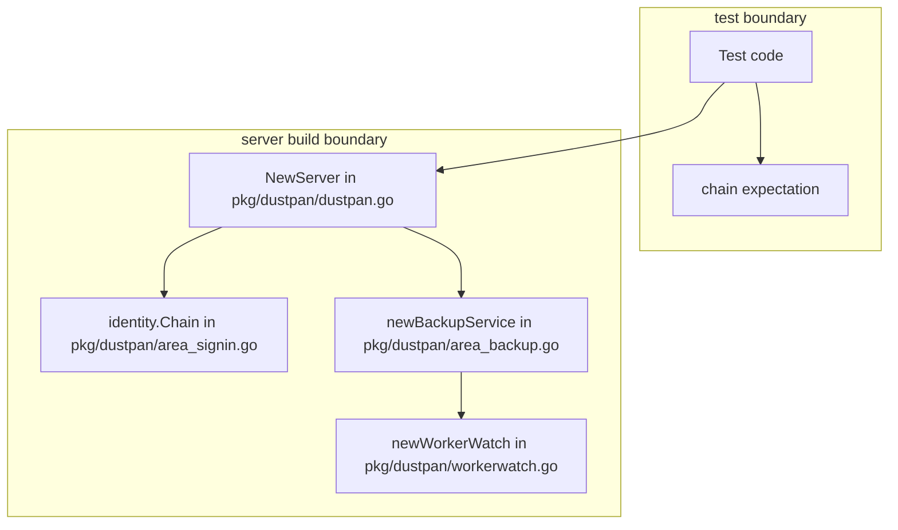

## Context

Test and naming follow-ups from review of the explicit-argument area files. No API change. No guard logic change. No wrapper order change.

## Decisions

1. **Hardening and rename.** Keep the wrapper order and the guard logic. The chain test in pkg/dustpan lists each wrapper in order including the token gate inside identity.Chain built at pkg/dustpan/area_signin.go. Keep one lone test of the dev guard alone so a failure names the guard. Drop the namespace-service guard test because no-magic-namespace-service-principal deletes that rule. Rename the entries field of profileInputs to valueEntries. Provisional decision on heartbeat: yes, wire the watch.

## Structure

No new type. The change uses newBackupService and newWorkerWatch as they are.

## Risks

- A full-chain compare fails when a wrapper is added on purpose. The failure names the new wrapper, and the expected chain is updated in the same change.

## Diagrams

Modules that the change touches, and their imports on main:

## Quality attributes

| Attribute | Target | Unit | Scope |
| --- | --- | --- | --- |
| none affected | Test hardening, one rename and one existing watch wiring. No latency or storage change. |  |  |

## Threat model

Data flow and trust boundaries:

| Boundary | STRIDE | Threat | Layer | Guard | Hostile test |
| --- | --- | --- | --- | --- | --- |
| server build boundary | T | An added or removed auth wrapper passes the prefix-only chain test unnoticed | boundary check | Chain test compares the whole wrapper chain, not a prefix | Add an outermost wrapper and show TestNewServerChainFull fails until the expectation is updated |
| server build boundary | T | An added or removed auth wrapper passes the prefix-only chain test unnoticed | encode or contain | Expected chain lists each wrapper in order with the token gate named | Remove the token gate from the expectation and show the test fails on main code |
| server build boundary | T | An added or removed auth wrapper passes the prefix-only chain test unnoticed | limit | One lone dev guard test stays so a guard failure names the guard | Remove the dev guard and show only the lone test names it |
| server build boundary | T | An added or removed auth wrapper passes the prefix-only chain test unnoticed | authorize at point of use | Wrapper order stays fixed at the point of use in NewServer | Swap two wrappers in a scratch branch and show the chain test fails |
| server build boundary | T | An added or removed auth wrapper passes the prefix-only chain test unnoticed | fail closed | A chain mismatch fails the test run with no silent pass | Truncate the compared chain in a scratch branch and show the test fails |
