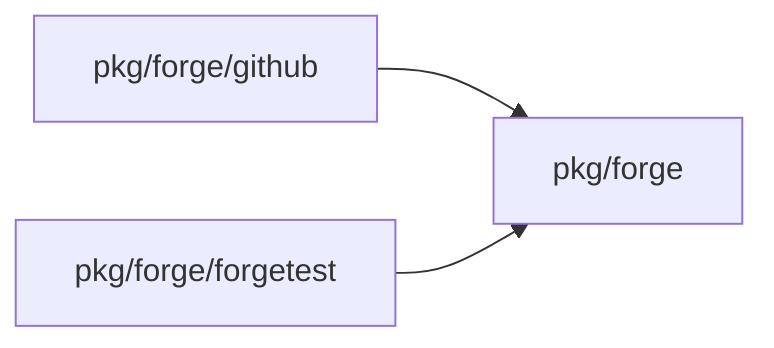
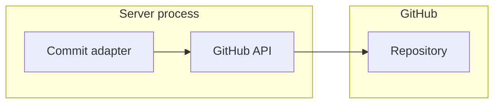

## Context

The GitHub Commit adapter hardens head-follow, write-access refusal, trailer match, ancestry read, and find limits without changing webhook signing, which stays in part 2.

## Decisions

1. **Bounded head-follow on existing functions.** Keep the existing check functions on the existing Commit path; bound the moved-head loop to 3 and cache base blob IDs across moves.
2. **One trailer rule.** Fix hasTrailer to call isTrailerBlock so one rule defines a trailer block, with an explicit prose-plus-trailer case.

## Structure

Unexported bounds checked by the existing Commit path: retry bound of 3, write-access check before each write, single trailer-block rule, and find limit of 500 with a 5-minute skew margin.

## Risks

- Webhook signing stays as-is until part 2; receivers keep two forms.

## Diagrams

Modules that the change touches, and their imports on main:

## Quality attributes

| Attribute | Target | Unit | Scope |
| --- | --- | --- | --- |
| latency | at most 3 head-follow retries per Commit call | retries | Commit with moved head |

## Threat model

Data flow and trust boundaries:

| Boundary | STRIDE | Threat | Layer | Guard | Hostile test |
| --- | --- | --- | --- | --- | --- |
| Server to GitHub API | T | A caller forges paths or trailers to write outside the allowed set | boundary check | checkCommit and checkChanges allowlist at adapter entry in pkg/forge/github/commit.go | Send hostile paths and trailer lines direct to checkCommit |
| Server to GitHub API | T | A caller forges paths or trailers to write outside the allowed set | encode or contain | Fixed GraphQL mutation createCommitOnBranch with typed fields for message and paths | Inject quote and newline in message and path |
| Server to GitHub API | T | A caller forges paths or trailers to write outside the allowed set | limit | At most 3 head moves and at most 500 commits per FindCommit | Force 4 head moves and 501 commits since since |
| Server to GitHub API | T | A caller forges paths or trailers to write outside the allowed set | authorize at point of use | Write-access check before each commit write returns ErrRefused without write grant | Call Commit with read-only credential set |
| Server to GitHub API | T | A caller forges paths or trailers to write outside the allowed set | fail closed | Refuse with ErrRefused or ErrUnavailable or ErrConflict with no extra write | Force compare overflow, missing grant, and fourth head move |

## Contracts

**GitHub Commit adapter**

- Invariant: Each commit write carries a write-scoped credential.
- Invariant: Each find documents its since clock and its 500-commit limit.
- `Commit`: pre: Caller holds write access for the repository.. Post: On a moved head the adapter retries at most three times then returns ErrConflict with no extra commit..
- `FindCommit`: pre: Trailer filter passes validTrailer.. Post: More than 500 commits since since returns ErrUnavailable..

## Change impact (computed from main)

Tests:

- `internal/chatops/chatops_test.go` names `ErrUnsupported`
- `internal/selfservice/state_test.go` names `ErrUnsupported`
- `pkg/store/storetest/backup_test.go` names `ErrUnsupported`

ADRs:

- `docs/adr/0271-the-forge-port-git-host-connections-and-the-installation-level-github-app.md` names `ErrUnsupported`
- `docs/adr/0243-the-source-port-its-adapters-and-conformance.md` names `ErrUnsupported`
- `docs/adr/0146-chatops-actions-and-authorization.md` names `ErrUnsupported`
