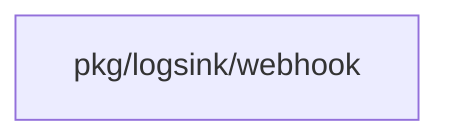
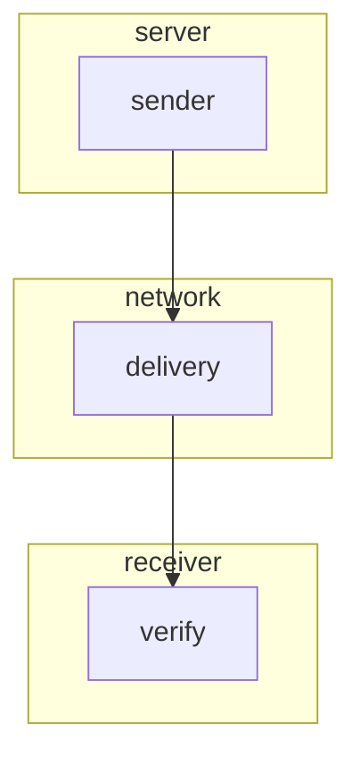

## Context

Two webhook senders sign with the same header name and version but different covered data and different secret counts.

## Decisions

1. **One shared signer.** Move Sign and Verify to a NEW leaf package that imports only the standard library and make both senders call it.

## Structure

NEW unexported signer type in NEW package pkg/webhooksig with constructor New that checks one or two secrets; only the constructor makes a signer.

## Risks

- Receivers of the old log-sink form refuse the new form until they update the verification call.

## Diagrams

Modules that the change touches, and their imports on main:

New imports of this change (each one allowed by the module rules):

- `pkg/notify` imports `pkg/webhooksig`
- `pkg/logsink/webhook` imports `pkg/webhooksig`

## Quality attributes

| Attribute | Target | Unit | Scope |
| --- | --- | --- | --- |
| none affected | Signing cost is one HMAC per delivery with no budget change |  |  |

## Threat model

Data flow and trust boundaries:

| Boundary | STRIDE | Threat | Layer | Guard | Hostile test |
| --- | --- | --- | --- | --- | --- |
| receiver | S | Spoofed webhook delivery with the old form or an unknown secret. | boundary check | Verify checks allowlisted header and v1 prefix at the boundary and refuses other forms. | Send old-form and unknown-prefix signatures directly to Verify and check refusal. |
| receiver | S | Spoofed webhook delivery with the old form or an unknown secret. | encode or contain | Verify contains the body as bytes and compares HMAC in constant time. | Send a tampered body with a valid timestamp and check refusal. |
| receiver | S | Spoofed webhook delivery with the old form or an unknown secret. | limit | Verify enforces timestamp tolerance and at most two secrets. | Send an expired timestamp and three secrets and check refusal. |
| receiver | S | Spoofed webhook delivery with the old form or an unknown secret. | authorize at point of use | Receiver maps the delivery to the stored sink secret at the point of use. | Send a valid signature under another sink secret and check refusal. |
| receiver | S | Spoofed webhook delivery with the old form or an unknown secret. | fail closed | Any parse or key error refuses closed and records the refusal without secret text. | Send malformed headers and unknown-secret deliveries and check refusal with no secret in the record. |
