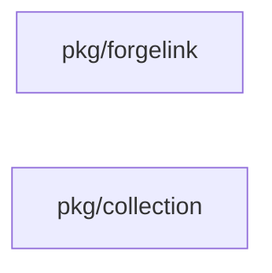

## Context

The test package in pkg/forgelink runs without a goroutine leak guard, so a leaked goroutine does not fail the package.

## Decisions

1. **Add the missing leak guard.** Add the NEW file pkg/forgelink/leak_test.go with TestMain that calls goleak.VerifyTestMain, in the same test package as the existing tests. Read the package clause from the existing test file before writing.
2. **Handle leaks without suppression.** Allow no goleak ignore option. Fix each leak the guard finds in test code. File a separate issue for a leak in production code and do not suppress it.

## Structure

No new type. The NEW file adds only TestMain in the existing test package, so no constructor is needed.

## Diagrams

Modules that the change touches, and their imports on main:

## Quality attributes

| Attribute | Target | Unit | Scope |
| --- | --- | --- | --- |
| none affected | Test-only change with no user-visible behavior |  |  |
