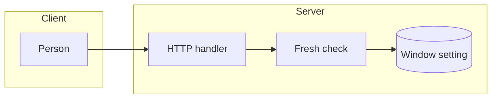

## Context

ADR 227 decision 3 says no value turns the check off. requireFresh returns nil at window 0.

## Decisions

1. **Zero asks each time.** requireFresh refuses at any age when the window is 0.
2. **Refusal text.** The 403 names the sign-in path; comment fresh() with its error code.
3. **Decrypt.** No decrypt change until the owner decides.

## Structure

An unexported freshWindow type with a constructor newFreshWindow that accepts only 0 and 60 to 900. No raw integer reaches the check.

## Risks

- Decrypt routes stay without a fresh check until the owner decides.

## Layers (defense in depth)

| Layer | Guard | Hostile test |
| --- | --- | --- |
| HTTP handler | requireFresh refuses at window 0 and maps a stale step to the 403 with the path. | Window 0 and age 0 gives 403 mfa.fresh-step-required. |

## Quality attributes

| Attribute | Target | Unit | Scope |
| --- | --- | --- | --- |
| correctness | 100 percent of steps refused at age 0 to 900 seconds | percent of requests | guarded steps under window 0 on the server |

## Threat model

Data flow and trust boundaries:

| Boundary | STRIDE | Threat | Layer | Guard | Hostile test |
| --- | --- | --- | --- | --- | --- |
| Client to server | E | A caller with a stale session does a guarded step when the window is 0. | boundary check | The fresh time comes only from the sealed access cookie. | Send a forged fresh-time header and check for 403. |
| Client to server | E | A caller with a stale session does a guarded step when the window is 0. | encode or contain | The window is an unexported freshWindow value made only by newFreshWindow, so no raw integer reaches the check. | Call newFreshWindow with 30, 1000 and -1 and check that each is refused. |
| Client to server | E | A caller with a stale session does a guarded step when the window is 0. | limit | The window accepts only 0 and 60 to 900 seconds, so no value turns the check off or makes it longer. | Store a window of 100000 and check that the step still refuses a stale session. |
| Client to server | E | A caller with a stale session does a guarded step when the window is 0. | authorize at point of use | requireFresh compares age at the step and refuses at window 0. | Window 0 and age 0 gives 403. |
| Client to server | E | A caller with a stale session does a guarded step when the window is 0. | fail closed | An unreadable window gives 0. | Fail the settings read and check for 403. |

## Failure modes

| Step | Failure | Retry | State after |
| --- | --- | --- | --- |
| Guarded step during a window change | The step uses the earlier window | Repeat the step after a new sign-in. | Step refused or accepted by one window, nothing partial. |
