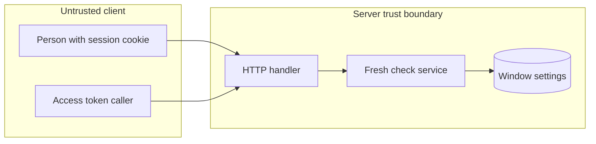

## Context

Fresh checks guard the steps that ADR 227 names, with one installation window plus narrower namespace and approval-rule windows. Issue 1325 reports a zero window that skips the check, a stale error without the sign-in path, and a missing comment on fresh().

## Decisions

1. **Zero means ask each time.** Fix the window test so 0 asks at each guarded step, including age 0; for nonzero windows age not above the window stays fresh; use the shortest window that holds.
2. **Refusal names sign-in path.** Map a stale step to 403 mfa.fresh-step-required with the sign-in path, name the enrollment page when no factor exists, and add a comment on fresh() that names the error code.
3. **Decrypt scope waits for owner.** Make no decrypt change in this change.
4. **One window and one code.** Keep one window setting and one error code for each guarded route.
5. **Window values.** Refuse a window value outside 0 and 60 to 900.

## Structure

Unexported freshChecker built only by newFreshChecker, which accepts only 0 and 60 to 900 and treats 0 as ask-each-time so no caller encodes skip.

## Risks

- Decrypt routes stay without a fresh check until the owner decides.
- A concurrent window change during a guarded step can check against a stale window.
- Clock skew between server and identity provider can make a fresh step look stale.

## Layers (defense in depth)

| Layer | Guard | Hostile test |
| --- | --- | --- |
| service | Service compares step age against the shortest window, with 0 as ask-each-time including age 0. | Call a guarded step with window 0 and age 0 and check for 403 mfa.fresh-step-required. |
| HTTP handler | Handler maps a stale step to 403 mfa.fresh-step-required with the sign-in path. | Request a guarded route with a stale session and check that the answer names the sign-in path. |

## Quality attributes

| Attribute | Target | Unit | Scope |
| --- | --- | --- | --- |
| correctness | refuse each stale step with 403 | request | guarded steps under window 0 |

## Threat model

Data flow and trust boundaries:

| Boundary | STRIDE | Threat | Layer | Guard | Hostile test |
| --- | --- | --- | --- | --- | --- |
| Client to server | E | A caller with a stale session or an access token does a guarded step when the window is 0. | boundary check | The handler refuses a window value outside 0 and 60 to 900 and a token as fresh proof. | Send a guarded request with an access token and check for 403 mfa.fresh-step-required. |
| Client to server | E | A caller with a stale session or an access token does a guarded step when the window is 0. | authorize at point of use | The service compares the age with the shortest window at the step, with 0 as ask each time. | Call the step with window 0 and age 0 and check for 403. |
| Client to server | E | A caller with a stale session or an access token does a guarded step when the window is 0. | fail closed | A missing or unreadable window or session refuses the step. | Remove the fresh time from the session and check for 403 mfa.fresh-step-required. |
| Client to server | T | A person sets a longer narrow window to weaken the check. | boundary check | The setting refuses a longer narrow window and values outside 0 and 60 to 900. | Send freshAuthSeconds 1000 and check the refusal and the stored value. |
| Client to server | T | A person sets a longer narrow window to weaken the check. | limit | The step uses the shortest window that holds. | Set namespace 0 against installation 900 and check each step asks. |

## Failure modes

| Step | Failure | Retry | State after |
| --- | --- | --- | --- |
| Guarded step under concurrent settings change | Concurrent window change mid-step uses the earlier window | Repeat the step after a new sign-in. | Step refused with 403 mfa.fresh-step-required, nothing changed. |
