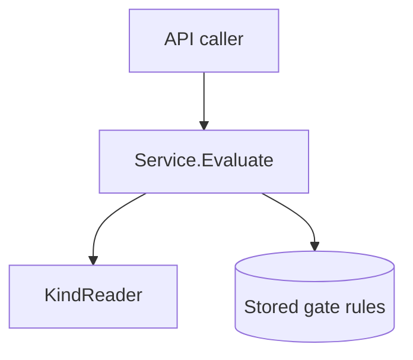

## Context

Service.Evaluate returns errNotImplemented today and fails closed by accident. Evaluation must apply the pure approver functions with the installation kind read once per call.

## Decisions

1. **One kind snapshot per Evaluate call.** Evaluate reads the kind once at the start through KindReader and uses it for that call only.
2. **Fail closed on kind error.** A KindReader error or an unknown kind denies the evaluation before any rule is checked.

## Structure

Unexported approverPolicy built only by newApproverPolicy(kind installation.Kind), which returns an error on an unknown kind. Service.Evaluate is the only caller.

## Risks

- The call site may shift when evaluation lands; the failing tests pin the call.

## Quality attributes

| Attribute | Target | Unit | Scope |
| --- | --- | --- | --- |
| correctness | 100 | % denied | NoApprover or dev-only approvers on production |

## Threat model

Data flow and trust boundaries:

| Boundary | STRIDE | Threat | Layer | Guard | Hostile test |
| --- | --- | --- | --- | --- | --- |
| Server boundary | S | A dev principal signature meets an approval on production. | boundary check | Validate the kind at the start of each call. | Unknown kind sent directly to Evaluate must deny. |
| Server boundary | S | A dev principal signature meets an approval on production. | encode or contain | Compare subjects only through CountsAsSignature. | DEV:admin must not count. |
| Server boundary | S | A dev principal signature meets an approval on production. | limit | Read the kind once per call. | A stored decision is not reused across calls. |
| Server boundary | S | A dev principal signature meets an approval on production. | authorize at point of use | Check Production when each signature counts. | A dev signature must not reach quorum. |
| Server boundary | S | A dev principal signature meets an approval on production. | fail closed | Deny on a kind error. | A failing KindReader must deny. |

## Failure modes

| Step | Failure | Retry | State after |
| --- | --- | --- | --- |
| Kind read | KindReader returns an error. | The caller retries the evaluation. | Denied with no signature counted. |

## Change impact (computed from main)

Tests:

- `pkg/gate/approvers_test.go` names `NoApprover`

ADRs:

- `docs/adr/0253-dev-data-does-not-reach-a-production-installation.md` names `NoApprover`
