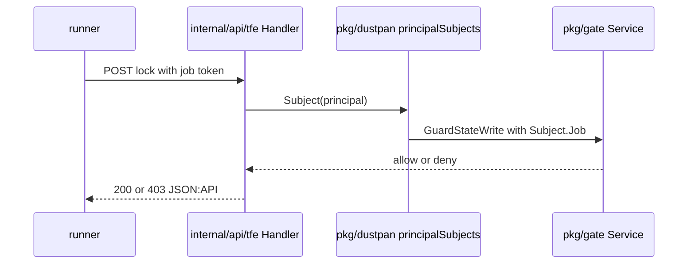
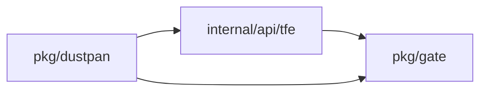
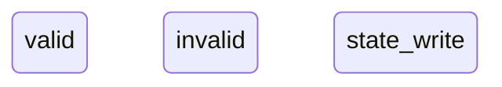
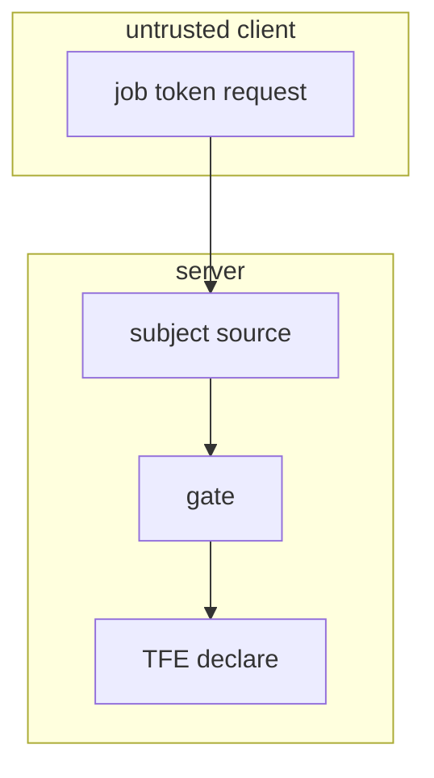

## Context

Job-token writes fail because principalSubjects.Subject leaves Subject.Job empty, and the TFE unlocked declare skips state.write.

## Decisions

1. **Fill the full job at the subject source and check the unlocked declare.** Fill Subject.Job in principalSubjects.Subject from the job of the token with job ID, phase, units, and the stored PassedApply value, fail closed on read failure with no retry on not-found, and call GuardStateWrite with unlocked-write and action unit:write-unlocked for a TFE unlocked declare before the transaction.

## Structure

The unexported type principalSubjects with its constructor keeps the job lookup in one place so no caller builds Subject by hand.

## Risks

- Token for another job must not gain its plan lock.
- A retry on a deleted job wastes time and may break the latency target.

## Layers (defense in depth)

| Layer | Guard | Hostile test |
| --- | --- | --- |
| boundary check | Subject source checks the credential kind and rejects unknown operation kinds against the ADR 224 table. | Unknown operation kind gets 403. |
| encode or contain | Job read uses parameterized store reads scoped to the job ID of the token. | Forged job ID cannot read another job. |
| limit | Job read runs inside the GuardStateWrite budget with no retry on not-found. | Slow job store still fails closed within budget. |
| authorize at point of use | Gate allows only its own plan lock or the state of its own job after PassedApply. | Token of job A cannot lock the plan of job B. |
| fail closed | Read failure denies and the denial is audited. | Deleted job token gets 403 with audit entry. |

## Diagrams

After this change:

Modules that the change touches, and their imports on main:

States on main in the touched packages:

## Quality attributes

| Attribute | Target | Unit | Scope |
| --- | --- | --- | --- |
| latency | 50 | ms | each GuardStateWrite call including the job read |
| none affected | No storage growth from this change. |  |  |

## Threat model

Data flow and trust boundaries:

| Boundary | STRIDE | Threat | Layer | Guard | Hostile test |
| --- | --- | --- | --- | --- | --- |
| client to server | T | A job token writes state of another job or without a passed apply. | boundary check | Check the operation kind against the ADR 224 decision 16 table including unlocked-write; reject unknown kinds. | Unknown operation kind gets 403. |
| client to server | T | A job token writes state of another job or without a passed apply. | encode or contain | Parameterized store reads for the job of the token; no shell or path use. | Forged job ID cannot read another job. |
| client to server | T | A job token writes state of another job or without a passed apply. | limit | Job read scoped to the token job within the 50 ms GuardStateWrite budget; no retry on not-found. | Slow job store still fails closed within budget. |
| client to server | T | A job token writes state of another job or without a passed apply. | authorize at point of use | Allow only own plan lock or passed apply of own job with unit:write-unlocked for the unlocked override. | Token of job A cannot lock the plan of job B. |
| client to server | T | A job token writes state of another job or without a passed apply. | fail closed | Read failure denies; denial is audited. | Deleted job token gets 403 with audit entry. |

## Contracts

**gate.Service**

- Invariant: A job token with no readable job never allows a state write.
- `GuardStateWrite`: pre: Subject carries the job of a job token with job ID, phase, units, and PassedApply, or the read failure.. Post: Refusal wraps identity.ErrDenied and names the one command that helps..
- `jobTokenWrite`: pre: Change carries Subject.Job and PlanLock.. Post: Plan lock of its own plan allows; apply write of its own job allows only when PassedApply is true; force-unlock, restore, and delete refuse..

## Failure modes

| Step | Failure | Retry | State after |
| --- | --- | --- | --- |
| Read job in GuardStateWrite | Job store read times out or the job was deleted. | No retry; deny at once. | Write denied with identity.ErrDenied and an audit entry; job phase unchanged. |
| Evaluate PassedApply in jobTokenWrite | Phase has no stored PassedApply value at write time. | No retry; deny non-lock writes until the phase records a pass. | Non-lock write denied and audited; plan lock of own job still allowed. |
