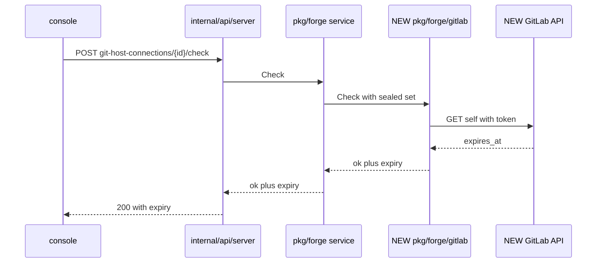
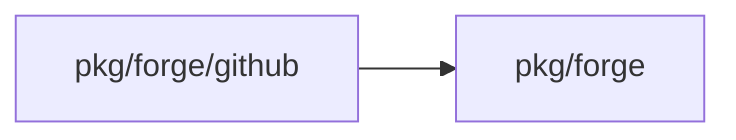
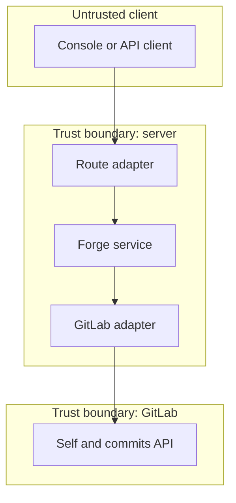

## Context

Add a GitLab adapter next to the GitHub adapter. Reuse the connection store, the git-host-connections routes, the Check flow and the webhook route. No schema change.

## Decisions

1. **Adapter structure.** Unexported gitlabOpener and gitlabForge in NEW pkg/forge/gitlab. Only NewOpener makes values and checks the https address and the token.
2. **GitLab mapping.** PRIVATE-TOKEN header. Expiry from GET /personal_access_tokens/self expires_at; a malformed value counts as no expiry. Commits map id, parent_ids and last_commit_id. The HTTP client refuses redirects. A Retry-After hint is clamped to 300 seconds.
3. **Address binding.** The opener takes the address from the stored connection. Plain http is refused; a private IP is refused by the egress check.

## Structure

Unexported gitlabForge with constructor NewOpener that checks the invariants, so a token cannot be used without an open bound to the stored address.

## Risks

- Token leak in logs, URLs or errors.
- Forged webhook event accepted.
- Credential follows a redirect.

## Layers (defense in depth)

| Layer | Guard | Hostile test |
| --- | --- | --- |
| boundary check | Allowlist https scheme at open; strict JSON decode with byte limit. | Open http and file addresses; each fails before any host call. |
| encode or contain | Token only in the header; CR and LF stripped before log. | Token with CR LF; the log has no split line. |
| limit | Timeout and response byte limit. | Slow large fake host; the call aborts. |
| authorize at point of use | Routes check namespace:read-git-host-connections and namespace:manage-git-host-connections. | Check with a grant on another connection is denied. |
| fail closed | Wrong event token gives 401; host 401, 429 and 5xx deny. | Wrong token event and unsupported method both deny. |

## Diagrams

After this change:

Modules that the change touches, and their imports on main:

New imports of this change (each one allowed by the module rules):

- `pkg/forge/gitlab` imports `pkg/forge`

## Quality attributes

| Attribute | Target | Unit | Scope |
| --- | --- | --- | --- |
| latency | p95 under 800 | ms | Check route against the fake GitLab |

## Threat model

Data flow and trust boundaries:

| Boundary | STRIDE | Threat | Layer | Guard | Hostile test |
| --- | --- | --- | --- | --- | --- |
| Client to server webhook | S | Forged GitLab event with a wrong X-Gitlab-Token. | boundary check | Allowlist token presence; body size limit. | Missing token and oversized event are rejected. |
| Client to server webhook | S | Forged GitLab event with a wrong X-Gitlab-Token. | encode or contain | Constant-time compare; secret never logged. | CR LF in token leaves the log clean. |
| Client to server webhook | S | Forged GitLab event with a wrong X-Gitlab-Token. | limit | Body limit and read timeout. | Oversized event is stopped at the limit. |
| Client to server webhook | S | Forged GitLab event with a wrong X-Gitlab-Token. | authorize at point of use | Hook ID resolves to one connection. | Unknown hook ID gets 404. |
| Client to server webhook | S | Forged GitLab event with a wrong X-Gitlab-Token. | fail closed | Deny wrong token with 401, no state change. | Wrong and empty token get 401. |
| Server to GitLab API | T | Token sent to an attacker address. | boundary check | Stored https address only. | http and private IP refused before dial. |
| Server to GitLab API | T | Token sent to an attacker address. | encode or contain | Token only in the header. | Token absent from URL and logs. |
| Server to GitLab API | T | Token sent to an attacker address. | limit | Dial timeout and response byte limit. | Slow large fake aborts. |
| Server to GitLab API | T | Token sent to an attacker address. | authorize at point of use | Token with read_api only. | Token without read_api fails Check. |
| Server to GitLab API | T | Token sent to an attacker address. | fail closed | Deny on TLS, 401, 429, 5xx or redirect. | Redirect to another host is denied. |

## Contracts

**Forge connection**

- Invariant: The credential set stays sealed; no route answers it.
- Invariant: Each open uses the stored address of its connection.
- `Check`: pre: Caller holds namespace:read-git-host-connections.. Post: The answer carries expiry only when the host answers it..
- `ListCommits`: pre: An open Forge exists for the stored address.. Post: Each commit carries id, parent links and last_commit_id..
- `ParseEvent`: pre: The hook ID resolves to a stored connection.. Post: A wrong token gives 401 and no state change..

## Change impact (computed from main)

ADRs:

- `docs/adr/0271-the-forge-port-git-host-connections-and-the-installation-level-github-app.md` names `ParseEvent`
