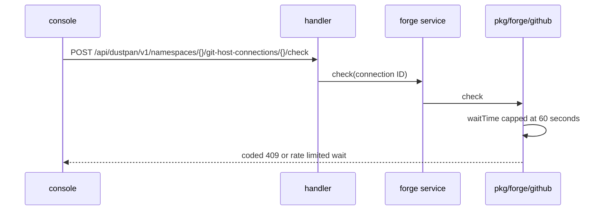
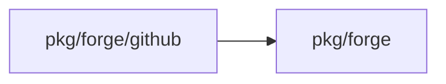
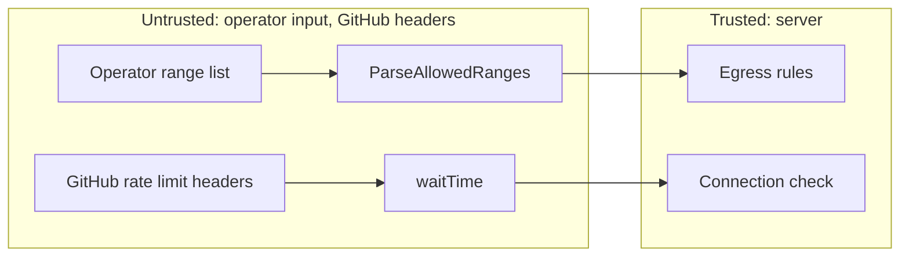

## Context

Follow-ups to the first git host slice: uncapped rate limit wait, two answers for no registration, and a range list that accepts globally routable ranges the rules then ignore.

## Decisions

1. **Cap the adapter wait.** Cap waitTime in pkg/forge/github/check.go with an unexported 60 second constant per call. waitTime does no sleep. Missing, malformed, negative or past-date headers give a 5 second fallback.
2. **One answer for no registration.** Use the coded 409 answer on both check and create for an existing connection with no registration. A connection ID that does not exist keeps 404. No new error code.
3. **Refuse public ranges at parse.** ParseAllowedRanges refuses the whole list with an error that names the range. Public means any prefix that holds a globally routable address, such as 0.0.0.0/0, 8.8.8.8/32 or 10.0.0.0/7. Prefixes inside 10.0.0.0/8, 172.16.0.0/12, 192.168.0.0/16 and fc00::/7 parse. Loopback and link-local still parse. An existing configured list with a public range fails closed at server start.

## Structure

Unexported maxWait constant in pkg/forge/github used only by waitTime; unexported globally-routable check inside ParseAllowedRanges so no caller builds a list with a public range.

## Risks

- A cap that is too low causes early retries; too high slows check answers.
- A client that matches the old uncoded 404 text breaks; mitigation is one coded body and a docs update.

## Layers (defense in depth)

| Layer | Guard | Hostile test |
| --- | --- | --- |
| boundary check | ParseAllowedRanges rejects globally routable prefixes | Call ParseAllowedRanges with 0.0.0.0/0 and 8.8.8.8/32; each fails |
| authorize at point of use | Egress rules match only private ranges | Inject a public prefix past the parser in a test; the rule denies it |

## Diagrams

After this change:

Modules that the change touches, and their imports on main:

## Quality attributes

| Attribute | Target | Unit | Scope |
| --- | --- | --- | --- |
| latency | 60 | seconds max wait | per git host check waitTime call that hits a rate limit |

## Threat model

Data flow and trust boundaries:

| Boundary | STRIDE | Threat | Layer | Guard | Hostile test |
| --- | --- | --- | --- | --- | --- |
| Operator range list and GitHub headers | T | A public range or a huge wait bypasses egress or stalls checks | boundary check | Parser refuses globally routable ranges and hostile CIDR text | Send 0.0.0.0/0 and 999.999.0.0/16 to ParseAllowedRanges; both fail |
| Operator range list and GitHub headers | T | A public range or a huge wait bypasses egress or stalls checks | encode or contain | Parsed prefixes only; no string-built rule | Send a range with CR LF; the stored value stays a parsed prefix or the parse fails |
| Operator range list and GitHub headers | T | A public range or a huge wait bypasses egress or stalls checks | limit | waitTime capped at 60 seconds with a 5 second fallback | Send Retry-After of 3600; the wait stays at the cap |
| Operator range list and GitHub headers | T | A public range or a huge wait bypasses egress or stalls checks | authorize at point of use | Egress rule rechecks private range at use | Inject a public prefix past the parser; the rule denies it |
| Operator range list and GitHub headers | T | A public range or a huge wait bypasses egress or stalls checks | fail closed | Hostile header or parse error gives rate limited or 400 | Send empty and hostile headers; the call denies with no wait overflow |

## Contracts

**egress allowed ranges**

- Invariant: Parse refuses a list that holds any globally routable range
- Invariant: Private-only lists still parse
- `ParseAllowedRanges`: pre: List holds CIDR strings. Post: On a globally routable range the call fails and returns no list.

**forge connection check**

- Invariant: Check and create answer no registration with the same coded 409
- Invariant: A missing connection ID answers 404
- `waitTime`: pre: HTTP headers hold the rate limit answer. Post: Result never exceeds 60 seconds; hostile headers give 5 seconds.
