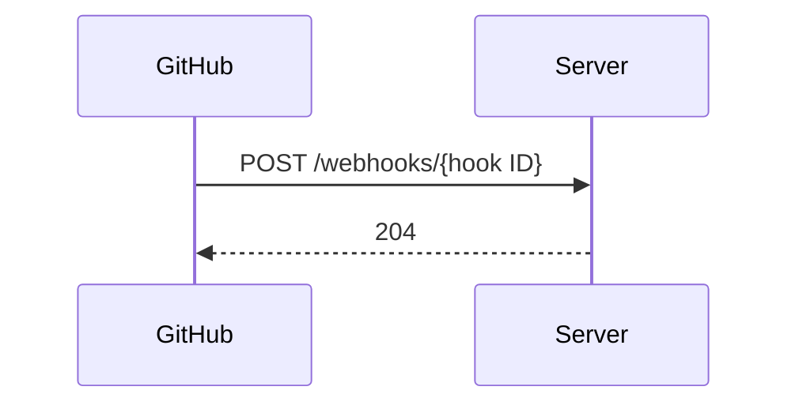
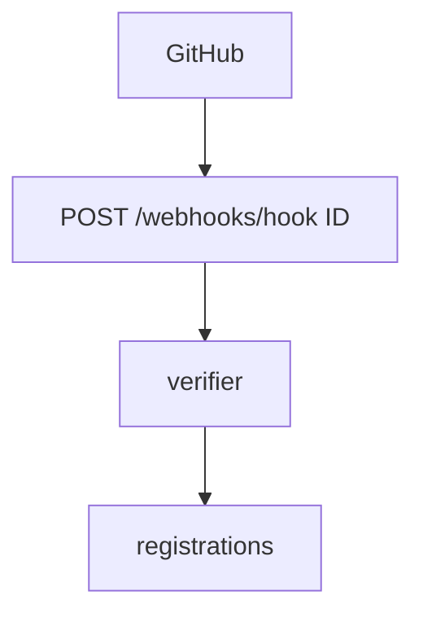

## Context

Slice 1 holds the store, the registration map and the check. This change adds the intake, the reads and the scoped token.

## Decisions

1. **Hint parsing in the port.** ParseEvent for GitHub uses an unexported verifier that compares X-Hub-Signature-256 against the stored secrets of one registration snapshot in constant time. The number of valid secrets is the active set; the overlap end is held by the open question.
2. **Intake answers 204.** The route is outside /api/dustpan/v1, takes no auth action and answers 204 with an empty body. A reject counts git_host_event_rejected_total.
3. **Adapter methods and scoped token.** Implement the Files, Commits and Reviews methods behind capabilities, and RepoToken with Scoped set and an expiry of at most 1 hour.
4. **Duplicates.** Hint record and effect mark are one atomic check-and-set. The 24-hour delivery store is a best-effort bound.

## Structure

Unexported type webhookIntake with constructor newWebhookIntake that checks its ports and the secret length.

## Risks

- Replayed delivery causes a second effect
- Unscoped token reaches a runner
- Hook URL tied to one member

## Layers (defense in depth)

| Layer | Guard | Hostile test |
| --- | --- | --- |
| signature | Constant-time compare against the stored secrets; reject short secrets. | Forged body and wrong secret sent to the adapter count a reject. |
| hook mapping | Hook ID resolves through the installation map only. | Traversal hook ID gives 204 and a reject. |
| scoped token use | The runner path refuses a token with Scoped not set. | A valid unscoped token is refused. |

## Diagrams

After this change:

New imports of this change (each one allowed by the module rules):

- `pkg/forge/github` imports `pkg/forge`

## Quality attributes

| Attribute | Target | Unit | Scope |
| --- | --- | --- | --- |
| request bound | 1 | MB max | webhook body read |
| token lifetime | 1 | hours max | RepoToken expiry |
| secret strength | 32 | bytes min | event secret length |

## Threat model

Data flow and trust boundaries:

| Boundary | STRIDE | Threat | Layer | Guard | Hostile test |
| --- | --- | --- | --- | --- | --- |
| Internet to server | S | Attacker forges a push delivery. | boundary check | Constant-time signature check. | Forged body counts a reject. |
| Internet to server | S | Attacker forges a push delivery. | encode or contain | Hook ID resolves through the map only. | Traversal hook ID gives 204 and a reject. |
| Internet to server | S | Attacker forges a push delivery. | limit | Body bound of 1 MB. | A 10 MB body is cut and answers 204. |
| Internet to server | S | Attacker forges a push delivery. | authorize at point of use | The runner path needs a scoped token. | An unscoped token is refused. |
| Internet to server | S | Attacker forges a push delivery. | fail closed | Drop on error and count a reject. | Unreadable effect state drops with 204. |

## Contracts

**webhookIntake**

- Invariant: Every answer is 204 with an empty body.
- Invariant: Hint record and effect mark are one atomic step.
- `HandleDelivery`: pre: Body within the size bound. Post: A verified hint is recorded once per effect key.

## Failure modes

| Step | Failure | Retry | State after |
| --- | --- | --- | --- |
| Hint apply | Duplicate delivery after restart | No retry; the effect check drops it. | Single hint effect. |
| RepoToken | Git host refuses the mint | No retry; return a refusal that names the host. | No token issued. |
