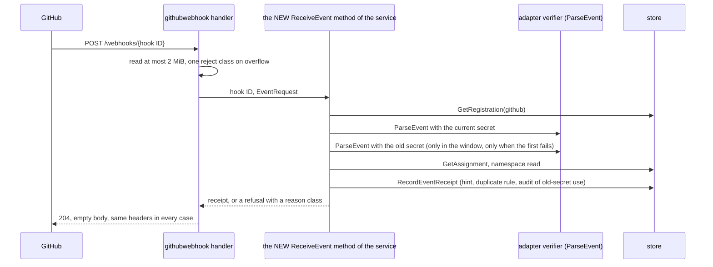
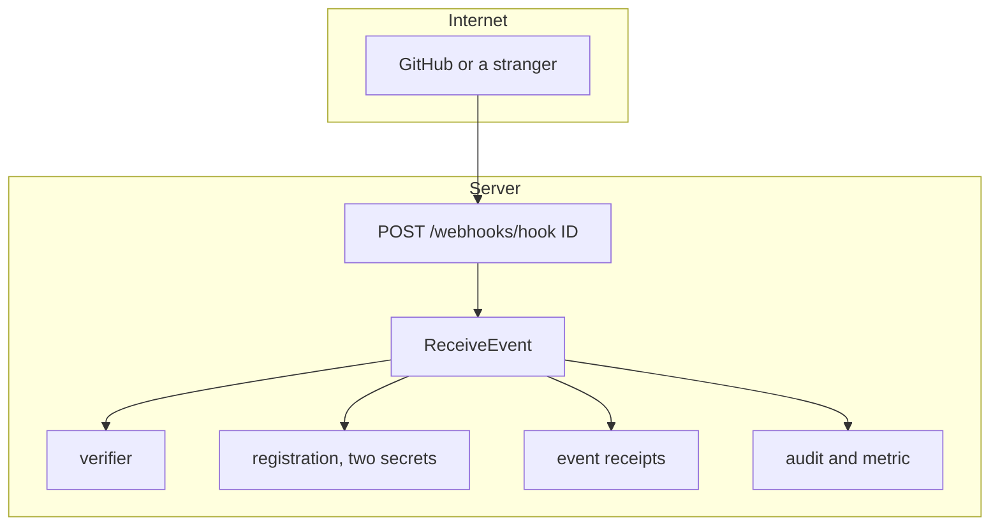

## Context

Main has the registration (one sealed key, one sealed event secret, one hook ID, an address digest), the installation-to-namespace map and the connections. It has no route that takes a delivery, no parser of events, no minting of a repo token for the git protocol, and no store of what a delivery brought. This change adds exactly those, and the rotation of the event secret that ADR 374 decision 2 needs.

The path of a delivery:



## Decisions

1. **The verifier is in the adapter, and it needs no connection.** `Opener` gets a NEW method `ParseEvent` with the contract of `Events.ParseEvent`. It returns an event, not an interface, so the port needs no interface return. The service cannot open a Forge before it knows the installation, and the installation is in the body that the signature must cover first. The ParseEvent method of an opened Forge calls the same function, so the two paths cannot differ. The verifier follows `pkg/forge/forge.go:427-439`:
   - It reads the header X-Hub-Signature-256 only. It needs exactly one value of the form `sha256=` and 64 hex digits, else ErrSignature. The legacy header X-Hub-Signature (SHA-1) is never read.
   - It computes HMAC-SHA256 of the body for each secret and compares with `hmac.Equal`. It ignores a secret shorter than `forge.MinEventSecretBytes` as it ignores an empty one. It computes the digest for each secret before it decides, so the time does not tell which secret matched. A list with no usable secret returns ErrSignature.
   - Only after a match, it reads X-GitHub-Event and X-GitHub-Delivery (one value each; the delivery ID needs the form of a UUID) and the body. Ping gives EventPing. A pull request event with the action opened, reopened, synchronize or closed gives EventReview. Any other event name or action gives ErrUnsupported. A body that is not JSON, or lacks the installation ID, the repository full name, the pull request number or the sender, gives ErrInvalid. The adapter checks the repository name with the same rule as `splitRepo`.
   - The adapter adds `CapEvents` to `Capabilities`. It makes no call to GitHub.
2. **RepoToken mints through the existing helper.** The RepoToken method of the GitHub adapter (its body is a stub on main) splits the repository like the other methods, calls `mintToken` (`pkg/forge/github/files.go:527`) with the level read, and returns `forge.Token{Username: "x-access-token", Value, ExpiresAt, Scoped: true}`. `ExpiresAt` is the earlier of the GitHub value and now + 1 hour. A token from GitHub that lives longer than 1 hour is cut, not refused. A token connection answers its own token with Scoped not set and the username `x-access-token`, as the port says (`pkg/forge/forge.go:416-420`). The adapter adds `CapRepoToken` for an app connection and `CapGitAccess` for both auth kinds; `CapRepoToken` also lists `CapGitAccess` (`pkg/forge/forge.go:1365-1367`). The service accepts app connections only on main (`pkg/forge/service.go:441-452`), so the token branch is the adapter's own contract and its conformance case. The runner side is later: main has no caller of RepoToken. This change gives the adapter side only: an app connection never answers a token with Scoped not set, and a conformance case shows it. The refusal of an unscoped token (ADR 271 decision 3) belongs to the change that adds the first caller.
3. **The intake is a thin handler over a service method.** `internal/api/githubwebhook` has a NEW handler for `POST /webhooks/{hookID}`. It reads at most 2 MiB through `http.MaxBytesReader`, builds an `EventRequest` with the headers, calls the NEW service method `ReceiveEvent`, and answers 204 with no body and the same headers for every outcome, accepted or refused. The route has the public scope and no action: the signature is the credential. Other methods and other paths under `/webhooks/` take the root mux answer, which does not depend on the hook ID. The NEW `ReceiveEvent` runs these steps and stops at the first refusal (fail closed; an unknown error is the reason `other`):
   1. `ValidHookID(hookID)`, else `unknown-hook`.
   2. `GetRegistration(github)`; `ErrNoRegistration` gives `no-registration`.
   3. Compare the hook ID with the stored one with `subtle.ConstantTimeCompare`, else `unknown-hook`. This holds the one-registration case; a second kind later needs a store lookup by hook ID.
   4. Check the address digest as `Service.Open` does (`pkg/forge/service.go:370-379`), then open the current event secret with `OpenBound` bound to the digest. A failure gives `secret-not-opened`.
   5. The check order of decision 5.
   6. Map and primary check (decision 8), then the receipt (decision 6).
4. **Two event secrets in the registration (ADR 374 decision 2, owner).** The table `git_host_app_registrations` gets three NEW nullable columns, in each dialect: `old_event_secret_ends_at_ms` (Unix milliseconds), `old_event_secret_set_id` and `old_sealed_event_secret`. The old secret is sealed as the current one is: `SealBound` under `EventSecretScope(kind)`, bound to the address digest. A CHECK in each dialect needs all three NULL or all three set. The shared row mapper `pkg/store/internal/githoststore/githoststore.go:75 (func Registration)` also refuses a partial set with `forge.ErrInvalid`, so a row that another version wrote fails closed. `forge.Registration` gets the NEW fields `OldEventSecretSetID`, `OldSealedEventSecret` and `OldEventSecretEndsAt` (zero time: no window).
   - The rotation is in `Service.PutRegistration`. It reads the stored registration. When one exists with the same address digest, it opens the stored event secret and compares it with the new one in constant time. A different secret moves the stored sealed secret, its set ID and now + 7 days into the old fields. The same secret keeps the old fields as stored, except that an ended window is cleared. A put during an open window replaces the old secret by the one that was current: a third secret cannot be valid, because two columns hold two secrets. When the service computed the old fields from a read, it passes the version of that read as the condition of the write, so a concurrent put returns `ErrVersionConflict` and never loses a secret.
   - The UPDATE query of each dialect writes the three columns together with the new secret in the same statement, so the rotation is one step. The backup column lists get the three columns (`pkg/store/sqlite/backup_githost.go:89-92`, `pkg/store/postgres/backup_githost.go:21-30`, `pkg/backup/portable_githost.go:12-31`), so a restore keeps an open window.
5. **The window and the confirmation.** The check order of one event, against one registration snapshot and one clock reading:
   1. The signature with the current secret. A match accepts the event.
   2. Only when step 1 fails, and all three old fields are set, and now is before `OldEventSecretEndsAt`: open the old secret and check with it. A match accepts the event and sets the NEW receipt field `OldSecret`, which makes the store write the audit entry `git-host-app:event-accepted-old-secret` in the same transaction as the receipt.
   3. Else refuse with the reason `signature`. The reason is the same for a wrong secret, an old secret after the end, an old secret after the confirmation and a third secret. The service never opens an expired secret to name a better reason.
   
   The NEW route `POST /api/dustpan/v1/git-host-apps/{kind}/confirm-rotation` (main does not serve this path; the change adds it; action server:manage-git-host, the action of the PUT) calls the NEW `Service.ConfirmRotation(ctx, e, kind, ifVersion)`. It clears the three columns and gives the next version in one UPDATE, with an audit entry of the same transaction. It returns `ErrNoRegistration`, `ErrVersionConflict`, and the NEW sentinel `ErrNoRotation` (409) when no window is open. `RegistrationView` and the answer of GET and PUT get the NEW field `oldSecretEndsAt` (Unix milliseconds): the effective end, absent when no window is open or the end passed.
6. **Event receipts: the hint record and the replay rule.** A NEW port `ReceiptStore` in `pkg/forge/eventreceipt.go`, part of `Store`, has one method, `RecordEventReceipt(ctx, EventReceipt) (bool, error)`. It deletes the receipts older than 24 hours, then inserts the receipt, in one transaction. The table `git_host_event_receipts` has the primary key `(kind, delivery_id)` and a second unique key `(kind, body_digest)`. An insert that hits either key writes nothing and returns false: the delivery is a duplicate.
   - The header X-GitHub-Delivery is not under the HMAC. A stranger who holds one signed body (for example from a leaked log) could send it again with a new delivery ID. The body digest key stops that replay for 24 hours. A real redelivery from GitHub keeps its delivery ID, so the first key stops it.
   - ADR 271 says "for the same connection". The connection of a delivery is the one of its installation in its namespace, and the map gives one connection kind and installation to one namespace. The keys use the kind, which is the registration, so the rule is per registration. This is stricter than per connection and never lets a delivery through that the decision would drop. A ping has no installation and uses the same keys.
   - The table is bounded: `maxEventReceipts` is 100000 rows. At the bound, the store returns the NEW sentinel `ErrReceiptsFull` after it purged the expired rows, and the intake refuses with `receipts-full`. Only a verified delivery reaches the insert.
   - The receipt holds the installation ID, the event kind, the repository, the review ID and the time. It is the hint. A later consumer reads it and reads the object through the API before it changes a record (ADR 271 decision 4). A restore leaves the table empty (`EmptiedTables`): a hint is not state.
7. **Rejects: a counter and a limited audit entry.** `ObserveGitHostEventRejected(reason)` counts `dustpan_git_host_event_rejected_total` with the one label `reason` and the fixed set `unknown-hook`, `no-registration`, `signature`, `too-large`, `malformed`, `unsupported`, `duplicate`, `not-assigned`, `not-primary`, `secret-not-opened`, `receipts-full`, `other`. Any other value counts as `other`. No label holds a hook ID, an installation or a repository. The handler writes the audit entry of each reject through `denylimit.Limiter`, with the key (principal `webhook`, action `git-host-event:receive`, kind `git-host-event`, scope the reason). The key set is fixed by the reasons, so a stranger cannot grow the table. The entry has the scope `@server`, the kind security, the outcome denied, and a text with the reason class only: never a header, a body, a hook ID or a signature. The entry of an old-secret use is written in the store transaction of the receipt and is not limited, because the owner decision says "each event".
8. **Map and federation.** For an EventReview, the service reads the assignment of the installation (`GetAssignment`; absent gives `not-assigned`), reads the namespace, and gives `not-primary` when `Namespaces.WritableHere` returns `namespace.ErrNotHome`. The interface `forge.Namespaces` gets `WritableHere` for this (task 0.3 confirms what the wiring passes). The event is dropped before any write. A ping needs no installation.
9. **E2e and docs.** The e2e step runs in process with `NewEnvWithGitHost` and `githubfake`: `NewDelivery` signs, `Send` posts, `Redeliver` repeats. There is no real-binary variant for the Git host on main (`e2e/githost.go:88`), and this change does not build one. The step is a persona step of the operator: register, read `hookID`, send ping, send a pull request event for an assigned installation, replay it, rotate, send with the old secret, confirm, send with the old secret again. The guide section "Webhooks and a federation" of `docs/guides/connect-github.md` and the reference `docs/reference/git-host-api.md` change in the same pull request. The Metric section of the guide lists the NEW metric.

## Contract

Port changes in `pkg/forge` (sentinels and errors follow the package: `fmt.Errorf("...: %w", err)`):

```go
// Opener gets one method. It returns the verifier of the kind and makes no call.
type Opener interface {
	Kind() Kind
	Open(ctx context.Context, c Connection, cred Credential) (Forge, error)
	ParseEvent(ctx context.Context, r EventRequest, secrets [][]byte) (Event, error) // NEW
}

// Namespaces gets one method (decision 8).
type Namespaces interface {
	GetNamespace(ctx context.Context, name namespace.Name) (namespace.Namespace, error)
	WritableHere(ctx context.Context, name namespace.Name) (namespace.Namespace, error) // NEW; namespace.ErrNotHome
}

// Registration gets the old event secret. The three fields are all zero or all set.
type Registration struct {
	// ... fields of main ...
	OldEventSecretSetID  string    // NEW
	OldSealedEventSecret []byte    // NEW
	OldEventSecretEndsAt time.Time // NEW; zero means no window
}

// RegistrationView gets the effective end. Zero means no open window.
type RegistrationView struct {
	// ... fields of main ...
	OldEventSecretEndsAt time.Time // NEW
}

var ErrNoRotation = errors.New("the registration has no open event secret rotation") // NEW
var ErrReceiptsFull = errors.New("the event receipts are at their bound")           // NEW

// ConfirmRotation ends the old event secret at once. It returns ErrNoRegistration,
// ErrVersionConflict and ErrNoRotation. e is the entry of the caller.
func (s *Service) ConfirmRotation(ctx context.Context, e audit.Entry, kind Kind, ifVersion int64) (RegistrationView, error)

// EventReceipt is a verified delivery: the hint.
type EventReceipt struct {
	Kind           Kind
	DeliveryID     string
	BodyDigest     string // hex SHA-256 of the body
	InstallationID string // empty for a ping
	EventKind      EventKind
	Repo           string
	ReviewID       string
	ReceivedAt     time.Time
	Audit          *audit.Entry // written in the same transaction when not nil
}

// ReceiptStore keeps the receipts of the last 24 hours.
type ReceiptStore interface {
	// RecordEventReceipt deletes the receipts older than 24 hours, then stores r.
	// It returns false, with no write, when r.DeliveryID or r.BodyDigest is already
	// stored. It returns ErrInvalid for a receipt that fails its checks and
	// ErrReceiptsFull at the bound.
	RecordEventReceipt(ctx context.Context, r EventReceipt) (bool, error)
}

// NEW: EventRefusalError is the error of ReceiveEvent for a delivery that the server refused.
type EventRefusalError struct{ Reason string } // Reason is one of the EventReason constants

// NEW: ReceiveEvent runs the steps of decision 3. It returns the receipt, or an *EventRefusalError.
func (s *Service) ReceiveEvent(ctx context.Context, hookID string, r EventRequest) (EventReceipt, error)
```

Route and answer:

| Item | Value |
| --- | --- |
| Intake | `POST /webhooks/{hookID}`, public scope, no action, 204 and no body in every case |
| Confirm (NEW route) | `POST /api/dustpan/v1/git-host-apps/{kind}/confirm-rotation` (main does not serve this path; the change adds it), action server:manage-git-host, 200 with the registration, 409 with no open window, 412 on a version conflict as the PUT does (`internal/api/server/githost.go:205`) |
| Field | `oldSecretEndsAt` in the answer of GET, PUT and confirm: Unix milliseconds, absent when no window is open |
| Metric | `dustpan_git_host_event_rejected_total{reason}` |
| Audit actions | `git-host-app:event-accepted-old-secret`, `git-host-app:confirm-rotation`, `git-host-event:receive` (denied) |

Schema (each dialect, in the baseline, in place; `opendustpan dev reset` follows):

```sql
-- git_host_app_registrations: three NEW nullable columns and a CHECK
old_event_secret_ends_at_ms  INTEGER/bigint,
old_event_secret_set_id      TEXT/text,
old_sealed_event_secret      BLOB/bytea,
CHECK ((old_event_secret_ends_at_ms IS NULL) = (old_event_secret_set_id IS NULL)
   AND (old_event_secret_set_id IS NULL) = (old_sealed_event_secret IS NULL))

-- NEW table
CREATE TABLE git_host_event_receipts (
    kind TEXT NOT NULL, delivery_id TEXT NOT NULL, body_digest TEXT NOT NULL,
    installation_id TEXT NOT NULL, event_kind TEXT NOT NULL, repo TEXT NOT NULL,
    review_id TEXT NOT NULL, received_at_ms INTEGER NOT NULL,
    PRIMARY KEY (kind, delivery_id), UNIQUE (kind, body_digest)
) STRICT;
CREATE INDEX git_host_event_receipts_received ON git_host_event_receipts (received_at_ms);
```

## Structure

- The verifier is an unexported function of the adapter. Both `Opener.ParseEvent` and the ParseEvent method of an opened Forge return its result, so there is one check.
- The NEW `ReceiveEvent` is the only code that decides the order of the checks. The handler holds no rule except the byte bound and the uniform answer.
- The old secret exists only as a sealed value bound to the digest, so a put that changes the address cannot carry it (see "Parked: owner question").
- The reject reasons are constants in `pkg/forge`. The metric maps any other value to `other`, as `ObserveGitHostRefused` does (`internal/metrics/server.go:726-735`).

## Layers (defense in depth)

One hostile table for each layer. Each row is a test that sends the input to that layer alone, as if the others failed.

**Adapter verifier (`pkg/forge/github`, ParseEvent)**

| Hostile input | Expected |
| --- | --- |
| No signature header, empty value, two header values | ErrSignature |
| `sha1=...`, wrong prefix, uppercase hex, 63 or 65 digits, non-hex | ErrSignature |
| Valid signature of another body (one byte changed), of the empty body | ErrSignature |
| Valid signature with a secret that is not in the list, a secret of 31 bytes, an empty secret only, a nil list | ErrSignature |
| The old secret is the second item of the list and signs | accepted (the service decides the window) |
| Valid signature, body that is not JSON, JSON array, missing installation or repository, number as a string, pull request number 0 | ErrInvalid |
| Valid signature, event `push`, `issues`, `pull_request` with action `labeled` | ErrUnsupported |
| Valid signature, delivery ID missing, two values, not a UUID, a value with CR LF | ErrInvalid |
| Valid signature, repository name with `..`, a leading slash, a backslash, 3 parts | ErrInvalid |

**Timing-safe compare (`pkg/forge/github`)**: a test replaces the digest compare input with a signature that matches 0, 16 and 31 of 32 bytes and checks the same error and that the code path calls `hmac.Equal` once for each usable secret (a counting seam in the unexported function). Each guard has a test that fails when the guard is removed: the test for the size check of the secret fails when the guard that skips a short secret goes.

**Service (`pkg/forge`, the NEW ReceiveEvent)**

| Hostile input | Expected reason |
| --- | --- |
| Hook ID of 31, 33 characters, upper case, `../x`, 4 KiB long, NUL | `unknown-hook`, no store call |
| Valid form, other value than the stored one | `unknown-hook` |
| No registration | `no-registration` |
| Registration row with a partial old set (store returns ErrInvalid) | `other` |
| Stored digest changed, sealed secret that does not open | `secret-not-opened` |
| Old secret 1 ms before the end | accepted, one old-secret audit entry in the transaction |
| Old secret at the end and 1 ms after | `signature` |
| Old secret after the confirmation | `signature` |
| Third secret (the one before the old secret) | `signature` |
| Old secret when the three columns are NULL | `signature` |
| Review event, installation not in the map | `not-assigned` |
| Review event of a namespace that another installation owns | `not-primary`, no receipt |
| Same delivery ID twice, same body with a new delivery ID | `duplicate` |
| Table at the bound | `receipts-full` |
| Any store error | `other` (fail closed) |

**Store (`pkg/store/*`, conformance in `pkg/forge/connectiontest`)**

| Hostile input | Expected |
| --- | --- |
| Insert with one of the three old columns set | CHECK fails in each dialect |
| A put that fails after the old fields were computed | both secrets as before (atomic) |
| Two puts at once with the same read version | one `ErrVersionConflict` |
| Receipt insert with the same key twice, with the same body digest and another ID | false, one row |
| Receipt older than 24 hours | purged in the same transaction |
| Receipt with an empty delivery ID or a digest that is not 64 hex digits | ErrInvalid |
| Confirm with no window | ErrNoRotation, no write |

**HTTP handler (`internal/api/githubwebhook`)**

| Hostile input | Expected |
| --- | --- |
| Body of 2 MiB, and of 2 MiB + 1 byte | read stops, `too-large`, 204 |
| Chunked body of 10 MiB with no length | read stops at the bound, 204 |
| Any reject reason and one accepted delivery | the same status, the same header names and values, the same empty body (compared byte by byte: no status, header or body tells the reasons apart) |
| GET and PUT on a valid and on an unknown hook ID | the same answer for both IDs |
| Hook ID with `%2f`, `%00`, a dot segment | 204 and a reject, or the mux answer, the same for every ID |
| A burst of 10000 bad signatures in one minute | one audit entry for the reason, the count on the next entry, the metric counts all 10000 |
| Audit store fails | the answer stays 204, the failure counts on the audit failure metric |
| Header values with CR LF in the log path | the reason class only reaches the entry and the log |

**RepoToken (`pkg/forge/github`)**

| Hostile input | Expected |
| --- | --- |
| GitHub answers a token for 2 repositories, for all repositories, with write permission, or with an extra permission | error, no token |
| GitHub answers an expiry of 24 hours, a past expiry, or none | expiry at most 1 hour from the call; a past expiry is refused |
| Repository name `a/b/c`, `../x`, empty, with CR LF | ErrInvalid before any call |
| Token connection | its own token, Scoped not set, no `repo-token` capability |
| Error text and log | hold no token value |

**Confirm route (`internal/api/server`)**: no sign-in gives the usual 401; a principal with only `server:read-git-host` gets 403 and the denial is audited; a stale `If-Match` gives the conflict answer; the answer shows no secret and no set ID of the old secret.

## Quality attributes

| Attribute | Target | Unit | Scope |
| --- | --- | --- | --- |
| request bound | 2 | MiB max | body read of the intake |
| token lifetime | 1 | hours max | RepoToken expiry |
| secret strength | 32 | bytes min | event secret length (main: `pkg/forge/forge.go:812`) |
| old secret window | 7 | days max | old event secret |
| duplicate memory | 24 | hours | event receipts |
| receipts bound | 100000 | rows max | git_host_event_receipts |
| audit entries of rejects | 1 | per reason per minute | denial limiter |

## Threat model



| Boundary | STRIDE | Threat | Layer | Guard | Hostile test |
| --- | --- | --- | --- | --- | --- |
| Internet to route | S | A stranger forges a delivery. | boundary check | HMAC compare with `hmac.Equal`, exact header form. | Verifier table |
| Internet to route | S | A stranger guesses a hook ID. | boundary check | 128-bit hook ID, form check, constant-time compare, same 204 for every reason. | Service table, handler uniformity row |
| Internet to route | T | A stranger changes the delivery ID header, which no signature covers. | limit the effect | Body digest key of the receipt. | Same body with a new delivery ID is a duplicate |
| Internet to route | R | A reject leaves no trace. | fail closed and record | Counter and limited audit entry for each reason. | Burst row |
| Internet to route | D | A body of any size, or a flood of rejects. | limit the effect | 2 MiB bound, limiter, receipts bound. | Handler table, store table |
| Server | E | An expired or older secret still opens a delivery. | authorize at the point of use | Two columns, CHECK, window check at each event. | Old-secret rows |
| Server | I | The 204 or the audit entry leaks the reason or a secret. | encode or contain | Same bytes in every case, reason class only in text. | Handler uniformity row, entry text row |
| Server to runner | E | A broad or long-lived installation token leaves the adapter. | limit the effect | mintToken asks for one repository and contents read, refuses a wider grant, and the expiry is cut to 1 hour. | RepoToken table |

## Failure modes

| Step | Failure | Retry | State after |
| --- | --- | --- | --- |
| Read of the registration | Store error | GitHub does not retry by itself; the operator redelivers | 204, reject `other`, no receipt |
| Receipt insert | Store error or full table | none | 204, no receipt, a reject is counted |
| Audit entry of a reject | Append fails | none | 204, audit failure metric counts it |
| Audit entry of an old-secret use | Same transaction as the receipt | none | The receipt and the entry both exist or both do not, and the delivery is refused with `other` |
| Put during a rotation | Version conflict | The caller reads and puts again | Both secrets as before |
| RepoToken | GitHub refuses or answers a wider grant | none | No token, the error names GitHub |

## Parked: owner question

**Question.** When the operator changes the API address (and so the address digest) in a PUT while an old event secret window is open, does the old secret stay valid?

**Why no ADR decides it.** ADR 374 decision 2 speaks of a rotation of the event secret only. The old secret is sealed bound to the address digest (`pkg/forge/registration.go:105-110`). A put with a new digest seals the new secret for the new digest; the old sealed value opens for no other digest. Keeping the window would need a re-seal of the old secret under the new digest, which changes who may use a secret after a change of the address: a security semantic that the owner decides.

**Interim, by structure, no decision taken.** The put that changes the digest writes NULL in the three old columns, because the old value cannot open under the new digest in any case. This is the fail-closed reading. It needs no test that pins it as a rule. No build task depends on this question, and the answer, whichever it is, changes one branch of `PutRegistration`.

**Options.** (a) Keep the interim: an address change ends the window. Cost: an operator who changes the address and the secret in one call must have GitHub on the new secret before the call. (b) Re-seal the old secret under the new digest and keep the window. Cost: one more path that opens a secret, and an old secret that outlives an address change.

**Recommendation.** (a): the window exists to bridge the delay of GitHub, and a change of address is a rare and deliberate step that already needs a new key.

**3 a.m. summary.** If the operator changes the GitHub address while a secret rotation is open, the old secret stops working at once. Say if it must keep working until the 7 days end.
