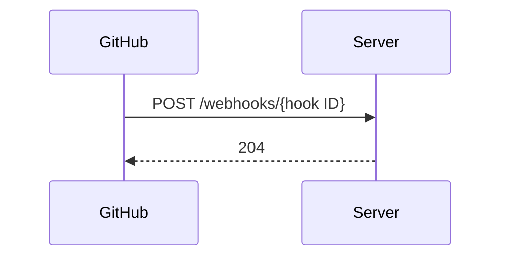
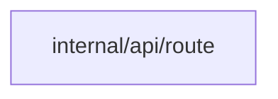
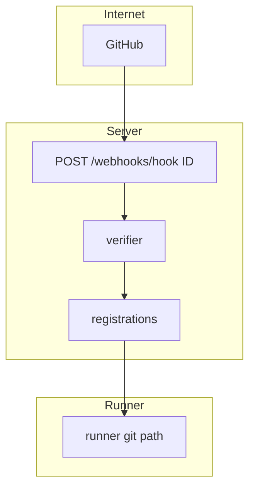

## Context

Slice 1 holds the store, the registration map and the check. This change adds the intake, the reads and the scoped token. The 24-hour delivery record is a NEW store method in a NEW file. The local installation identity comes from the installation ID of main; if main has none, the change stops and asks the PM.

## Decisions

1. **Hint parsing in the port.** ParseEvent for GitHub uses an unexported verifier that compares X-Hub-Signature-256 against the stored secrets of one registration snapshot in constant time. A registration keeps at most two event secrets. During a rotation the old secret is valid for the check of an event only. It ends after 7 days or when the operator confirms the rotation. Each event accepted with the old secret writes an audit entry. Each refusal of an event signed with an expired, confirmed-away or third (older) secret also writes an audit entry. The API shows the effective end of the window (ADR 374 decision 2).
2. **Intake answers 204.** The route is outside /api/dustpan/v1, takes no auth action and answers 204 with an empty body. A reject counts git_host_event_rejected_total. The handler method HandleDelivery runs verify, map lookup, duplicate check and hint record in that order.
3. **Adapter methods and scoped token.** Implement the Files, Commits and Reviews methods behind capabilities, and RepoToken with Scoped set and an expiry of at most 1 hour.
4. **Duplicates.** The NEW store method MarkDelivery in pkg/forge/delivery.go records the delivery ID for 24 hours and the effect mark in one atomic check-and-set. The effect state decides a manual redelivery.
5. **Two event secrets and the window, in the store (ADR 374 decision 2, owner).** ADR 374 decision 2 says: "During a rotation, the old event secret is valid for the check of an event only. It ends after 7 days, or earlier when the operator ends the rotation (the confirmation of the rotation). Each event that the server accepts with the old secret writes an audit entry. The API shows the effective end of the window. The server refuses an event signed with the old secret after the end, or after the confirmation. A secret older than the old secret is never valid: a registration keeps at most two event secrets."
   - Storage: the table git_host_app_registrations gets three NEW nullable columns, edited in place in the baseline of each dialect in name order: old_event_secret_ends_at_ms (Unix milliseconds), old_event_secret_set_id and old_sealed_event_secret. The old secret stays sealed as the current one is: SealBound under EventSecretScope(kind), bound to the address digest. All three are NULL, or all three are set; a CHECK constraint in each dialect enforces this, and a read of a row with a partial set fails closed with `forge.ErrInvalid`.
   - The rotation: a PutRegistration whose event secret differs from the current one (the service opens the current secret and compares in constant time), with the same address digest, moves the current sealed secret, its set ID and now + 7 days into the three old columns, in the same UPDATE statement and transaction that writes the new secret. A PutRegistration during an open window replaces the old secret with the current one, so the secret before it is gone: two columns hold at most two secrets, so a third secret cannot be valid by structure. A put that changes the address digest writes NULL in the three old columns: the old secret is bound to the old address and opens for no other (fail closed). A put with the same event secret leaves the old columns as they are.
   - The confirmation: the NEW route POST /api/dustpan/v1/git-host-apps/{kind}/confirm-rotation writes NULL in the three old columns in one UPDATE with the version check, and writes an audit entry.
   - The check order of one event, against one registration snapshot: (1) the signature with the current secret, constant time; on a match, accept. (2) Only when (1) fails, and the old columns are set, and the time of the server is before old_event_secret_ends_at_ms: the signature with the old secret, constant time; on a match, accept and write the audit entry `git-host.event-accepted-old-secret` with the kind, the hook ID, the delivery ID and the end of the window. (3) Else refuse, answer 204 as for every refusal, count git_host_event_rejected_total and write the audit entry `git-host.event-refused` with the reason (`signature`, `old-secret-expired`). An unreadable or partial old set refuses (fail closed).
   - The API: the answer of GET /api/dustpan/v1/git-host-apps/{kind} gets the NEW field oldSecretEndsAt (Unix milliseconds), the effective end of the window; the field is absent when no window is open. No read answers a secret.
   - Backup: backup_githost.go of each dialect lists the three columns, so a backup holds the window (a restore keeps an open window as it was).

## Structure

Unexported type webhookIntake with constructor newWebhookIntake that checks its ports and the secret length.

## Risks

- Replayed delivery causes a second effect
- Unscoped token reaches a runner
- Hook URL tied to one member

## Layers (defense in depth)

| Layer | Guard | Hostile test |
| --- | --- | --- |
| signature | Constant-time compare against the stored secrets; reject short secrets. | Forged body and wrong secret sent to the adapter count a reject. |
| old secret window | The old secret is tried only after the current one fails, only before its end and only when all three old columns are set; at most two secrets by structure. | An event with the old secret 1 ms after the end, after the confirm, and with a third secret is refused with its audit entry; a row with a partial old set is refused (TestOldSecretWindow, TestConfirmRotation, TestThirdSecretRefused, TestPartialOldSecretRowRefused). |
| store | The CHECK constraint refuses a partial old set; the rotation writes the old set in the same UPDATE as the new secret. | A direct insert of a partial old set fails in each dialect; a failed put leaves both secrets as they were (TestRotationIsAtomic in pkg/store/storetest). |
| hook mapping | Hook ID resolves through the installation map only. | Traversal hook ID gives 204 and a reject. |
| scoped token use | The runner path refuses a token with Scoped not set. | A valid unscoped token is refused. |

## Diagrams

After this change:

Modules that the change touches, and their imports on main:

New imports of this change (each one allowed by the module rules):

- `pkg/forge/github` imports `pkg/forge`

## Quality attributes

| Attribute | Target | Unit | Scope |
| --- | --- | --- | --- |
| request bound | 1 | MB max | webhook body read |
| token lifetime | 1 | hours max | RepoToken expiry |
| secret strength | 32 | bytes min | event secret length |

## Threat model

Data flow and trust boundaries:

| Boundary | STRIDE | Threat | Layer | Guard | Hostile test |
| --- | --- | --- | --- | --- | --- |
| Internet to server | S | Attacker forges a push delivery. | boundary check | Constant-time signature check. | Forged body counts a reject. |
| Internet to server | S | Attacker forges a push delivery. | encode or contain | Hook ID resolves through the map only. | Traversal hook ID gives 204 and a reject. |
| Internet to server | S | Attacker forges a push delivery. | limit | Body bound of 1 MB. | A 10 MB body is cut and answers 204. |
| Internet to server | S | Attacker forges a push delivery. | authorize at point of use | The runner path needs a scoped token. | An unscoped token is refused. |
| Internet to server | S | Attacker forges a push delivery. | fail closed | Drop on error and count a reject. | Unreadable effect state drops with 204. |

## Contracts

**webhookIntake**

- Invariant: Every answer is 204 with an empty body.
- Invariant: Hint record and effect mark are one atomic step.
- `HandleDelivery`: pre: Body within the size bound. Post: A verified hint is recorded once per effect key.

## Failure modes

| Step | Failure | Retry | State after |
| --- | --- | --- | --- |
| Hint apply | Duplicate delivery after restart | No retry; the effect check drops it. | Single hint effect. |
| RepoToken | Git host refuses the mint | No retry; return a refusal that names the host. | No token issued. |
