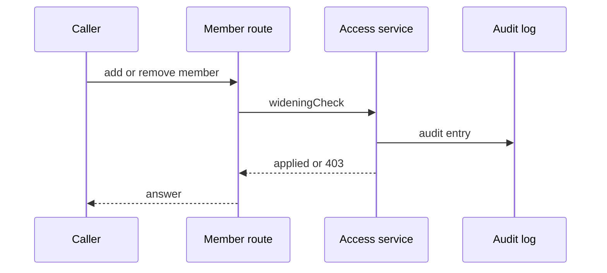

## Context

Membership of a group that a limit names changes the Cedar forbid result. The guard runs in the same transaction as the membership write, together with the reach check of the change check-reach-when-grant-membership.

## Decisions

1. **Guard widening membership changes.** At write time the access service lists saved limits whose policy tests the stable group ID in a principal-in-group test, in when or unless, directly or through a parent group. An add to an unless-named group widens access. A remove from a when-named group widens access. The caller must hold each limited action at the scope of the limit. A group named by no limit keeps the current guard.
2. **Stable ID matching with fail closed parse.** The parser reads group stable IDs from the saved policy and compares IDs only, with parent chain resolution and cycle-safe traversal. A limit set that fails to parse makes the service refuse the change.
3. **Fenced check with versioned installation read.** Namespace limits are read in the same fenced transaction as the write. Installation limits are read as a versioned snapshot before the transaction and rechecked at commit. On a mismatch the guard retries or refuses.

## Structure

Unexported type wideningCheck, built only by newWideningCheck(groupID, limitSet), which parses saved forbid policies for group stable IDs and returns the limited actions. Callers cannot build the set by hand.

## Risks

- The parser misses a group reference form and a widening change passes.
- The guard blocks routine membership work.

## Diagrams

After this change:



## Quality attributes

| Attribute | Target | Unit | Scope |
| --- | --- | --- | --- |
| correctness | 0 widening membership changes pass without the limited actions, in 100 percent of the hostile test cases | hostile test cases | the membership guard in pkg/access |

## Threat model

Data flow and trust boundaries:

```mermaid
membership route -> access service guard -> fenced store -> audit log
```

| Boundary | STRIDE | Threat | Layer | Guard | Hostile test |
| --- | --- | --- | --- | --- | --- |
| membership route | E | A caller with group rights alone widens a forbid limit through a membership add or remove. | boundary check | The widening check on stable group ID across when and unless. | TestGroupGuardHostileParser with negated, compound and set forms. |
| membership route | E | A caller with group rights alone widens a forbid limit through a membership add or remove. | limit | The fenced namespace check with a versioned installation read. | TestGroupGuardConcurrentLimitSave. |
| membership route | E | A caller with group rights alone widens a forbid limit through a membership add or remove. | fail closed | A parse failure refuses the change and the error hides unreadable limit IDs. | TestGroupGuardCases with an unparsable limit set and a hidden limit. |

## Failure modes

| Step | Failure | Retry | State after |
| --- | --- | --- | --- |
| Atomic check and write | A concurrent limit save adds a group reference during the write. | Retry the fenced check on version mismatch and refuse when the guard now matches. | The change is applied or refused, with an audit entry. |
| Bulk batch | The batch holds one widening entry without the limited actions. | Refuse the whole batch. The caller resubmits after the rights change. | No entry is applied. |

## Change impact (computed from main)

Tests:

- `pkg/principal/guard_test.go` names `access.CheckGroupGrants`
- `pkg/access/group_limits_test.go` names `access.CheckGroupGrants`
- `internal/api/server/principals_test.go` names `access.CheckGroupGrants`
- `pkg/tempadmin/tempadmin_test.go` names `gate.ErrInvalid`
- `pkg/outputshare/outputsharetest/mem_test.go` names `gate.ErrInvalid`
- `pkg/outputshare/outputshare_test.go` names `gate.ErrInvalid`
- `pkg/manuallock/manuallock_test.go` names `identity.Authorizer`
- `internal/outputsharesvc/outputsharesvc_test.go` names `identity.Authorizer`
- `pkg/outputshare/outputshare_test.go` names `identity.Authorizer`
- `internal/authgate/authgate_test.go` names `gate.ErrLimited`

ADRs:

- `docs/adr/0202-secrets-revisions-tags-drafts-and-rotation.md` names `gate.ErrInvalid`
- `docs/adr/0271-the-forge-port-git-host-connections-and-the-installation-level-github-app.md` names `gate.ErrInvalid`
- `docs/adr/0141-freeze-schedules.md` names `gate.ErrInvalid`
- `docs/adr/0051-collections-of-units.md` names `identity.Authorizer`
- `docs/adr/0273-output-sharing-rules-and-the-read-outputs-action.md` names `identity.Authorizer`
- `docs/adr/0013-separate-tool-models-shared-read-model-and-access.md` names `identity.Authorizer`
- `docs/adr/0230-gate-configuration-actions-routes-errors-and-audit.md` names `gate.ErrLimited`
- `docs/adr/0223-access-limits-cedar-forbid-policies-for-each-scope.md` names `gate.ErrLimited`
