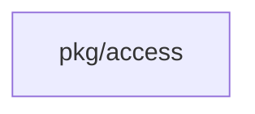
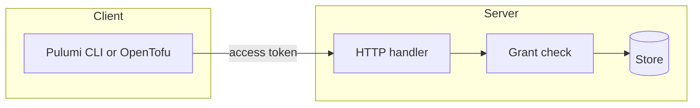

## Context

The grant check reads stored grants at each request. This change adds proof and fixes gaps. It adds no grant shape.

## Decisions

1. **Read stored grants at each request.** The service reads the live grant and membership rows. No allow is cached, so a revoked grant fails on the next request.

## Structure

Keep the one existing reach function in pkg/access as the only place that decides reach, so the write path and the export cannot diverge. Add no new exported type.

## Risks

- A cached allow lets a revoked grant write after it ended.

## Layers (defense in depth)

| Layer | Guard | Hostile test |
| --- | --- | --- |
| service | The service checks the stored grant for the caller, action and object before each state read or write | A writer on collection A writes a unit of collection B and expects 403 |
| port adapter | The store reads live grant and membership rows in the same transaction | Revoke the grant and retry the same token and expect 403 |
| HTTP handler | The handler maps a refused check to 403 | A viewer sends the write call and expects 403 |

## Diagrams

Modules that the change touches, and their imports on main:

## Quality attributes

| Attribute | Target | Unit | Scope |
| --- | --- | --- | --- |
| Revocation latency | 0 | requests served after the grant ends | each tool route |

## Threat model

Data flow and trust boundaries:

| Boundary | STRIDE | Threat | Layer | Guard | Hostile test |
| --- | --- | --- | --- | --- | --- |
| Server | E | A writer or viewer does an action outside its grant | boundary check | The handler rejects a request with an unknown token or a malformed object name | Send a write with a malformed unit name and expect a refusal |
| Server | E | A writer or viewer does an action outside its grant | encode or contain | The store reads grants with placeholders only, scoped to the namespace | Send a collection name with SQL text and expect no grant match |
| Server | E | A writer or viewer does an action outside its grant | limit | A grant on one collection reaches only that collection and its units | A writer on collection A writes a unit of collection B and expects 403 |
| Server | E | A writer or viewer does an action outside its grant | authorize at point of use | The service checks the stored grant for the action and object | A viewer runs tofu apply and expects 403 |
| Server | E | A writer or viewer does an action outside its grant | fail closed | An unknown or ended grant denies and writes an audit entry | Use a token after its grant ends and expect 403 |
| Server | I | A caller reads the export without the read-access action | boundary check | The export route validates namespace and collection path values | Ask for an export of a malformed collection name and expect 400 |
| Server | I | A caller reads the export without the read-access action | encode or contain | The export query uses placeholders and the namespace of the path | Ask for the export of namespace A with a collection of namespace B and expect no rows |
| Server | I | A caller reads the export without the read-access action | limit | The export is limited to the object of the route | Ask for the export of collection A and expect no grant of collection B |
| Server | I | A caller reads the export without the read-access action | authorize at point of use | The export route checks its read-access action | Ask for the export without the action and expect 403 |
| Server | I | A caller reads the export without the read-access action | fail closed | An error in the check denies the export | Fail the grant read and expect 403 with no rows |

## Failure modes

| Step | Failure | Retry | State after |
| --- | --- | --- | --- |
| Unit write | The grant ends between the grant read and the commit | Retry after a new grant | No write committed and the answer is 403 |
