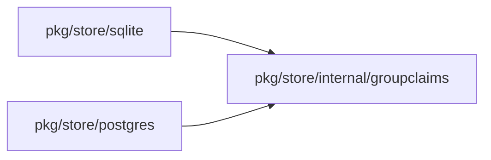

## Context

The guide implies an enforced rule for protected groups that main does not implement. The fix aligns the guide with main until the enforcement lands. ADR 70 decision 14 and ADR 320 decision 14 stay the accepted rule. Owner decision, 13 Nov 2026 (queue P21), is provisional and the change does not weaken it.

## Decisions

1. **Docs-only boundary.** Edit only the guide wording about protected groups and identity provider sync. Do not change sync code, the protected flag or the catalog of code rules.
2. **State the fact and the accepted rule.** The guide says what main does now and names the accepted rule as not yet enforced. It adds one safe step. It names no SCIM error code or audit entry.
3. **Order.** This change lands first. The enforcing pull request rewrites the sentence to the enforced rule.

## Structure

No structure change. The change edits prose in docs/guides/principals-and-groups.md only.

## Risks

- A reader keeps the old implied rule if the wording stays vague.
- The guide goes stale when the enforcement lands, if that pull request does not rewrite the sentence. The comment on issue #2688 reduces this.
- A later edit can state a rule that main does not enforce.

## Diagrams

Modules that the change touches, and their imports on main:

## Quality attributes

| Attribute | Target | Unit | Scope |
| --- | --- | --- | --- |
| Guide accuracy | 0 | sentences that imply a refusal that main does not enforce | docs/guides/principals-and-groups.md |
| Runtime effect | 0 | changed lines of server code | whole server |
