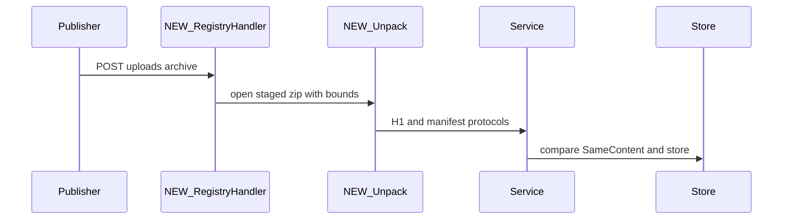
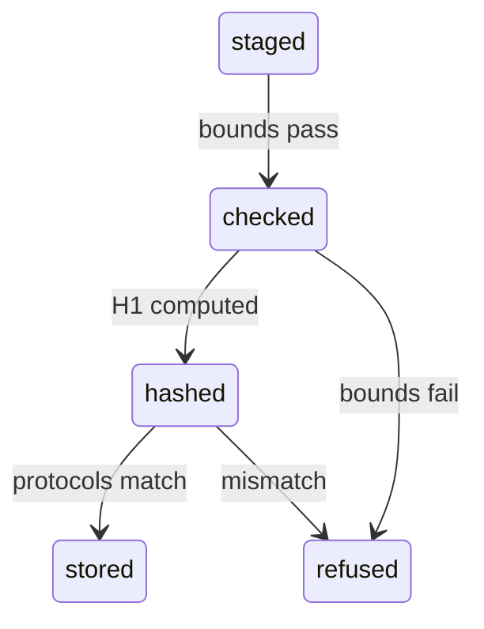
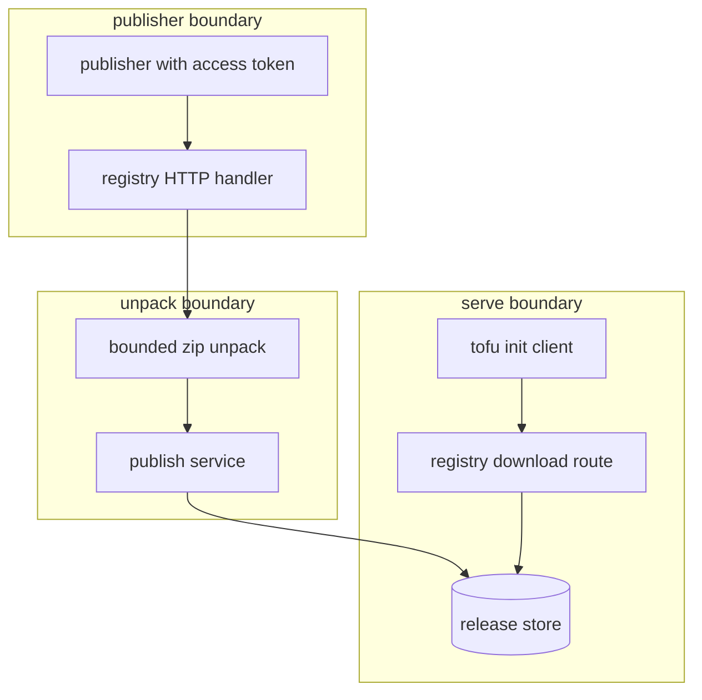

## Context

Provider archives are untrusted zip files. The server unpacks with limits, computes the h1 hash, reads the registry manifest for protocols, and maps each namespace to a registry-safe slug.

## Decisions

1. **Bounded unpack as structure.** Add an unexported unpack function that opens the staged zip, rejects absolute paths and dot-dot entries, enforces limits on unpacked size, file count, entry size and compression ratio, counts real decompressed bytes while it reads, rejects duplicate names after case folding, and returns the manifest bytes and the h1 digest.
2. **Archive truth from bytes.** Store H1 on registry.Archive at publish time from the unpack result, include H1 in SameContent with a missing-H1 rule for old releases, and derive protocols only from terraform-registry-manifest.json inside the archive with order-insensitive set match.
3. **Stable slug from ID.** Derive the registry slug for each namespace from its stable ID in lowercase with unsafe characters removed, store the slug on the namespace record at publish time, index slug to namespace for lookup, backfill old namespaces on first publish or read, keep the prior name path for existing releases with slug winning on conflict, append a short suffix on collision or empty result, and edit the baseline of each dialect in place with no numbered migration.

## Structure

Unexported type archiveFacts with constructor openArchiveFacts(stagedKey) that checks invariants; only the constructor unpacks bytes, and callers read H1 and protocols from its result.

## Risks

- Zip bomb exhausts disk or memory during unpack.
- Path traversal writes outside the staging directory.
- Publisher states false protocols and OpenTofu selects a provider it fails to start.
- Namespace name outside the safe subset breaks registry URLs.

## Layers (defense in depth)

| Layer | Guard | Hostile test |
| --- | --- | --- |
| port adapter | Unpack rejects entries with absolute paths, dot-dot segments, and symlink bits, and stops past 64 MB unpacked size, 1024 files, 16 MB per file, and 100 times expansion of compressed size counted on real bytes. | Publish a zip with ../../evil, absolute /tmp/evil, symlink entry, and zip bomb entries; each publish fails with 400 and no file leaves the staging directory. |
| service | Service compares stated protocols to manifest protocols with exact set match and refuses mismatch; a stated protocol value without a manifest fails closed. | Publish a provider that states protocols 5.0 while the manifest states 6.0, and one that states protocols without a manifest; the service returns invalid protocols and stores nothing. |
| HTTP handler | Registry HTTP handlers check publish authorization first, then zip content type, then count request bytes during read to 32 MB, and stage bytes only after those checks. | Send an oversize archive and a wrong content type with a principal without publish grant; the handler returns 403, 415, and 413 without unpacking. |

## Diagrams

After this change:

New imports of this change (each one allowed by the module rules):

- `internal/registry/service` imports `pkg/registry`

States and transitions after this change:

## Quality attributes

| Attribute | Target | Unit | Scope |
| --- | --- | --- | --- |
| publish safety | 64 | MB max unpacked bytes | provider publish with zip archive |
| publish safety | 1024 | files max per archive | provider publish with zip archive |
| request limit | 32 | MB max request body | POST /api/dustpan/v1/namespaces/{}/registry/uploads |

## Threat model

Data flow and trust boundaries:

| Boundary | STRIDE | Threat | Layer | Guard | Hostile test |
| --- | --- | --- | --- | --- | --- |
| publisher boundary | S | Attacker without publish grant stages a malicious archive and forces unpack. | boundary check | Handler rejects paths with dot-dot and absolute entries before staging. | Send publish with traversal entry; expect 400 before staging. |
| publisher boundary | S | Attacker without publish grant stages a malicious archive and forces unpack. | encode or contain | Handler stages bytes under random key with no execution bit. | Stage hostile zip then read staging dir; expect no execution and no escape. |
| publisher boundary | S | Attacker without publish grant stages a malicious archive and forces unpack. | limit | Handler counts request bytes during read to 32 MB for chunked bodies. | Send chunked body past 32 MB; expect 413 with staged bytes deleted. |
| publisher boundary | S | Attacker without publish grant stages a malicious archive and forces unpack. | authorize at point of use | Handler checks access token and unit:manage on namespace before staging. | Send publish without grant; expect 403 with no staging. |
| publisher boundary | S | Attacker without publish grant stages a malicious archive and forces unpack. | fail closed | Handler denies on unknown content length and deletes staged bytes on error. | Send malformed upload that fails mid-read; expect denial with no orphan. |
| unpack boundary | T | Attacker uploads traversal or zip bomb archive that writes outside staging or exhausts disk. | boundary check | Unpack allowlists zip entries and rejects absolute paths and dot-dot. | Publish traversal archive; expect 400 registry.bad-archive. |
| unpack boundary | T | Attacker uploads traversal or zip bomb archive that writes outside staging or exhausts disk. | encode or contain | Unpack extracts under staging root and rejects symlinks. | Publish symlink archive; expect 400 with no write outside root. |
| unpack boundary | T | Attacker uploads traversal or zip bomb archive that writes outside staging or exhausts disk. | limit | Unpack stops past 64 MB real bytes, 1024 files, 16 MB per file, 100x ratio. | Publish zip bomb with lying headers; expect 400 on real-byte count. |
| unpack boundary | T | Attacker uploads traversal or zip bomb archive that writes outside staging or exhausts disk. | authorize at point of use | Service checks publish grant again before H1 store. | Call service unpack without grant; expect denial with no store. |
| unpack boundary | T | Attacker uploads traversal or zip bomb archive that writes outside staging or exhausts disk. | fail closed | Unpack fails closed on duplicate names and bad headers with no release. | Publish duplicate-name archive; expect 400 with no release stored. |
| serve boundary | I | Publisher states false protocols or swaps archive bytes so OpenTofu installs a provider it cannot start. | boundary check | Download validates slug characters against safe subset before lookup. | Request install with dot-dot slug; expect 404 registry.unknown-slug. |
| serve boundary | I | Publisher states false protocols or swaps archive bytes so OpenTofu installs a provider it cannot start. | encode or contain | Serve encodes slug in URLs and serves bytes with fixed content type. | Fetch release under slug with hostile name; expect safe encoding. |
| serve boundary | I | Publisher states false protocols or swaps archive bytes so OpenTofu installs a provider it cannot start. | limit | Download caps archive bytes served per request. | Fetch oversize release path; expect capped stream with no exhaustion. |
| serve boundary | I | Publisher states false protocols or swaps archive bytes so OpenTofu installs a provider it cannot start. | authorize at point of use | Download checks read grant on namespace object of slug owner. | Fetch private release without read grant; expect 403. |
| serve boundary | I | Publisher states false protocols or swaps archive bytes so OpenTofu installs a provider it cannot start. | fail closed | Service refuses false protocols and changed H1 with 400 and 409. | Publish false protocols and changed-bytes republish; expect mismatch and content-changed. |

## Contracts

**registry release**

- Invariant: H1 identifies unpacked bytes; SameContent includes H1.
- Invariant: Stored protocols equal manifest protocols or empty when no manifest and no stated protocols.
- Invariant: Registry slug derives from stable namespace ID and never changes on rename.
- `compute h1 hash`: pre: caller holds publish grant on namespace. Post: release stored with H1 over unpacked tree.
- `read protocols from manifest`: pre: archive unpack passed bounds. Post: stored protocols equal manifest set or empty.
- `serve releases under slug`: pre: slug maps to one namespace. Post: client receives release bytes under slug path.

## Failure modes

| Step | Failure | Retry | State after |
| --- | --- | --- | --- |
| Bounded unpack | Unpack exceeds limit mid-stream | Fix archive and publish again; staged bytes deleted. | No release stored, staged bytes deleted. |
| Protocol check | Stated protocols differ from manifest | Rebuild request from manifest and publish again. | No release stored. |
| Compare and store in one transaction | Changed-bytes republish race | Publish a new version with changed bytes. | One winner stored, loser gets 409. |
