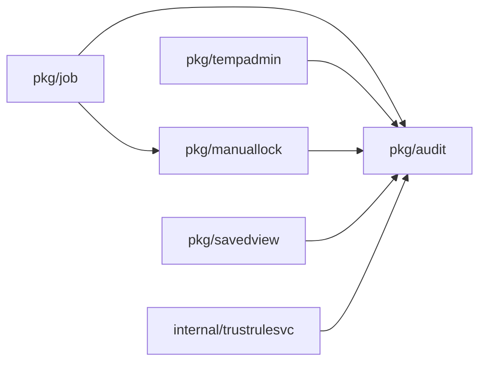

## Context

Copied hidden-rune checks refuse different sets. Main keeps the full set only as audit.IsHiddenRune.

## Decisions

1. **One shared hidden-rune set in internal/textcheck.** Add the NEW leaf package internal/textcheck with func IsHiddenRune that covers Cc, Cf, Zl and Zp. Keep audit.IsHiddenRune in pkg/audit as a wrapper that calls the NEW function. Point each listed copy at the NEW function. Point the existing audit.IsHiddenRune callers in pkg/job, pkg/tempadmin, pkg/manuallock, pkg/savedview and internal/trustrulesvc/exchange.go at it too. Keep one documented exemption in pkg/notify/chat/chat.go: U+000A stays allowed in the message body. Each site checks input on write or on cursor decode; stored rows stay readable and no read path adds a check on a stored name. Keep the NEW func signature stable so qa-round-10-minor-findings can extend the set later.

## Structure

The set is four fixed unicode categories in one plain function, so no unexported type is needed. Every site calls the one function, so a partial copy cannot be built by accident.

## Risks

- Chat text becomes stricter in pkg/notify/chat/chat.go: U+200B, U+2028 and U+2029 are refused while U+000A stays allowed.
- Callers of audit.IsHiddenRune change import only; their refusal behavior does not change.

## Diagrams

Modules that the change touches, and their imports on main:

New imports of this change (each one allowed by the module rules):

- `pkg/audit` imports `internal/textcheck`
- `pkg/job` imports `internal/textcheck`
- `pkg/drift` imports `internal/textcheck`
- `pkg/accesstoken` imports `internal/textcheck`
- `pkg/gate` imports `internal/textcheck`
- `pkg/principal` imports `internal/textcheck`
- `pkg/backup` imports `internal/textcheck`
- `pkg/history` imports `internal/textcheck`
- `pkg/inventory` imports `internal/textcheck`
- `pkg/trustrule` imports `internal/textcheck`
- `pkg/notify/chat` imports `internal/textcheck`
- `internal/api/refusal` imports `internal/textcheck`

## Quality attributes

| Attribute | Target | Unit | Scope |
| --- | --- | --- | --- |
| none affected | No latency or storage target changes; the check runs on short strings only |  |  |
