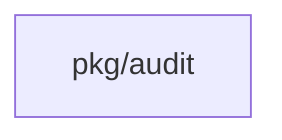
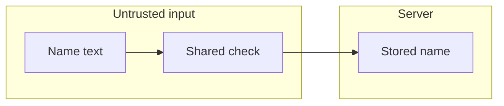

## Context

On main the one shared check is IsHiddenRune in pkg/audit/audit.go, which the issues call ident.IsHiddenRune. It lets variation selectors, Hangul fillers and U+034F pass.

## Decisions

1. **One shared refused set, provisional.** Add the listed runes to the check in pkg/audit/audit.go now. This is provisional until the owner answers the open question. A later change adds any named exception.
2. **Only new writes face the refusal.** Only new writes face the refusal. A stored name stays readable and usable for sign-in. A rename, an update, or a rewrite with a new value validates the new value. An unchanged rewrite keeps its value.

## Structure

One unexported refused-rune table behind IsHiddenRune; only it defines the ranges.

## Risks

- A stored lookalike pair stays until renamed.

## Diagrams

Modules that the change touches, and their imports on main:

## Quality attributes

| Attribute | Target | Unit | Scope |
| --- | --- | --- | --- |
| none affected | Name validation stays in process with no new network call |  |  |

## Threat model

Data flow and trust boundaries:

| Boundary | STRIDE | Threat | Layer | Guard | Hostile test |
| --- | --- | --- | --- | --- | --- |
| Name text from outside the process | S | Two stored names look the same through hidden runes. | boundary check | IsHiddenRune refuses the listed runes. | Send U+FE00, U+3164 and U+034F to IsHiddenRune; fails when any returns false. |
| Name text from outside the process | S | Two stored names look the same through hidden runes. | encode or contain | The server refuses and does not change the input. | Send a hidden rune; fails when stored bytes differ from a valid name. |
| Name text from outside the process | S | Two stored names look the same through hidden runes. | limit | A refused name stops before storage. | Send a refused name; fails when a row appears. |
| Name text from outside the process | S | Two stored names look the same through hidden runes. | authorize at point of use | Each caller applies the check to the new value. | Send U+FE00 to each caller; fails when accepted. |
| Name text from outside the process | S | Two stored names look the same through hidden runes. | fail closed | A check error denies the write. | Force a check error; fails when the write succeeds. |

## Contracts

**hidden-name**

- Invariant: A new name accepted after the change holds no refused rune.
- `IsHiddenRune`: pre: Input is a Unicode code point.. Post: Returns true for the selector ranges, the four Hangul fillers and U+034F..
