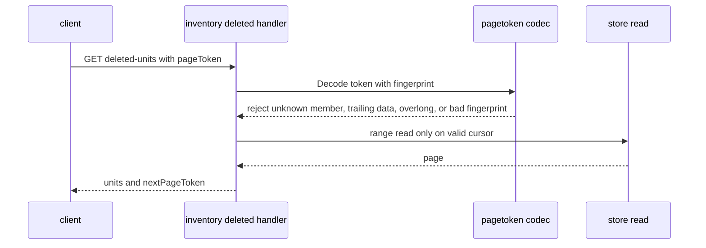
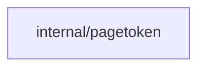
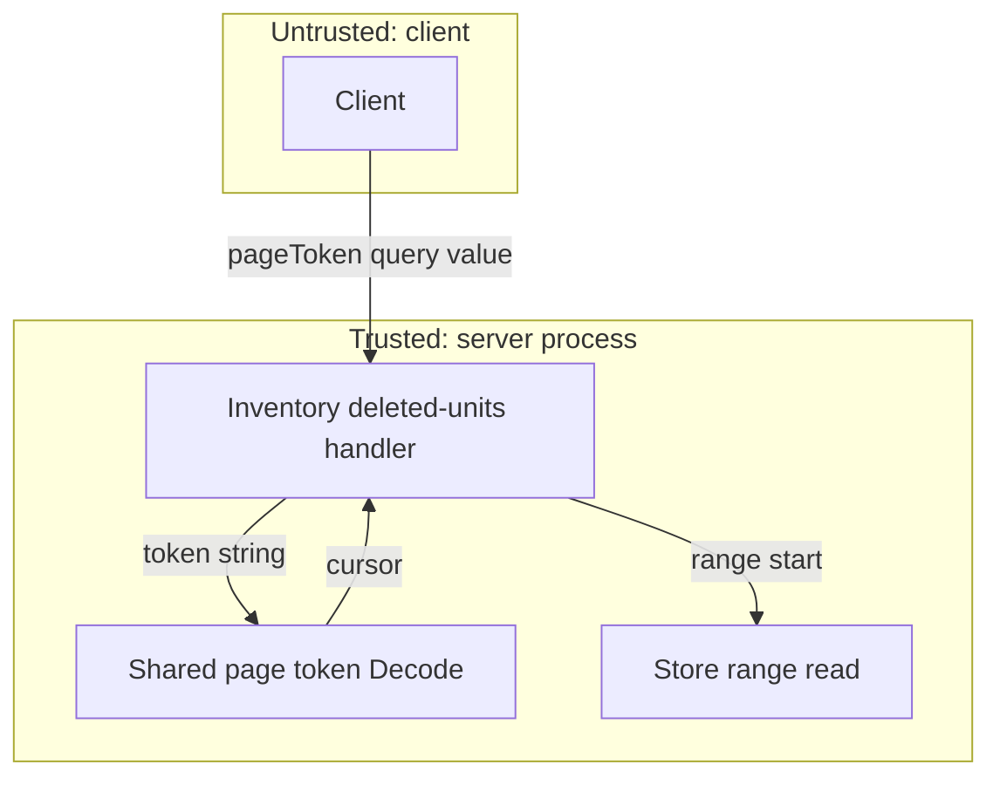

## Context

Issue #1645 reports that the deleted-units cursor, the registry provider cursor, and the namespace cursor keep per-adapter codecs with missing caps, missing fingerprints, and missing field checks, while internal/pagetoken holds the shared capped codec. On main the deleted and registry adapters already call pagetoken.Encode and pagetoken.Decode inside thin wrappers, but the wrappers still accept unknown members, trailing data, and unchecked field values before the store read.

## Decisions

1. **One codec for the three cursors in scope.** Route the deleted-units cursor, the registry provider cursor, and the namespace cursor through internal/pagetoken Encode and Decode inside the existing adapter wrappers, with a filter fingerprint per list, so one 4 KiB capped codec owns base64 and JSON shape.
2. **Strict decode in the shared function.** Call DisallowUnknownFields in shared Decode and then check that only whitespace remains after the first JSON object, so every caller inherits one strict object shape.
3. **Boundary field checks stay in adapters.** Validate each decoded cursor field at the boundary before the store read: tool from the known tool list, name and unit ID with the parsers of the domain, fingerprint by constant-time compare. Keep encode, length cap, and fingerprint behavior otherwise unchanged.

## Structure

No new type. The fix is a guard in the existing func Decode in internal/pagetoken/pagetoken.go:58 (func Decode) plus field checks in the existing adapter wrappers. No structure removes the need for the JSON shape check, so a guard with hostile tests takes its place.

## Risks

- Tokens in flight with an extra member or trailing data fail closed; the client lists again from the first page with no pageToken on the same route.

## Layers (defense in depth)

| Layer | Guard | Hostile test |
| --- | --- | --- |
| boundary check | Shared Decode rejects members outside the caller wire shape and rejects non-whitespace data after the first JSON object. | Send a token with an extra member and a token with trailing data; each fails without a store read. |
| boundary check | Each adapter validates decoded Tool, Name, UnitID, and fingerprint before building the store range start. | Send a well-formed token with a 10KB name, unknown tool, or wrong fingerprint; each fails at the boundary. |
| limit | Shared Decode enforces the 4 KiB cap before base64 and JSON decode. | Send a multi-megabyte cursor and check the server rejects it without a store read. |

## Diagrams

After this change:

Modules that the change touches, and their imports on main:

## Quality attributes

| Attribute | Target | Unit | Scope |
| --- | --- | --- | --- |
| none affected | Strictness-only and wrapper-consolidation change to opaque cursors; no latency, storage, or limit target changes. |  |  |

## Threat model

Data flow and trust boundaries:

| Boundary | STRIDE | Threat | Layer | Guard | Hostile test |
| --- | --- | --- | --- | --- | --- |
| Untrusted client to trusted server process | T | Tampered page token with an extra member, trailing data, overlong input, or bad field values reaches the store range read. | boundary check | Decode rejects unknown members and non-whitespace trailing data before any store use. | Send a token with an extra member and a token with trailing data; each fails without a store read. |
| Untrusted client to trusted server process | T | Tampered page token with an extra member, trailing data, overlong input, or bad field values reaches the store range read. | encode or contain | Decode keeps the value inside the typed wire struct and never builds SQL or paths by string concatenation. | Send a token with an extra member holding SQL text and check it causes no raw query. |
| Untrusted client to trusted server process | T | Tampered page token with an extra member, trailing data, overlong input, or bad field values reaches the store range read. | limit | Decode caps input length before base64 and JSON decode at 4 KiB. | Send a multi-megabyte cursor and check the server rejects it without a store read. |
| Untrusted client to trusted server process | T | Tampered page token with an extra member, trailing data, overlong input, or bad field values reaches the store range read. | authorize at point of use | The handler checks the namespace grant before the decoded cursor reaches the store read. | Call the route with no grant and check it fails even with a valid token. |
| Untrusted client to trusted server process | T | Tampered page token with an extra member, trailing data, overlong input, or bad field values reaches the store range read. | fail closed | Any decode, shape, trailing-data, fingerprint, or field failure denies the read with an invalid-token error. | Send unknown-member, trailing-data, overlong, bad-fingerprint, and bad-field tokens and check each fails closed. |
