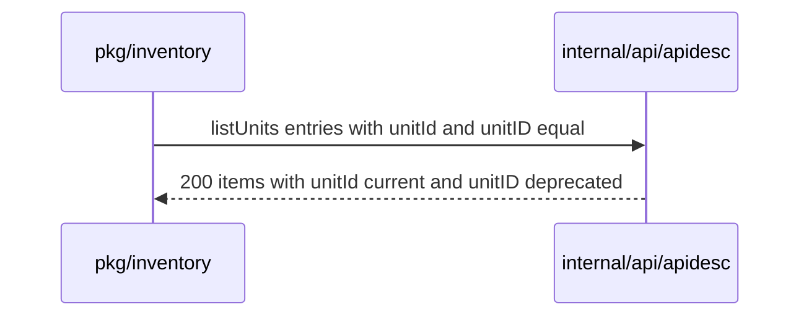
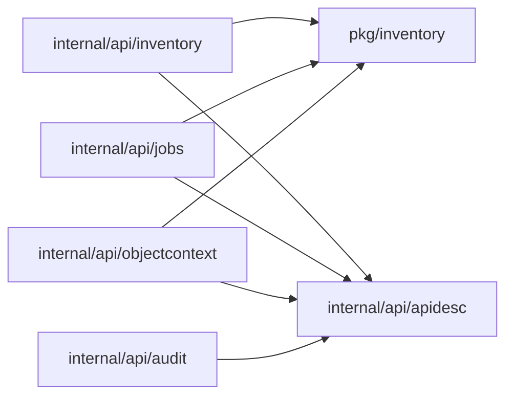

## Context

The tool-neutral answers write unitID, versionID and other acronym fields. ADR 210 decision 10 requires camelCase. Readers use the old names, so removal waits for the reader move before stable.

## Decisions

1. **Dual-write then remove old spellings.** Add the camelCase name beside each old name in Unit, DeletedUnit, ContextObject, the closed job object, audit entries, installation objects, runner objects, agent-result objects, history bodies and job store bodies. Both names carry the same value. Mark each old name deprecated in the API description. Move readers to the new names, then remove the old names and their LegacyFieldNames entries before stable. Each adapter owns its own unexported wire struct with one stored ID field; its constructor fills both JSON names on answers, and its decode path checks that both spellings match. No struct is shared between inventory and jobs packages. Each new route of this milestone names fields with camelCase names unitId and versionId only.

## Structure

Each adapter owns one unexported wire struct with one stored ID field and a constructor that fills both JSON names on answers plus a decode check for matching inputs.

## Risks

- Generated clients expose two names for one concept until removal.

## Diagrams

After this change:

Modules that the change touches, and their imports on main:

## Quality attributes

| Attribute | Target | Unit | Scope |
| --- | --- | --- | --- |
| none affected | Dual-write adds one small string field per item; no latency or storage target changes. |  |  |

## Contracts

**Inventory entry**

- Invariant: Wire form exposes both spellings during migration with equal values.
- `listUnits`: pre: Caller holds unit:read on each returned unit.. Post: Answer holds unitId equal to unitID on each item..

**Closed job answer**

- Invariant: Wire form exposes both spellings during migration with equal values.
- `getJob`: pre: Caller holds job:read on the job.. Post: Closed answer holds versionId equal to versionID..
