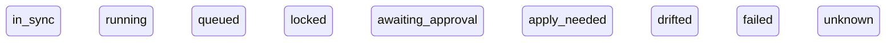

## Context

The shared inventory entry holds an OpenTofu-only record. ADR 337 keeps storage and match on the workspace row.

## Decisions

1. **Remove the field from the inventory only.** Remove LastRelease from the pkg/inventory entry and lastRelease from the unit view. Leave the workspace row and the unlock behavior as they are.
2. **Edit the baselines in place.** Remove the inventory columns from the baseline of each dialect in place and run make generate. Add no migration, because no tag shipped them.

## Structure

No structure stops a later tool-only field in shared code. The guard is the removal and the review of pkg/inventory diffs.

## Risks

- A client that read lastRelease from the inventory must read the workspace resource.

## Diagrams

Modules that the change touches, and their imports on main:

States on main in the touched packages:

## Quality attributes

| Attribute | Target | Unit | Scope |
| --- | --- | --- | --- |
| none affected | Removal of one optional field; no latency or storage target changes. |  |  |

## Contracts

**inventory entry**

- Invariant: An entry holds no tool-specific lock history.
