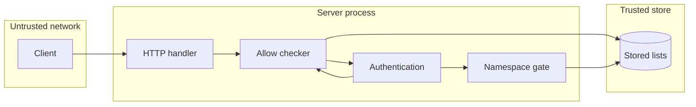

## Context

The allowlist check is security code on the request path of console sign-in and access token use. Main checks the installation list before the credential and the namespace list after authentication. It has no token list, and the namespace list is on a legacy route with its own column (see "What main lacks" in the proposal). This design adds the token list and moves the namespace list into the settings resource, as ADR 55 decision 8 and ADR 212 decision 7 say.

## Decisions

1. **Parse once at the boundary.** `ipallow.List` has unexported prefixes. Only `ParseList` and `DecodeList` make a value, and both refuse a bad entry (`pkg/ipallow/list.go:47,171`). Every scope uses this one type, so a list that did not pass the check cannot reach a checker. The token list and the namespace key use it. The change adds no second parser.
2. **Three enforcement points, one rule: deny when any opted-in list denies.** Each point reads the stored list on each request.
   - The installation list runs in `admit` before the credential is read (`pkg/dustpan/ipallow.go:470`). Main has this.
   - The token list runs in the same `admit`, after authentication gives the token ID (the token ID of the principal, `pkg/identity/identity.go:54`). The check is a second step of the same function. A request with a token that fails authentication reads no token list.
   - The namespace list runs in `ipallow.Gate`, after authentication and before the handler, for the namespace of the object (`pkg/ipallow/gate.go:39`). Main has this. The object is known only there, so the namespace list cannot join the checker of `admit`.
   - The checker of `admit` holds a namespace slot that no production call fills (see the proposal). This change replaces that slot with a token slot. `TestDenyAnyListDenies` moves to a table through the HTTP handler, so the "any list denies" rule is tested where it holds.
   - One function answers "are the lists on". The checker, the gate and the key reads call it. Open question 2 sets what it reads. Until the owner answers, it keeps the two switches of main.
3. **The token list is a column of the token row.** `access_tokens` gets the column `ip_allowlist` in both baselines, edited in place. No migration and no conversion code exist (`CLAUDE.md`, "Backend rules"). The store reads the list in the same lookup as the digest (`pkg/accesstoken/store.go:36 (GetTokenByDigest)`), so a change applies at the next request on every instance, as the token policy does. The token field is unexported, and a constructor refuses a list that `ParseList` did not make.
4. **The namespace list has one home: the settings resource.** The key `ipAllowlist.namespace` is a namespace setting (`setting.LevelNamespace`, `Database: true`). It uses `checkList` and `listReducesSecurity` of `pkg/ipallow/settings.go`. The view `/api/dustpan/v1/namespaces/{namespace}/settings/ip-allowlist` groups the keys with the prefix `ipAllowlist.` and adds no rule (ADR 212 decision 7). The column `namespaces.ip_allowlist` is removed from both baselines, so the legacy route and the resource cannot disagree. `ipallow.Store` keeps its two reads (`NamespaceList`, `NamespacesWithList`) over the settings rows. It loses `SetNamespaceList`: `setting.Store.Update` writes the value, the revision and the audit entry in one transaction, and checks the fence there (`pkg/setting/store.go:20-40`). This is a design decision of this change. The conformance suite for the new read comes before the adapters.
5. **The refresh path needs no new code.** `allowlistRequest` already matches the session, access and refresh cookies (`pkg/dustpan/ipallow.go:247-253`). The guard is that one `case`. A test sends the refresh route with the refresh cookie only, from a denied and from an allowed address, and fails when `session.RefreshCookie` leaves the `case`.
6. **Limits.** A list holds at most 64 entries (`ipallow.MaxEntries`). A string setting holds at most 1024 bytes (`pkg/setting/setting.go:85`), and the table of both dialects checks it. Open question 4 sets the byte limit of the list keys. The token column has no such limit, so the token list and the namespace key can differ until the owner answers.
7. **Structure over checks.** The bug class "a list that did not pass the check opens a scope" is made impossible by decision 1. The bug class "a derived fact and its source disagree" is made impossible by decision 4: one stored home. The guards that remain are fail-closed branches. Each one has a mutation test, because no structure removes the need for the branch (an unreadable store or a stored value from a restored backup is outside the type).

## Contract

Names are the design of this change. The builder keeps the signatures and may adjust a name with a note in the pull request.

**Stored schema** (both dialects, baselines edited in place):

| Table | Column | SQLite | PostgreSQL | Notes |
| --- | --- | --- | --- | --- |
| `access_tokens` | `ip_allowlist` | `TEXT NOT NULL DEFAULT ''` | `text DEFAULT ''::text NOT NULL` | The text of `ipallow.EncodeList`. Empty means no list. |
| `namespaces` | `ip_allowlist` | removed | removed | Moves to the row `settings (scope_id, key = 'ipAllowlist.namespace')`. |
| `settings` | none | `value` check 1024 | `value` check 1024 | Open question 4 may raise the check. |

**Port** (`pkg/accesstoken/store.go`, `TokenStore`). The conformance cases are in `pkg/accesstoken/accesstokentest` and run before an adapter has the method:

```go
// SetTokenIPAllowlist replaces the list of the token id; the zero List removes
// it. The audit entry e commits with the change.
SetTokenIPAllowlist(ctx context.Context, id string, l ipallow.List, e audit.Entry) error
```

Errors: `ErrNotFound` (no token), `ErrEnded` (revoked, expired or replaced), `ErrUnknownKind` (stored kind unknown). `Match` from `GetTokenByDigest` and `Token` from `GetToken` carry the list. A stored value that does not decode gives `ipallow.ErrInvalidList` (wrapped) on read, and the caller denies.

**Service** (`pkg/accesstoken/service.go`):

```go
func (s *Service) SetIPAllowlist(ctx context.Context, caller identity.Principal, e audit.Entry, scope Scope, id string, items []string) (ipallow.List, error)
func (s *Service) ClearIPAllowlist(ctx context.Context, caller identity.Principal, e audit.Entry, scope Scope, id string) error
```

Errors: `ipallow.ErrInvalidList` for an empty or bad list (use `ClearIPAllowlist` to opt out, as for a namespace), `ErrNotFound`, `ErrEnded`, `identity.ErrDenied`, `ErrSignInRequired`. Who may call and the step are open question 1.

**Namespace view** (this part does not depend on question 1):

| Item | Value |
| --- | --- |
| Path | `GET`, `PATCH` `/api/dustpan/v1/namespaces/{namespace}/settings/ip-allowlist` |
| Request (`PATCH`) | `application/merge-patch+json`: `{"ipAllowlist.namespace":"10.0.0.0/8,192.0.2.7"}`. `null` removes the list. Header `If-Match` with the `ETag` of the last read. |
| Response | 200 with the keys of the group, each with its effective value and source, and the `ETag` of the resource. |
| Errors | 400 `ip-allowlist.invalid-cidr` (bad entry, more than 64 entries, empty list); 403 `access.ip-not-allowed`; 403 `mfa.fresh-step-required`; 409 key locked; 412 stale `If-Match`; 404 `namespace.not-found`. |
| Actions | `namespace:read-settings` and `namespace:manage-settings` (ADR 212 decision 7), plus the action of open question 3. |
| Fresh step | Only for a change that widens or clears the list (`listReducesSecurity`), and only when the installation requires a fresh step (ADR 385). |

**Token route**: set by the answer to open question 1. Option B: `PUT` and `DELETE` `/api/dustpan/v1/me/tokens/{id}/ip-allowlist`, body `{"cidrs":[...]}`, action `token:manage-own` (`pkg/identity/identity.go`), wrapped like the other token changes (`internal/api/server/tokens.go:263 (serveTokenChange)`). The token resource shows `ipAllowlist` as a list of CIDR text, `[]` when none (the effective value, "No magic").

**Audit actions**: a denial writes `installation:deny-ip-allowlist` with the scope `installation`, `namespace` or `token` (`pkg/dustpan/ipallow.go:418`). The entry carries the client address and, for the token scope, the token ID. It never names the namespace in the response. A change of a token list writes `token:set-ip-allowlist` or `token:remove-ip-allowlist`. A change of the namespace key writes the audit entry of the settings resource.

## Structure

Unexported type `allowChecker` with constructor `newAllowChecker` that stores `ipallow.List` values (main: `pkg/dustpan/ipallow.go:62,74`). The type has the slots `installation` and `token`. The token field of `accesstoken.Token` is unexported, and its constructor takes an `ipallow.List`.

## Risks

- A wrong client address behind a proxy blocks valid users.
- An installation list that excludes the administrator blocks sign-in. The recovery is in the docs page.
- A token list that excludes the address of the CI runner blocks that pipeline. The administrator revokes and recreates the token, or clears the list (open question 1).
- The settings value limit cuts a list that the legacy route accepted (open question 4). With no data and no installation, no migration is needed.
- Removing the legacy route breaks the console until its change merges (task 4.3).

## Layers (defense in depth)

| Layer | Guard | Hostile test |
| --- | --- | --- |
| port adapter | The token store and the settings store refuse a value that does not decode, and the read denies. | Store `not-a-cidr` straight in the column and the row, and check that the request gets 403. |
| port adapter | The settings API refuses an invalid CIDR. | Write 999.999.0.0/16 and check 400. |
| service | `SetIPAllowlist` and the settings check refuse an empty list, 65 entries and a bad entry. | Call the service with each and check `ErrInvalidList`. |
| service | The checker denies when any opted-in list denies. | Use an address in the token list but outside the installation list and check denial with scope `installation`. Use an address in the installation list but outside the token list and check scope `token`. |
| HTTP handler | The handler answers 403 before credential use for the installation list. | Send a valid token from a denied address and check 403 with no state read. |
| HTTP handler | The handler answers 403 for the token list after authentication and writes no other entry. | Send a valid token from an address outside its list and check 403, the audit entry and the token last-used time. |
| HTTP handler | The route needs its action and the step. | Call each route with no action, with an access token and with a stale session. |

## Quality attributes

| Attribute | Target | Unit | Scope |
| --- | --- | --- | --- |
| availability | A list change applies to 100% of later requests on each instance, with the stored list read on each request. | percent of requests | each server process of one installation |
| latency | The token list adds no query to a request: it comes in the digest lookup. | queries added per request | each request with an access token |

## Threat model

Data flow and trust boundaries:



| Boundary | STRIDE | Threat | Layer | Guard | Hostile test |
| --- | --- | --- | --- | --- | --- |
| network to server | S | A spoofed proxy header bypasses the list. | boundary check | The settings API refuses an invalid CIDR. | Write 999.999.0.0/16 and check 400. |
| network to server | S | A spoofed proxy header bypasses the list. | encode or contain | The checker parses the address to netip.Addr and matches IPv4-mapped forms as IPv4. | Send ::ffff:10.0.0.1 and check it matches as 10.0.0.1. |
| network to server | S | A spoofed proxy header bypasses the list. | limit | A list holds at most 64 entries (`ipallow.MaxEntries`, `pkg/ipallow/list.go:18`). This change keeps the limit of main. | Write 65 entries and check 400. |
| network to server | S | A spoofed proxy header bypasses the list. | authorize at point of use | The checker uses the recorded client address after trusted-proxy handling. | Send a spoofed header from an untrusted source and check the recorded address is used. |
| network to server | S | A spoofed proxy header bypasses the list. | fail closed | A stored list that fails to parse denies sign-in and token requests. | Store a bad list and check 403 for each address. |
| network to server | E | A stolen token works from any address. | authorize at point of use | The token list is checked on each request after authentication. | Use a valid token from an address outside its list and check 403 scope `token`. |
| network to server | E | A refresh cookie renews a session from a denied address. | authorize at point of use | `allowlistRequest` matches the refresh cookie (`pkg/dustpan/ipallow.go:249`). | Send the refresh route with the refresh cookie only from a denied address and check 403 and no new cookie. |
| network to server | E | A token holder widens its own list. | authorize at point of use | The route needs a console session, and a widening needs the step when it is on (open question 1). | Call the route with the token itself and check 403. |
| network to server | I | The 403 names a namespace or a token and so leaks that it exists. | encode or contain | The scope is one of three fixed values, never text of the request (`pkg/dustpan/ipallow.go:520`). | Deny in a namespace with the name `acme` and check that the body holds no `acme`. |
| network to server | D | Many denied addresses fill the audit log. | limit | The limiter writes one entry for each scope and address in each window (`pkg/dustpan/ipallow.go:295 (record)`). | Send 1000 denials from one address and check one entry plus a count. |
| store to server | T | A restored backup holds a list that does not decode. | fail closed | `DecodeList` refuses the value, and the request is denied (`pkg/dustpan/ipallow.go:214 (installationChecker)`). | Restore a bad value for each of the three scopes and check 403. |

## Failure modes

| Step | Failure | Retry | State after |
| --- | --- | --- | --- |
| server start | A stored list fails to parse. | Repair the list through the host database path, then restart. | The server refuses sign-in and token requests until repair. |
| request | The database does not answer when a list is read. | Retry the request. | The server answers 503 and writes no denial entry (`pkg/dustpan/ipallow.go:49-55`). |
| request | The token list does not decode. | Clear the list of the token, or repair the row. | The server answers 403 for that token and writes a denial entry. |
| list change | The audit entry cannot be written. | Retry the change. | The change does not happen. |
