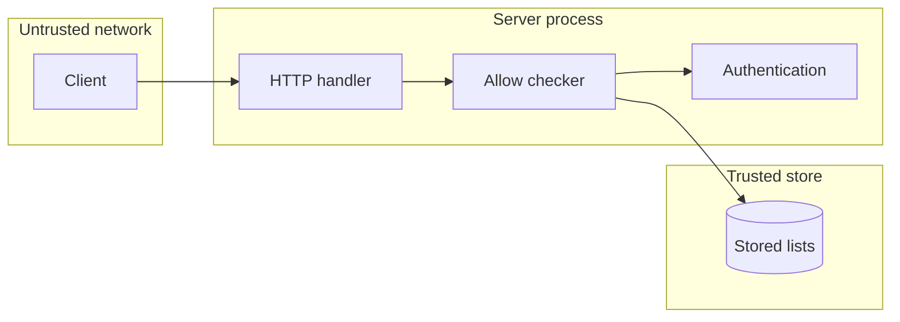

## Context

The allowlist check is security code on the request path of console sign-in and access token use.

## Decisions

1. **Parse once at the boundary.** One unexported checker holds parsed prefixes. Its constructor refuses a bad entry.
2. **Two-stage order.** The installation list runs before credential use. Namespace and token lists run after authentication. The server reads the stored list on each request.

## Structure

Unexported type allowChecker with constructor newAllowChecker that stores netip.Prefix values.

## Risks

- A wrong client address behind a proxy blocks valid users.
- An installation list that excludes the administrator blocks sign-in.

## Layers (defense in depth)

| Layer | Guard | Hostile test |
| --- | --- | --- |
| port adapter | The settings API refuses an invalid CIDR. | Write 999.999.0.0/16 and check 400. |
| service | The checker denies when any opted-in list denies. | Use an address in the namespace list but outside the installation list and check denial. |
| HTTP handler | The handler answers 403 before credential use for the installation list. | Send a valid token from a denied address and check 403 with no state read. |

## Quality attributes

| Attribute | Target | Unit | Scope |
| --- | --- | --- | --- |
| availability | A list change applies to 100% of later requests on each instance, with the stored list read on each request. | percent of requests | each server process of one installation |

## Threat model

Data flow and trust boundaries:

| Boundary | STRIDE | Threat | Layer | Guard | Hostile test |
| --- | --- | --- | --- | --- | --- |
| network to server | S | A spoofed proxy header bypasses the list. | boundary check | The settings API refuses an invalid CIDR. | Write 999.999.0.0/16 and check 400. |
| network to server | S | A spoofed proxy header bypasses the list. | encode or contain | The checker parses the address to netip.Addr and matches IPv4-mapped forms as IPv4. | Send ::ffff:10.0.0.1 and check it matches as 10.0.0.1. |
| network to server | S | A spoofed proxy header bypasses the list. | limit | A list holds at most 256 entries. | Write 257 entries and check 400. |
| network to server | S | A spoofed proxy header bypasses the list. | authorize at point of use | The checker uses the recorded client address after trusted-proxy handling. | Send a spoofed header from an untrusted source and check the recorded address is used. |
| network to server | S | A spoofed proxy header bypasses the list. | fail closed | A stored list that fails to parse denies sign-in and token requests. | Store a bad list and check 403 for each address. |

## Failure modes

| Step | Failure | Retry | State after |
| --- | --- | --- | --- |
| server start | A stored list fails to parse. | Repair the list through the host database path, then restart. | The server refuses sign-in and token requests until repair. |
