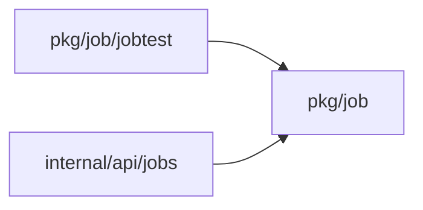

## Context

Follow polls of a growing job log ask for bytes after the last sent position. The store holds the log in chunks keyed by chunk keys.

## Decisions

1. **Byte offset reader with generation.** Add an unexported offsetCursor in pkg/job with constructor newOffsetCursor that checks offset, generation and limit. A poll seeks by byte offset across chunk start offsets and reads only chunks at or after the offset. The client passes offset and generation as query values. A generation mismatch, a negative, non-numeric, overflowing or past-end offset fails with job-log.invalid-offset as HTTP 400 and the error text never repeats the input. The poll uses the authorization action and object of the existing job log read route.

## Structure

Unexported type offsetCursor in pkg/job with constructor newOffsetCursor. Only the constructor makes a cursor.

## Risks

- A stale offset must never return wrong bytes: the generation check refuses it.

## Diagrams

Modules that the change touches, and their imports on main:

## Quality attributes

| Attribute | Target | Unit | Scope |
| --- | --- | --- | --- |
| follow poll bytes read | 1 | multiple of new bytes | per follow poll of one job log |
