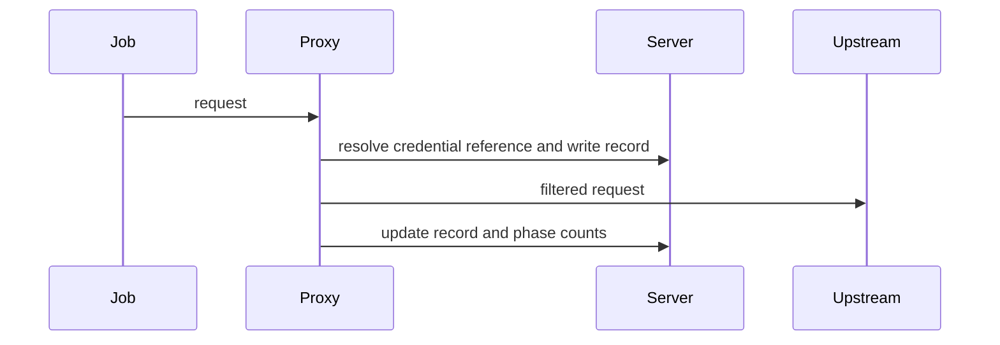
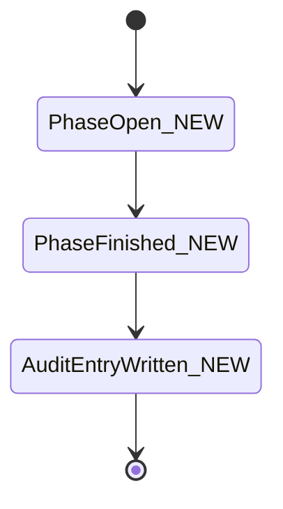
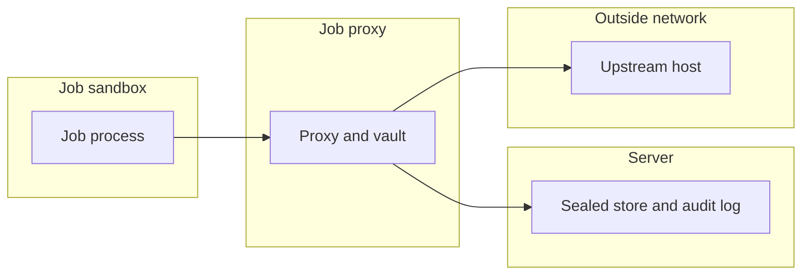

## Context

Rule sets and the runtime guard come from earlier parts. This part adds credential injection, records, audit, response scan and the plan-phase block.

## Decisions

1. **Proxy-side injection.** Credentials bind to proxy rules by stable credential ID and stay sealed. The assignment carries references only. The job proxy adds the credential at request time.
2. **Records and audit.** Each proxied request writes one record before send and updates it after response. The phase record aggregates counts. The audit log stores one idempotent entry per finished phase.

## Structure

Unexported proxyCredentialVault, built only by newProxyCredentialVault, which checks rule binding and sealed storage. Unexported planEffectiveRules, built only by newPlanEffectiveRules, which keeps apply-only rules out.

## Risks

- Credential value leaks through assignment, logs or records.
- Unrecorded proxy access breaks audit.
- Plan phase performs a write reserved for apply.

## Layers (defense in depth)

| Layer | Guard | Hostile test |
| --- | --- | --- |
| credential hold | Assignment holds references only. | Dump the assignment and job environment and find no credential value. |
| request check | Proxy strips job credential headers and re-checks each redirect host. | Send a forged Authorization header and a redirect to an unlisted host and expect refusal. |
| response scan | Proxy redacts plain credential values and refuses unscannable bodies over the scan limit. | Return a body with a credential value and expect redaction. |
| plan-phase block | Plan phase uses plan-effective rules only. | Run a plan-phase write that only an apply rule allows and expect refusal before network contact. |

## Diagrams

After this change:

States and transitions after this change:

## Quality attributes

| Attribute | Target | Unit | Scope |
| --- | --- | --- | --- |
| Proxy added latency | 20 | ms at p95 | one proxied request without upstream time |
| Response scan size limit | 1 | MiB per response | one proxied response |

## Threat model

Data flow and trust boundaries:

| Boundary | STRIDE | Threat | Layer | Guard | Hostile test |
| --- | --- | --- | --- | --- | --- |
| Job sandbox to job proxy | S | The job forges a credential header. | boundary check | Proxy strips job credential headers and rejects unlisted hosts. | Send a forged Authorization header and expect it removed. |
| Job sandbox to job proxy | S | The job forges a credential header. | encode or contain | Proxy never copies job headers into upstream auth headers. | Inject CRLF in a header and expect no split write. |
| Job sandbox to job proxy | S | The job forges a credential header. | limit | Proxy caps header count and size per request. | Send an oversize header set and expect refusal. |
| Job sandbox to job proxy | S | The job forges a credential header. | authorize at point of use | Proxy checks the effective rule set at the point of use. | Send a request past a revoked rule and expect refusal. |
| Job sandbox to job proxy | S | The job forges a credential header. | fail closed | Proxy denies on unknown header or rule state. | Send an unknown auth scheme and expect denial with no send. |
| Job proxy to server | I | A credential value leaks through the assignment or a record. | boundary check | Assignment and record APIs accept references only and reject values. | Post a record with a credential value and expect rejection. |
| Job proxy to server | I | A credential value leaks through the assignment or a record. | encode or contain | Assignment and records hold references only with redacted logs. | Dump the assignment and records and find no value. |
| Job proxy to server | I | A credential value leaks through the assignment or a record. | limit | Record APIs cap page size and body size. | Request a huge page and expect a capped page. |
| Job proxy to server | I | A credential value leaks through the assignment or a record. | authorize at point of use | Records list checks unit read grant at the point of use. | List records without a grant and expect 403. |
| Job proxy to server | I | A credential value leaks through the assignment or a record. | fail closed | Proxy fails closed when sealed storage is unreachable. | Break the vault link and expect refusal with no send. |
| Job proxy to outside network | E | A plan phase makes an apply-only write. | boundary check | Proxy validates method and host against plan-effective rules. | Send an apply-only write from a plan phase and expect refusal. |
| Job proxy to outside network | E | A plan phase makes an apply-only write. | encode or contain | Proxy builds the upstream request from the rule, not from job bytes. | Send a method-override header and expect it ignored. |
| Job proxy to outside network | E | A plan phase makes an apply-only write. | limit | Proxy caps request bytes per plan phase write attempt. | Send an oversize plan write and expect refusal. |
| Job proxy to outside network | E | A plan phase makes an apply-only write. | authorize at point of use | Proxy authorizes each request against the phase rule revision. | Replay an apply rule ID in a plan phase and expect refusal. |
| Job proxy to outside network | E | A plan phase makes an apply-only write. | fail closed | Proxy denies unknown methods in a plan phase. | Send an unknown method in a plan phase and expect denial. |
| Job proxy to server | R | A request goes out with no record. | boundary check | Proxy validates the record shape before send. | Send a malformed record field and expect refusal. |
| Job proxy to server | R | A request goes out with no record. | encode or contain | Proxy stores host plus path with placeholders only. | Send SQL metacharacters in a path and expect safe storage. |
| Job proxy to server | R | A request goes out with no record. | limit | Proxy bounds record queue depth per phase. | Flood requests and expect back-pressure, not loss. |
| Job proxy to server | R | A request goes out with no record. | authorize at point of use | Proxy checks phase ownership before it writes a record. | Write a record for another phase and expect denial. |
| Job proxy to server | R | A request goes out with no record. | fail closed | Proxy sends nothing when the record write fails. | Fail the record write and expect no upstream contact. |
| Outside network to job proxy | T | A response echoes a credential value. | boundary check | Proxy checks content type and length before scan. | Send an unknown content type and expect refusal. |
| Outside network to job proxy | T | A response echoes a credential value. | encode or contain | Proxy decodes as bytes and redacts matches without execution. | Send an HTML script with a value and expect inert redaction. |
| Outside network to job proxy | T | A response echoes a credential value. | limit | Proxy scans at most 1 MiB per response. | Send a 2 MiB echo and expect refusal. |
| Outside network to job proxy | T | A response echoes a credential value. | authorize at point of use | Proxy applies the scan policy of the matched rule. | Send an echo outside the rule scope and expect refusal. |
| Outside network to job proxy | T | A response echoes a credential value. | fail closed | Proxy refuses unscannable or over-limit bodies. | Send a compressed body the proxy cannot scan and expect refusal. |

## Contracts

**proxy phase record**

- Invariant: One audit entry per phase ID.
- Invariant: Records reference rule set revision and stable credential ID.
- `finish-phase`: pre: Phase ran with a job proxy.. Post: Phase record holds counts and one audit entry exists..
- `list-records`: pre: Caller holds unit read grant on the unit.. Post: Caller receives page of records without query strings or credential values..

## Failure modes

| Step | Failure | Retry | State after |
| --- | --- | --- | --- |
| Resolve the credential reference | The sealed credential is missing or revoked. | The job retries after an administrator binds a valid credential. | No upstream contact and a refused record exists. |
| Write the request record | The record write fails. | The client retries the request. | The request is refused and the phase counts the failure. |
| Write the phase audit entry | The server stops before the audit entry is written. | The phase finish runs again with the same phase ID and writes one entry. | One audit entry exists after the finish with no duplicate. |
| Update the record after response | The proxy stops between record write and response update. | Phase finish marks the record as unknown outcome. | The record shows sent without response and the phase counts it. |
