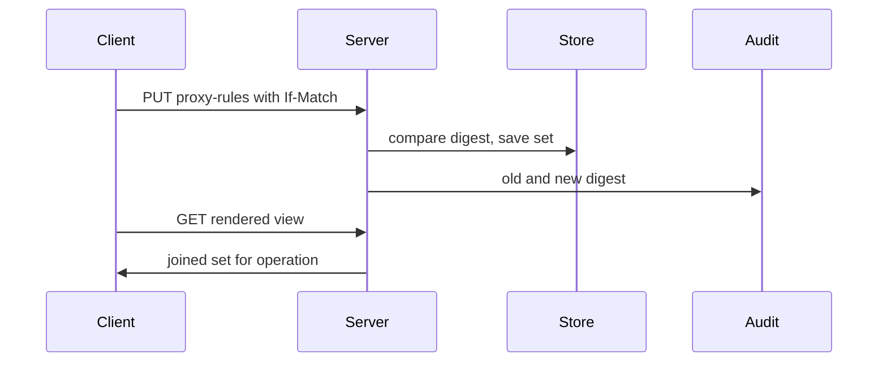
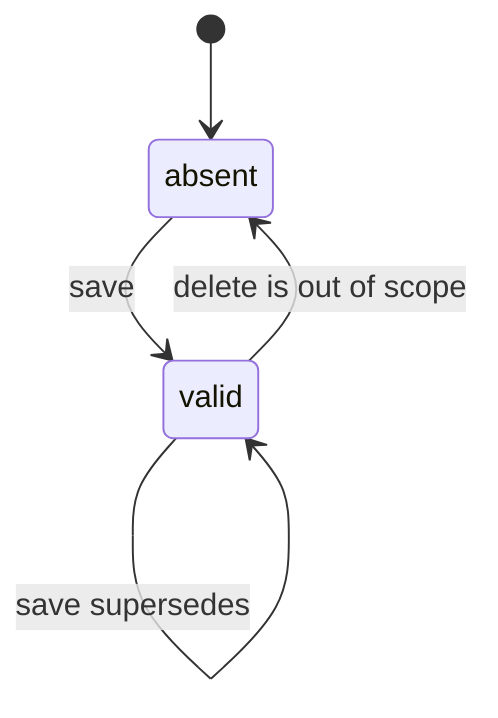
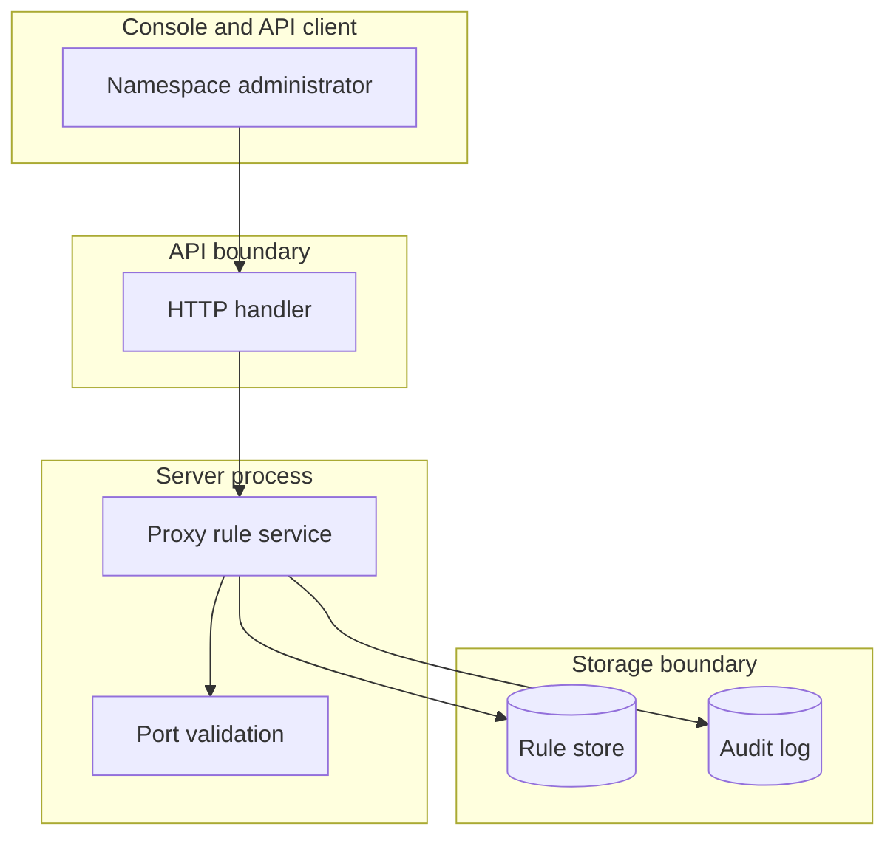

## Context

Namespace and unit proxy rule sets are plain JSON data. The server stores each set, checks each proxy rule, joins the scopes of a unit, and shows a rendered view for debug only.

## Decisions

1. **Join scopes at read time.** Store one document per scope with digest. Join at read time in fixed order: namespace set then unit set. Each joined entry carries scope, operation, host, port, method, and canonical path match. Ids stay unique within each scope. Duplicate ids across scopes stay allowed and show as two entries with scope namespace and scope unit.
2. **Strict validation of each proxy rule.** Reject unknown fields, bad id form, duplicate id within one set, empty or unknown operations list, bad host, bad port, bad method and bad path pattern. Operations list is required and holds one or more of plan, apply, destroy, refresh. Apply the port default of ADR 330 decision 4 when port is absent. Return the proxy rule id and the field in the error. Host is an exact lowercase DNS name: reject uppercase, IP literals, trailing dot, wildcard star, and non ASCII names. Check canonical path only and keep no normalized copy. An empty scope means no proxy rules from that scope. A unit with no set in both scopes has no proxy rules and keeps current behavior.
3. **Concurrency and rendered view.** A save may send an If-Match header with the digest that the writer read. When it is sent and differs from the stored digest, the server refuses the save with 412 and changes nothing. When it is absent, the last write wins. Each save writes a new digest and an audit entry with old and new digest in the same transaction: audit failure fails the save. The rendered view shows stored patterns without template render and without secret values. Templates render when the job starts in a later part.

## Structure

Unexported type `proxyRuleSet` with constructor `newProxyRuleSet` that checks all invariants. Only the constructor makes a value. Stored references use stable namespace ID and unit ID, never the name.

## Risks

- A bad join order changes which proxy rule allows a host.
- A weak host or path check widens access past the intended host.
- A rendered view misleads a reader who expects rendered templates.
- A script that sends no If-Match can overwrite a change silently.

## Layers (defense in depth)

| Layer | Guard | Hostile test |
| --- | --- | --- |
| port adapter | Port checks shape and values: id form, id uniqueness within the set, operations set, host form, port range and default, method set, path pattern form with `*` and `**`, canonical path only. | Send a proxy rule with `..`, non canonical path, upper case host, bad port, duplicate id, and unknown operation directly to the port. Each case fails. |
| service | Service checks authorization actions, fresh authentication, scope join order, the If-Match digest and digest write with old and new digest. | Save a unit set from a principal without `unit:manage-proxy-rules` and without fresh authentication. The save fails closed. Save with a stale digest. The save fails. |
| HTTP handler | Handler checks auth, content type, size limit, and operation query value on the rendered route. Rendered route needs read access on the unit. | Call the rendered route with a bad operation and with no read access. Each call fails with the fixed error. |

## Diagrams

After this change:

New imports of this change (each one allowed by the module rules):

- `internal/api/server` imports `add the new file internal/proxysvc`

States and transitions after this change:

## Quality attributes

| Attribute | Target | Unit | Scope |
| --- | --- | --- | --- |
| validation latency | 300 | ms p95 | PUT namespace and unit proxy-rules |
| read latency | 200 | ms p95 | GET joined and rendered proxy-rules |
| request size | 64 | KB max | PUT proxy-rules document |

## Threat model

Data flow and trust boundaries:

| Boundary | STRIDE | Threat | Layer | Guard | Hostile test |
| --- | --- | --- | --- | --- | --- |
| API boundary | S | Spoofed save of a proxy rule set by a caller without manage proxy rules. | boundary check | Check auth, content type, size limit, operation query value. | Send oversize body and bad operation directly to handler. |
| API boundary | S | Spoofed save of a proxy rule set by a caller without manage proxy rules. | encode or contain | Encode host and path in errors; never include secret values. | Trigger validation error; check response holds no secret. |
| API boundary | S | Spoofed save of a proxy rule set by a caller without manage proxy rules. | limit | Limit document to 64 KB and 200 path patterns. | Send document past size limit and past pattern count. |
| API boundary | S | Spoofed save of a proxy rule set by a caller without manage proxy rules. | authorize at point of use | Check grant and fresh authentication at point of use. | Save without grant and without fresh auth. |
| API boundary | S | Spoofed save of a proxy rule set by a caller without manage proxy rules. | fail closed | Deny on error with fixed error text. | Force store error; call fails closed. |
| API boundary | T | Tampered proxy rule widens allowed hosts past intent. | boundary check | Strict allowlist validation of host, port, method, path, operation. | Send upper case host and non canonical path. |
| API boundary | T | Tampered proxy rule widens allowed hosts past intent. | encode or contain | Encode host and path in errors without secret values. | Trigger validation error; check no secret leaks. |
| API boundary | T | Tampered proxy rule widens allowed hosts past intent. | limit | Limit document size and pattern count. | Send document past size limit. |
| API boundary | T | Tampered proxy rule widens allowed hosts past intent. | authorize at point of use | Check manage proxy rules grant at point of use on save. | Save with read grant only; save fails. |
| API boundary | T | Tampered proxy rule widens allowed hosts past intent. | fail closed | Fail closed on unknown field, bad host, or bad path. | Send unknown field and IP host; each save fails closed. |
| Storage boundary | R | Denied save repudiates change without audit record. | boundary check | Check stored scope exists before read or save. | Read and save a missing namespace; each returns not found. |
| Storage boundary | R | Denied save repudiates change without audit record. | encode or contain | Store scope label with each joined entry; never mix scopes. | Save same id in both scopes; read shows two scoped entries. |
| Storage boundary | R | Denied save repudiates change without audit record. | limit | Bound digest size and audit entry size. | Save large set; digest and audit stay bounded. |
| Storage boundary | R | Denied save repudiates change without audit record. | authorize at point of use | Join in fixed order namespace then unit with scope label. | Save same id in both scopes; read shows two scoped entries. |
| Storage boundary | R | Denied save repudiates change without audit record. | fail closed | Write audit entry with old and new digest on each save. | Save and check audit holds both digests. |

## Contracts

**proxy-rule-set**

- Invariant: One document per scope keyed by stable namespace ID and unit ID.
- Invariant: Each id is unique within one scope document.
- Invariant: Each port defaults per ADR 330 decision 4 when absent.
- Invariant: Each path pattern is canonical and keeps no normalized copy.
- Invariant: A save with an If-Match digest that is not the stored digest changes nothing.
- `Save namespace proxy rule set`: pre: Caller holds namespace:manage-proxy-rules.; Caller passed fresh authentication.; If-Match, when sent, equals the stored digest.. Post: Stored set equals validated input.; Digest changes on each save..
- `Save unit proxy rule set`: pre: Caller holds unit:manage-proxy-rules.; Caller passed fresh authentication.; If-Match, when sent, equals the stored digest.. Post: Stored set equals validated input.; Digest changes on each save..
- `Join scopes for a unit`: pre: Caller holds unit read access.. Post: Result lists namespace entries then unit entries..
- `Rendered debug view`: pre: Caller holds unit read access.. Post: Result holds joined rules for one operation with stored patterns..

## Failure modes

| Step | Failure | Retry | State after |
| --- | --- | --- | --- |
| Save namespace set | Store write fails after validation | Return 503 with retry; stored set stays at old digest. | Old set stays readable. |
| Save unit set | Audit write fails in the same transaction | Fail the save with 503; stored set stays at old digest. | No save without audit record. |
| Save unit set | Concurrent saves to one scope with If-Match | The second save gets 412; read again and send again. | First saved set is current. |
| Read rendered view | Bad operation query on rendered view | Fix the query value and send again. | No state change. |
