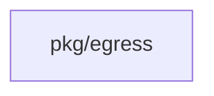
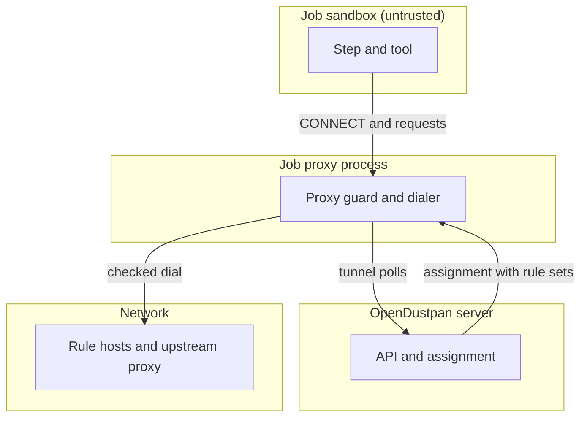

## Context

Untrusted job code runs on runners. The sandbox must have no path around the job proxy. Failure of the proxy must stop the job, not open direct access.

## Decisions

1. **Proxy per claim as only exit.** One proxy process per claim, started by the coordinator before any step starts. Steps get proxy address by environment only, with no direct route. Loss of proxy or failed start fails the phase closed.
2. **Bound dial with outbound guard.** All dials use a bound dialer that resolves, checks each address with pkg/egress, and connects only to a checked address. The check repeats after upstream proxy selection. Tunnel to server host is built in.

## Structure

Unexported proxyServer built only by newProxyServer with bound dialer, egress checker, and tunnel host. No caller can make a dial path that skips the checker because the dialer field is unexported and the constructor rejects a nil checker.

## Risks

- Sandbox escape by direct route left after proxy restart.
- DNS time-of-check to time-of-use gap between resolve and connect.
- Upstream proxy that does not apply its own rules.
- Log line that leaks header, body, query value, or credential.

## Layers (defense in depth)

| Layer | Guard | Hostile test |
| --- | --- | --- |
| placement and network | Coordinator starts proxy as own user outside step sandbox, sets sandbox route to proxy address only, drops other packets including DNS. Start failure stops claim before steps start. | Remove route drop and run job that opens direct TCP to outside host; test fails when connection succeeds. |
| request check | Proxy checks CONNECT host against proxy rules before TLS, refuses non-canonical path, checks SNI and Host header match, resolves tunnel host and checks each address with pkg/egress, dials only checked address. | Send CONNECT to unnamed host, mismatched SNI, non-canonical path, and DNS that resolves to denied address; each gets refusal without outbound connection. |
| fail closed | Proxy loss, upstream failure, or guard denial fails the request closed, writes blocked line to job log, and marks phase failed. No fallback to direct dial exists in step environment. | Kill proxy mid-phase and attempt direct fetch from step; fetch fails and phase ends failed with blocked line present. |

## Diagrams

Modules that the change touches, and their imports on main:

## Quality attributes

| Attribute | Target | Unit | Scope |
| --- | --- | --- | --- |
| availability | 100 | percent of proxy-loss events that fail closed with no direct egress | proxied job phase on a runner |
| latency | 50 | ms p95 added refusal time per refused request | tunnel CONNECT refused by guard on runner |

## Threat model

Data flow and trust boundaries:

| Boundary | STRIDE | Threat | Layer | Guard | Hostile test |
| --- | --- | --- | --- | --- | --- |
| Job sandbox to job proxy | S | Step spoofs another host with mismatched SNI or Host header to bypass a proxy rule. | boundary check | CONNECT host must match a proxy rule; SNI and Host must match CONNECT host; path must be canonical. | Send unnamed host, mismatched SNI, and dot-segment path; each gets refusal with no upstream dial. |
| Job sandbox to job proxy | S | Step spoofs another host with mismatched SNI or Host header to bypass a proxy rule. | encode or contain | Refusals use canonical path form only and strip line breaks before logging. | Send path with CRLF and dot segments; log holds one safe line. |
| Job sandbox to job proxy | S | Step spoofs another host with mismatched SNI or Host header to bypass a proxy rule. | limit | Sandbox route allows only proxy address; other packets including DNS drop. | Attempt direct TCP from step; connection fails. |
| Job sandbox to job proxy | S | Step spoofs another host with mismatched SNI or Host header to bypass a proxy rule. | authorize at point of use | Proxy checks rule allow for request operation before dial. | Send allowed host with refused operation; proxy answers 403. |
| Job sandbox to job proxy | S | Step spoofs another host with mismatched SNI or Host header to bypass a proxy rule. | fail closed | Unknown host, mismatch, or bad path fails closed with 403 and blocked line. | Send hostile CONNECT after removing earlier checks; proxy still refuses. |
| Job proxy to network | T | Attacker tampers DNS to redirect a named host to a denied private address. | boundary check | Proxy resolves tunnel host and rejects non-canonical or empty host before dial. | Request tunnel to empty host; proxy refuses before DNS. |
| Job proxy to network | T | Attacker tampers DNS to redirect a named host to a denied private address. | encode or contain | Bound dial dials only the checked IP with no rebind; IPv4-mapped IPv6 checked as IPv4. | Rebind DNS between check and connect; dial fails closed. |
| Job proxy to network | T | Attacker tampers DNS to redirect a named host to a denied private address. | limit | Upstream proxy carries connection but guard still checks resolved rule host first. | Name upstream proxy and request denied host; proxy refuses before upstream dial. |
| Job proxy to network | T | Attacker tampers DNS to redirect a named host to a denied private address. | authorize at point of use | Private address opens only inside pool allowed ranges; otherwise refused. | Resolve to private address outside pool range; proxy refuses. |
| Job proxy to network | T | Attacker tampers DNS to redirect a named host to a denied private address. | fail closed | Guard denial or upstream failure fails closed with fixed reason and no direct fallback. | Block upstream and attempt fetch; step gets failure and no direct egress. |
| Job proxy to server | I | Step reads server traffic or reaches hosts outside the tunnel rule after proxy loss. | boundary check | Tunnel accepts only server host from assignment; other hosts refused. | Request non-server host through tunnel; proxy refuses. |
| Job proxy to server | I | Step reads server traffic or reaches hosts outside the tunnel rule after proxy loss. | encode or contain | Tunnel payloads are framed launcher polls; raw step traffic cannot use tunnel. | Send raw step request to tunnel port; proxy refuses. |
| Job proxy to server | I | Step reads server traffic or reaches hosts outside the tunnel rule after proxy loss. | limit | Tunnel allows only launcher poll rate and server host; bursts refused. | Flood tunnel with requests; excess gets refusal. |
| Job proxy to server | I | Step reads server traffic or reaches hosts outside the tunnel rule after proxy loss. | authorize at point of use | Tunnel rule allows only server host; launcher keeps its own TLS check of server. | Present wrong server certificate to launcher; launcher refuses. |
| Job proxy to server | I | Step reads server traffic or reaches hosts outside the tunnel rule after proxy loss. | fail closed | Proxy loss fails polls and requests closed; no direct server dial from sandbox. | Kill proxy mid-phase; launcher poll fails and phase ends failed. |

## Failure modes

| Step | Failure | Retry | State after |
| --- | --- | --- | --- |
| Start job proxy for claim | Coordinator cannot bind proxy port or load joined rule sets. | Coordinator reports claim failed; operator fixes pool or rules and starts a new job. No auto retry of the claim. | Claim failed before any step starts; no step output. |
| Serve requests during phase | Proxy process exits or tunnel to server breaks. | In-flight requests fail; launcher poll fails closed; operator reruns the job after proxy recovers. No resume of the phase. | Phase failed; job log holds blocked line for refused requests. |
| Check CONNECT and tunnel dial | Guard denies resolved address or no proxy rule allows host. | No retry inside job; proxy answers 403 and the tool decides whether the phase continues; author widens proxy rule set or pool range and starts a new job. | Request refused with 403 and blocked line in job log; phase result follows tool exit. |
| Dial through pool upstream proxy | Upstream proxy unreachable or refuses connection. | Request fails closed; operator fixes pool upstream proxy and reruns job. No direct fallback. | Request failed; phase ends failed when tool cannot proceed; blocked line present. |
