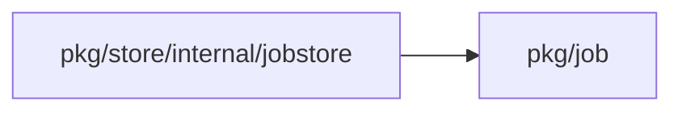
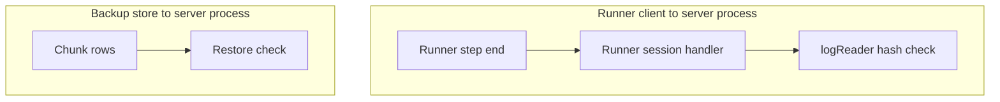

## Context

The logReader in pkg/job and the restore row check in pkg/store/internal/jobstore carry two small defects.

## Decisions

1. **Sticky hash error.** The logReader stores the first hash error and returns it on every later Read and Close.
2. **Row check.** After the shared chunk rule from follow-ups-1431-review-one lands, extend that shared helper to refuse a sha256 that is not 64 lowercase hex characters, and a row whose job or namespace differs from its parent; the error repeats no row content.

## Structure

The unexported logReader keeps one error field that its constructor leaves empty; only its Read method sets it.

## Risks

- A stricter row check refuses a backup that an older server made.
- Reserved plans that nobody fills stay in the database with their key records until a later sweep sets a limit and a retention value.
- The slow step end on a very large log stays; this change does not move hashing out of the request path.

## Diagrams

Modules that the change touches, and their imports on main:

## Quality attributes

| Attribute | Target | Unit | Scope |
| --- | --- | --- | --- |
| none affected | Only error handling and one row check change. |  |  |

## Threat model

Data flow and trust boundaries:

| Boundary | STRIDE | Threat | Layer | Guard | Hostile test |
| --- | --- | --- | --- | --- | --- |
| Runner client to server process | T | Tampering with log chunks to hide step output. | boundary check | Handler checks the runner token and the claim at the boundary. | Send a step end with a forged claim and check it is denied. |
| Runner client to server process | T | Tampering with log chunks to hide step output. | encode or contain | Error text repeats no log content or secret. | Force a hash error and check the answer carries no log bytes. |
| Runner client to server process | T | Tampering with log chunks to hide step output. | limit | Log read keeps the sticky error and does not re-read past the limit. | Force a mismatch then read past the end and check the same error returns. |
| Runner client to server process | T | Tampering with log chunks to hide step output. | authorize at point of use | Step close checks the claim on the job object at the point of use. | Send a valid token for another job and check the close is denied. |
| Runner client to server process | T | Tampering with log chunks to hide step output. | fail closed | On hash or chunk error the step fails closed and keeps the error. | Drop a chunk mid-read and check the step ends as failed, not success. |
| Backup store to server process | T | Tampering with a restored backup to mix jobs or namespaces. | boundary check | Restore checks sha256 format as 64 lowercase hex at the boundary. | Restore a chunk row with a short sha256 and check it is refused. |
| Backup store to server process | T | Tampering with a restored backup to mix jobs or namespaces. | encode or contain | Row check repeats no row content in the error. | Restore a bad row and check the answer carries no job key. |
| Backup store to server process | T | Tampering with a restored backup to mix jobs or namespaces. | limit | Restore aborts the whole restore on the first bad row. | Restore a backup with one bad row among good rows and check nothing is applied. |
| Backup store to server process | T | Tampering with a restored backup to mix jobs or namespaces. | authorize at point of use | Restore checks job and namespace agreement at the point of use. | Restore a row that names a job of another namespace and check it is refused. |
| Backup store to server process | T | Tampering with a restored backup to mix jobs or namespaces. | fail closed | On a bad row the restore fails closed with backup.corrupt. | Restore a backup with a mismatched row and check the answer is backup.corrupt. |

## Contracts

**job**

- Invariant: Each stored chunk row agrees with its job and namespace.
- `CheckChunkRow`: pre: The row carries job, namespace and sha256.. Post: A row with a bad sha256 format or a mismatch is refused..
