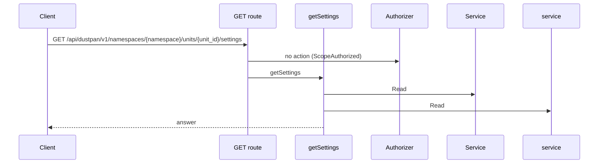
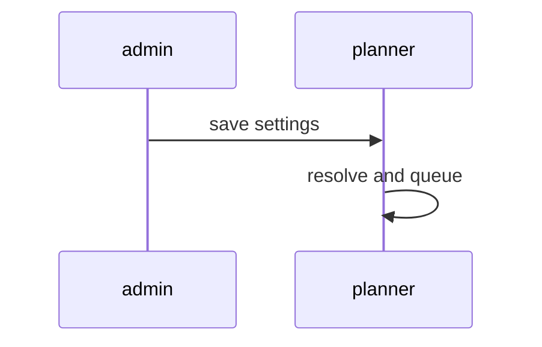
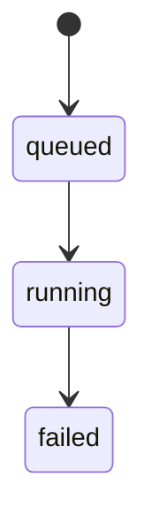
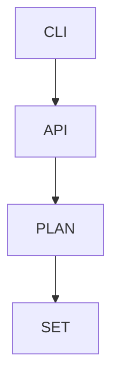

## Context

The planner reads pool, location, profile reference and steps from unit settings with namespace defaults as fallback.

## Decisions

1. **Settings resolution with snapshot.** Order: request override, unit settings, namespace defaults, refusal. Resolved inputs freeze on the job at start.
2. **Trigger saver check at each read.** The output-read handler calls OutputReadCheck.Allow for a job with a trigger, after check 1. Any error denies.
3. **Stable profile reference.** Settings hold the profile stable ID, never its name. A removed profile fails the next start closed.

## Structure

Unexported settingsResolver with a constructor NewSettingsResolver; the planner reads no raw request fields directly.

## Risks

- Pulumi default steps stay undefined; a start with no stored steps is refused.

## Layers (defense in depth)

| Layer | Guard | Hostile test |
| --- | --- | --- |
| handler | Authorization of overrides and saver check at each read. | Pool override without namespace:manage-runners gets 403. |
| service | Settings come from stored data only. | Start with no stored location is refused. |
| port adapter | Saver resolution fails closed. | Deleted saver denies the next read. |

## Diagrams

Today: `GET /api/dustpan/v1/namespaces/{namespace}/units/{unit_id}/settings` on main (from the route table and the handler body, route row internal/api/settings/routes.go:98, handler internal/api/settings/serve.go:30).

After this change:

States and transitions after this change:

## Quality attributes

| Attribute | Target | Unit | Scope |
| --- | --- | --- | --- |
| correctness | deny on the next read | reads | output reads after saver grant change |

## Threat model

Data flow and trust boundaries:

| Boundary | STRIDE | Threat | Layer | Guard | Hostile test |
| --- | --- | --- | --- | --- | --- |
| CLI to server API | E | A forged location runs code with the rights of another unit. | boundary check | Reject oversize and unknown fields. | Oversize location answers 400. |
| CLI to server API | E | A forged location runs code with the rights of another unit. | encode or contain | Resolve profile by stable ID. | Cross-namespace ID answers 422. |
| CLI to server API | E | A forged location runs code with the rights of another unit. | limit | Size limit on settings. | Oversize settings body answers 400. |
| CLI to server API | E | A forged location runs code with the rights of another unit. | authorize at point of use | Check override actions at the route. | Pool override without grant gets 403. |
| CLI to server API | E | A forged location runs code with the rights of another unit. | fail closed | Deny on store error. | Settings store error gives 503 with no job. |

## Contracts

**job**

- Invariant: Resolved inputs freeze at start.
- `Start`: pre: Caller holds unit:run-plan.. Post: Job carries the resolved snapshot..

## Failure modes

| Step | Failure | Retry | State after |
| --- | --- | --- | --- |
| Resolve settings | Store read fails. | Caller retries. | No job; 503. |
