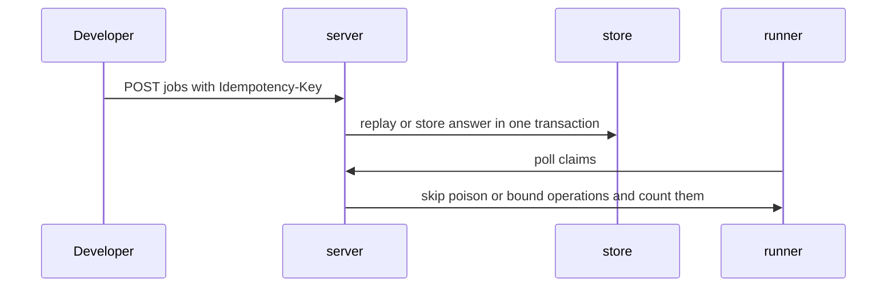
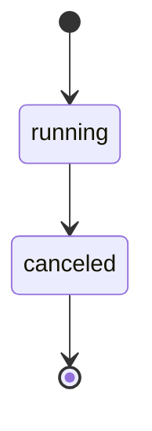

## Context

Job start and job claim carry review comments from prior reviews. The fixes are small corrections in the job service and the claim path, with no new API and no schema change.

## Decisions

1. **Fix the review items in place.** Keep retention in the durable idempotency store so answers survive restart and failover; write the job row and the replay record in one transaction; fix the Route comment in place; check the source; write the refused action with actor, reason, and time; skip a poison operation for that poll and retry it on the next poll with a skip counter and an operator alert threshold; end job and durable record both as canceled; count and log poll-bound skips in poll order and process them on later polls.

## Structure

No new type and no new constructor. The fix stays in the existing unexported sourceOf in pkg/job/service_start.go and the existing unexported bindClaim in pkg/store/internal/jobstore/apply.go, with the Route comment fixed in place.

## Risks

- A 24 hour durable retention stores more replay records.
- Ending both records as canceled changes what automation reads for canceled jobs.

## Diagrams

After this change:



States and transitions after this change:



## Quality attributes

| Attribute | Target | Unit | Scope |
| --- | --- | --- | --- |
| durability | 24 | hours | job-start idempotency answers per principal, route, and key |
| correctness | 100 | percent of polls that continue to the next operation | claim poll with failed job or namespace reads |
| completeness | 100 | percent counted in the poll-bound skip metric | operations skipped by the poll bound of 64 |

## Threat model

Data flow and trust boundaries:

```mermaid
Developer -> server job start route -> job service (sourceOf, denial record, idempotency store) -> claim poll (poison skip, bound count, bindClaim)
```

| Boundary | STRIDE | Threat | Layer | Guard | Hostile test |
| --- | --- | --- | --- | --- | --- |
| server job start route | T | Replay of a job start creates a second job | boundary check | Check Idempotency-Key and request body before a second job starts | Send the same key with a different body and a replay after expiry; second job must not start on conflict |
| server job start route | S | Key reuse across principals or routes replays the wrong answer | boundary check | Key the stored answer by principal, route, and key; refuse keys over 128 chars | Send one key from two principals, on two routes, and with 256 chars; each principal and route must stay distinct and the long key must fail |

## Failure modes

| Step | Failure | Retry | State after |
| --- | --- | --- | --- |
| Job start with Idempotency-Key | Store write fails before the answer is stored | Caller retries with the same key; the one transaction wrote neither the job row nor the replay record, so the server starts one new job | One new job; no duplicate job from the lost attempt |
| Claim poll over pending operations | Read of one job or its namespace fails during a claim poll | Poll skips that operation for that poll, counts it in job_claim_poison_skips_total, and the next poll reads it again with backoff | Skipped operation stays pending; poll continues with the next operation; 10 skips of one operation raise an operator alert |
| Cancel of a running job | Cancel arrives after a change began | No retry; job and durable record both move to canceled once in one transaction | Job canceled and durable record canceled agree |
