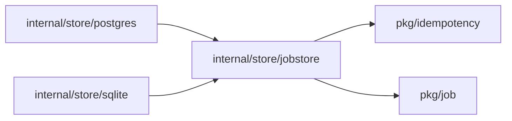

## Context

The key of a job start lives in the `idempotency_key` column of its job row. The job store (`internal/store/jobstore`) looks it up in func sameKey and returns the stored job with no time check. The generic idempotency store of `pkg/idempotency` and its `RecordTTL` do not serve the job start. Decision 6 of ADR 210 keeps a key for 24 hours from the first request. This change puts the 24-hour check where the key lives.

## Decisions

1. **Fixed retention.** The retention of a job-start key is 24 hours. The NEW Retention type of `pkg/idempotency` holds it.
2. **Expiry derived on read.** No expiry is stored. In func sameKey, the job store reads the time of the database (`tx.Now`) and asks the Retention whether the job that the key names is expired: expired when `now` minus the field CreatedAt of the stored `job.Job` is more than the Retention. A job of exactly the Retention age still answers the replay, as the generic store does (`age > RecordTTL`). The creation time of the job row is the one source of truth, and both times come from the clock of the database.
3. **The new job takes the key.** The unique index `jobs_key` on `(namespace_id, idempotency_key)` stays. When the key names an expired job, func sameKey clears the key of that job (a copy with an empty `IdempotencyKey`, version plus one, update time from func nextUpdateAt) through the existing func update, in the same transaction, before func createIn inserts the new row. The same transaction writes one audit entry with the action `job:key-expired` (the constant `KeyExpiredAction`). The entry names the old job and says that its key expired. The store writes this entry itself on each clear: a clear that has no audit entry to write fails, and the start fails with it. So no key is cleared with no record. If a later step of the start fails (a freeze, the limits, a busy unit), the transaction rolls back, and the old job keeps its key and no `job:key-expired` entry stays.
4. **Clear only, never set.** The `UpdateJob` query of each dialect sets `idempotency_key = CASE WHEN sqlc.arg(idempotency_key) = '' THEN '' ELSE idempotency_key END`. An update can clear the key, and no update can set or change one. The `UpdateJob` query stays the only query that updates the `jobs` table, so func TestJobRowIsWrittenOnlyByUpdateJobRow stays as it is. func updateJobRow passes `Row.Key` in both dialects. Each other write path reads the job and writes its key back unchanged.
5. **A lost race.** When the clear finds a newer version of the old row (func update returns `job.ErrConflict`), func sameKey returns `ErrKeyIndex`. func Create then runs one more attempt (`createAttempts`), and that attempt finds the new job by the key and answers the replay.
6. **The same rules after the expiry.** A key of an expired job is a new key. The new start does not compare the request with the old job, so another body after 24 hours starts a job and gives no 422.

## Contract

NEW: `pkg/idempotency/retention.go`:

- `type Retention struct { d time.Duration }`, with an unexported field.
- `MinRetention = RecordTTL` (24 hours).
- `func NewRetention(d time.Duration) (Retention, error)` refuses `d < MinRetention` with `ErrInvalid`.
- NEW `func JobStartRetention() Retention` returns the 24 hours, through func NewRetention.
- `func (r Retention) Expired(created, now time.Time) (bool, error)` returns `ErrInvalid` for the zero value `Retention{}`. So a store built with the zero value refuses each start whose key names a job, and never skips the check. A test calls func Expired on `Retention{}`.

`jobstore.New(run Runner, keep idempotency.Retention) *Store` keeps the Retention. `internal/store/postgres/jobs.go` and `internal/store/sqlite/jobs.go` pass the NEW `idempotency.JobStartRetention()`. No setting changes it.

The port doc of `job.Store.Create` in `pkg/job/job.go` says that a key names its job for 24 hours from the creation of the job.

## Risks

- A job row keeps its key after the Retention, until a new start takes it. The key is not in any API answer.
- The clear moves the version and the update time of the old job. A client that holds the old ETag of that job gets 412 on its next conditional write, and reads the job again.

## Diagrams

Modules that the change touches, and their imports:

## Quality attributes

| Attribute | Target | Unit | Scope |
| --- | --- | --- | --- |
| retention of a job-start idempotency key | 24 | hours | job store of one installation |

## Failure modes

| Step | Failure | Retry | State after |
| --- | --- | --- | --- |
| Clear the key of an expired job | The update fails. | The agent retries with the same key. | The transaction rolls back: the old job keeps its key and no new job exists. |
| Clear the key of an expired job | A second retry cleared it first. | func Create runs one more attempt. | One new job holds the key, and the second retry gets its answer. |
| Insert the new job | The insert fails. | The agent retries with the same key. | The transaction rolls back: the old job keeps its key. |
| Read after a failover | The new primary has the job row. | The agent retries with the same key. | The server answers the stored job when it is younger than the Retention. |
