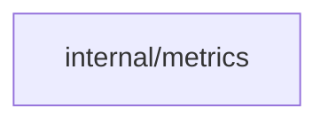

## Context

A start that fails again and again is skipped. The skip must be counted and then raise an alert at a threshold of 10.

## Decisions

1. **Counter.** One counter for skipped poison starts, named with the metric name check of internal/metrics. The name is provisional.
2. **Alert.** The alert fires once when the count reaches 10 and writes a record of what did it and why.

## Structure

A NEW unexported type holds the count and the threshold. Only its constructor makes a value. The constructor refuses a threshold below 1.

## Risks

- A restart resets the counter, so the alert can fire again after a restart.

## Diagrams

Modules that the change touches, and their imports on main:

## Quality attributes

| Attribute | Target | Unit | Scope |
| --- | --- | --- | --- |
| Counter overhead | 1 | atomic add per skip | each skipped job start |

## Failure modes

| Step | Failure | Retry | State after |
| --- | --- | --- | --- |
| Send the alert | The destination does not answer. | The sink retries as it does for other notifications. | The counter stays raised and a record is written. |
