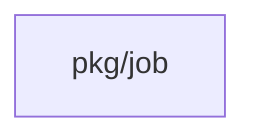
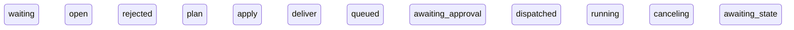

## Context

Job SQL stores map storage failures to domain errors. Two leaks remain: a store-internal missing-unit constant reachable from the Apply path and a wrapped driver error in the index mapper.

## Decisions

1. **Map store failures to job sentinels only.** Wrap jobstore.ErrUnitNotInInventory in job.ErrUnitGone at the shared Apply boundary in pkg/store/internal/jobstore/apply.go:17 for both the pre-check miss and a concurrent insert conflict on the missing inventory row, and document the case on the port in pkg/job/store.go. Change the default branch of jobIndexError in both SQL adapters to format the driver value with %v while keeping its text in the message.

## Structure

No new unexported type; the fix is a narrower error mapping at the existing Apply boundary plus existing sentinels.

## Risks

- The 16-way create case must stay stable on SQLite and PostgreSQL.

## Diagrams

Modules that the change touches, and their imports on main:

States on main in the touched packages:

## Quality attributes

| Attribute | Target | Unit | Scope |
| --- | --- | --- | --- |
| none affected | Error mapping and one conformance case only; no latency, storage, or rate change. |  |  |

## Contracts

**job**

- Invariant: Apply on a unit that is gone fails with job.ErrUnitGone and stores no job.
- Invariant: A unit removed and made again with the same tool name is a new stable ID, so Apply for the new ID succeeds.
- `Apply`: pre: Caller holds a fence for the namespace of the unit.. Post: If the unit row is missing at the pre-check or at the insert, the result wraps job.ErrUnitGone.; On a seq collision the store retries inside the boundary and returns one stored job with a unique seq..
