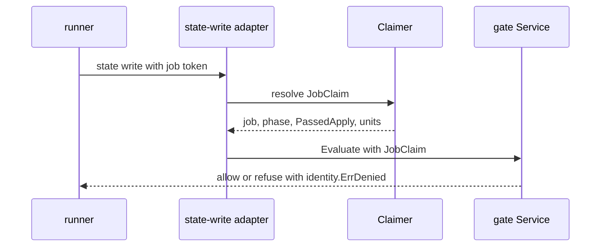
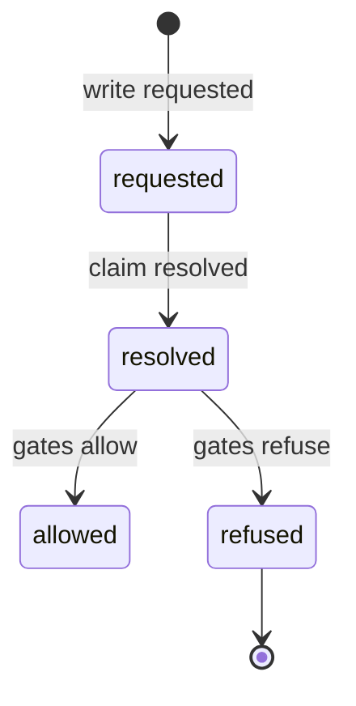
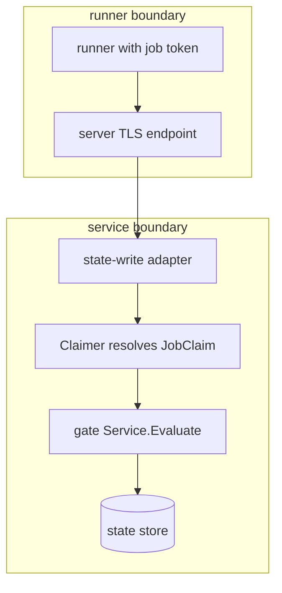

## Context

State-write adapters pass no job claim, so the gate service cannot apply the job-token rule. The existing job.Claimer wired by dustpan.WithJobClaimer builds job, phase, PassedApply, and units from the verified job token once per write request, and each state.write call passes the result to Evaluate on the Pulumi and TFE-compatible paths including unlocked-write. Deny gates and manual locks are checked before the plan-lock exception allows a lock write.

## Decisions

1. **Resolve JobClaim at the boundary and evaluate with it.** Reuse the existing job.Claimer as the single source, resolve the JobClaim fresh at the adapter boundary for each write request, and pass it into Evaluate at each state.write call.

## Structure

Unexported field claim of type job.JobClaim inside unexported adapter gate.jobWriteGuard built only by constructor newJobWriteGuard(claimer job.Claimer); call sites cannot write a JobClaim literal.

## Risks

- A job token with no resolvable job fails closed and its write is refused until the claim source resolves; a later write after the phase passes change.apply is evaluated again with a fresh claim.

## Layers (defense in depth)

| Layer | Guard | Hostile test |
| --- | --- | --- |
| port adapter | Adapter accepts only a JobClaim built by the reused server Claimer from a verified job token, resolved fresh for each write request. | Send a state write with a forged job ID and phase and show the write fails closed with identity.ErrDenied. |
| service | Service refuses any write other than the lock or lease of the plan when PassedApply is false or the unit is outside the units of the job. | Remove the adapter check and show the service still refuses out-of-phase and cross-unit writes. |
| HTTP handler | Handler declares state.write authorization and returns the denial. | Call each tool write route with an out-of-phase job token and check the same refusal. |

## Diagrams

After this change:

States and transitions after this change:

## Quality attributes

| Attribute | Target | Unit | Scope |
| --- | --- | --- | --- |
| correctness | 100 | percent refused when out-of-phase, cross-unit, or unresolvable | each state.write call with a job token |
| freshness | 1 | claim resolutions per write request | each state.write call with a job token |

## Threat model

Data flow and trust boundaries:

| Boundary | STRIDE | Threat | Layer | Guard | Hostile test |
| --- | --- | --- | --- | --- | --- |
| runner boundary | S | A forged or replayed job token writes state outside its phase or unit. | boundary check | Accept only a server-issued job token and resolve the claim fresh per request. | Replay a forged or expired job token and check refusal with identity.ErrDenied. |
| runner boundary | S | A forged or replayed job token writes state outside its phase or unit. | encode or contain | Use only the Claimer output, never client-supplied job or phase fields. | Send client fields naming another job and check the server ignores them. |
| runner boundary | S | A forged or replayed job token writes state outside its phase or unit. | authorize at point of use | Authorize the target unit against the units of the resolved job. | Send an in-phase token for another unit and check refusal. |
| runner boundary | S | A forged or replayed job token writes state outside its phase or unit. | limit | Plan phase writes only its plan lock or lease. | Send a plan-phase token with a state body and check refusal. |
| runner boundary | S | A forged or replayed job token writes state outside its phase or unit. | fail closed | Refuse with identity.ErrDenied when the claim does not resolve. | Delete the job before the write and check refusal with no state change. |
| service boundary | T | A caller tampers with job, phase, or PassedApply to pass evaluation. | boundary check | Accept only a verified job token with a resolvable job and phase. | Send a token with no phase claim and check refusal before evaluation. |
| service boundary | T | A caller tampers with job, phase, or PassedApply to pass evaluation. | encode or contain | Claimer output only, never client-supplied fields. | Send client fields naming another job and check the server ignores them. |
| service boundary | T | A caller tampers with job, phase, or PassedApply to pass evaluation. | limit | Limit the effect to the plan lock or lease when PassedApply is false. | Send a plan-phase unlocked-write and check refusal. |
| service boundary | T | A caller tampers with job, phase, or PassedApply to pass evaluation. | authorize at point of use | Authorize each write with PassedApply and unit membership. | Flip PassedApply in transit and check the service still refuses. |
| service boundary | T | A caller tampers with job, phase, or PassedApply to pass evaluation. | fail closed | Fail closed on claimer error, cancelled job, or missing phase. | Break the claim lookup and check refusal with identity.ErrDenied. |

## Contracts

**gate**

- Invariant: Each state.write call with a job token evaluates with a JobClaim resolved fresh for that call.
- Invariant: A phase that did not pass change.apply writes only the lock or lease of its plan.
- Invariant: An unresolvable job claim fails closed with identity.ErrDenied.
- `GuardStateWrite`: pre: Caller credential and target unit are known.; JobClaim is resolved fresh for the call when the caller holds a job token.. Post: GuardStateWrite evaluated with the JobClaim of the token when the caller holds a job token.; GuardStateWrite refused out-of-phase, cross-unit, or unresolvable writes with identity.ErrDenied..
- `Evaluate`: pre: Compiled policy set and fact document are present.; JobClaim is present for a job-token caller.. Post: Answer reflects job, phase, PassedApply, and units of the token..

## Failure modes

| Step | Failure | Retry | State after |
| --- | --- | --- | --- |
| Resolve JobClaim from verified job token | Claimer cannot resolve job, phase, or units | No retry of the write; a later write after the phase passes change.apply is evaluated again with a fresh claim | Write refused with identity.ErrDenied; job record unchanged; refusal written to the request log and the audit entry |
| GuardStateWrite with JobClaim at state.write | Job cancelled or deleted before the write | No retry; a new job starts a new phase and its token makes a new write | Write refused with identity.ErrDenied; job record unchanged; refusal written to the request log and the audit entry |
| GuardStateWrite out-of-phase write | Plan-phase token writes state body instead of plan lock or lease | No retry of the body write; plan phase writes its own lock or lease again | Body write refused; plan lock or lease unchanged; refusal written to the request log and the audit entry |
