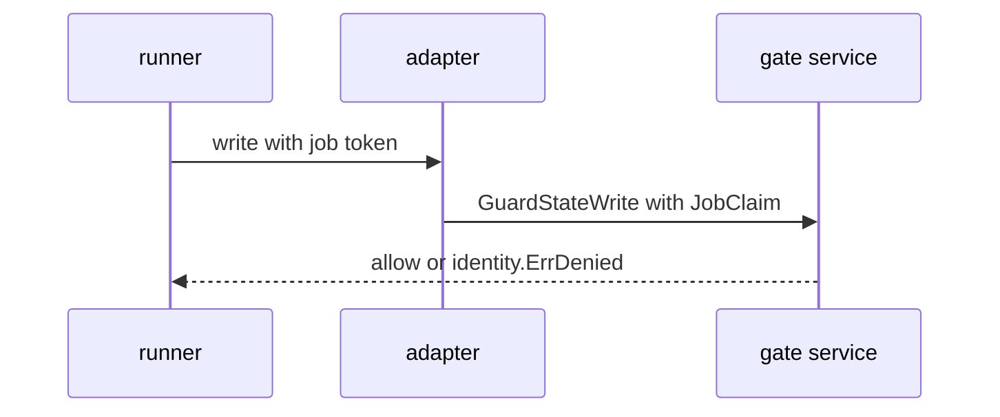
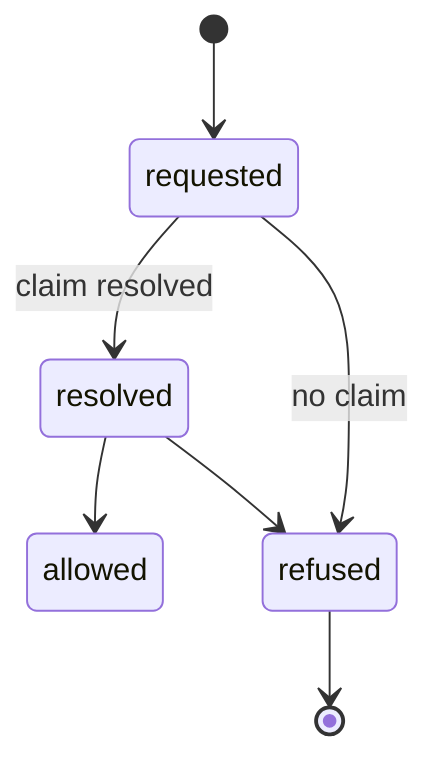
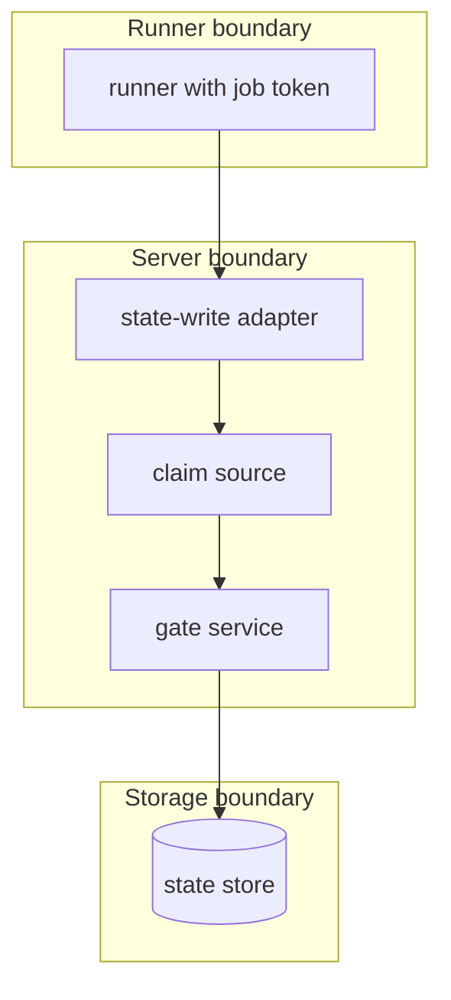

## Context

The state-write adapters pass no job claim, so the gate service cannot apply the job-token rule. A new source builds the claim from the verified job token for each write.

## Decisions

1. **Resolve JobClaim at the adapter boundary.** A new unexported resolver builds the JobClaim fresh for each write request from the verified job token and passes it to Evaluate.

## Structure

Unexported type jobClaimSource in the new file internal/api/stategate/jobclaim.go, made only by newJobClaimSource; call sites cannot write a JobClaim literal.

## Risks

- A job token with no resolvable job fails closed until the job record resolves.

## Layers (defense in depth)

| Layer | Guard | Hostile test |
| --- | --- | --- |
| port adapter | The adapter accepts only a JobClaim built by the resolver from a verified job token. | Send a write with a forged job ID and phase; it fails with identity.ErrDenied. |
| service | The service refuses any write except the plan lock or lease when PassedApply is false or the unit is outside the job. | Skip the adapter check; the service still refuses out-of-phase and cross-unit writes. |
| HTTP handler | The handler declares the state.write action and returns the denial. | Call each tool write route with an out-of-phase job token; the refusal is the same. |

## Diagrams

After this change:

States and transitions after this change:

## Quality attributes

| Attribute | Target | Unit | Scope |
| --- | --- | --- | --- |
| correctness | 100 | percent refused when out of phase, cross-unit or unresolvable | each state.write call with a job token |

## Threat model

Data flow and trust boundaries:

| Boundary | STRIDE | Threat | Layer | Guard | Hostile test |
| --- | --- | --- | --- | --- | --- |
| runner boundary | E | A job token writes state outside its phase or unit. | boundary check | Accept only a server-issued job token. | Send a forged token; it is refused. |
| runner boundary | E | A job token writes state outside its phase or unit. | encode or contain | Use only the claim source output. | Send client fields naming another job; they are ignored. |
| runner boundary | E | A job token writes state outside its phase or unit. | limit | A plan phase writes only its lock or lease. | Send a plan-phase body write; it is refused. |
| runner boundary | E | A job token writes state outside its phase or unit. | authorize at point of use | Check the unit against the units of the job. | Write another unit; it is refused. |
| runner boundary | E | A job token writes state outside its phase or unit. | fail closed | Refuse when the claim does not resolve. | Delete the job first; the write is refused. |

## Contracts

**gate**

- Invariant: Each job-token write evaluates with a freshly resolved JobClaim.
- Invariant: A phase that did not pass change.apply writes only the lock or lease of its plan.
- `GuardStateWrite`: pre: The caller and the unit are known.. Post: The write is evaluated with the claim or refused with identity.ErrDenied..

## Failure modes

| Step | Failure | Retry | State after |
| --- | --- | --- | --- |
| Resolve the claim | The job, phase or units do not resolve | The server does not retry; a later write resolves again | Write refused; job record unchanged |
