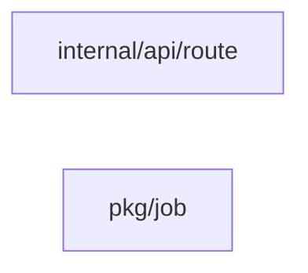

## Context

The jobs POST start route declares fewer actions than the service checks. Users cannot see every permission the platform applies.

## Decisions

1. **Declare the union with per-kind operation text.** Declare the union {unit:run-plan, unit:run-apply} on the static jobs POST start route row in internal/api/route. Write the operation text as: plan start needs unit:run-plan; apply start needs unit:run-apply; a caller needs only the action of its own start. This wording stops the union reading as needs-both.
2. **Enumerate every kind with no runtime wiring.** Add one NEW consistency test that enumerates every ExecutorKind value in pkg/job/job.go, calls startActionFor and startAction in pkg/job/actions.go for each kind, and fails when the union of returned actions differs from the declared union. Enumeration uses the existing kind set, not a hard-coded list, so a new kind fails without an update. Build after the route-guard part of small-hardening and test against the new route.Enforce path. No runtime wiring: no new import from the route layer to pkg/job; the test alone links them.

## Structure

No new unexported type. The single source of the checked set is the existing startActionFor mapping in pkg/job/actions.go; the NEW consistency test compares the static declared union against it.

## Risks

- A future executor kind adds a start action without updating the declaration.

## Diagrams

Modules that the change touches, and their imports on main:

## Quality attributes

| Attribute | Target | Unit | Scope |
| --- | --- | --- | --- |
| none affected | Declaration-only fix with one consistency test |  |  |

## Contracts

**job**

- Invariant: A plan start checks unit:run-plan on the unit.
- Invariant: An apply start checks unit:run-apply on the unit.
- `startActionFor`: pre: Executor kind and operation are known.. Post: Result names unit:run-plan for a plan start and unit:run-apply for an apply start..
