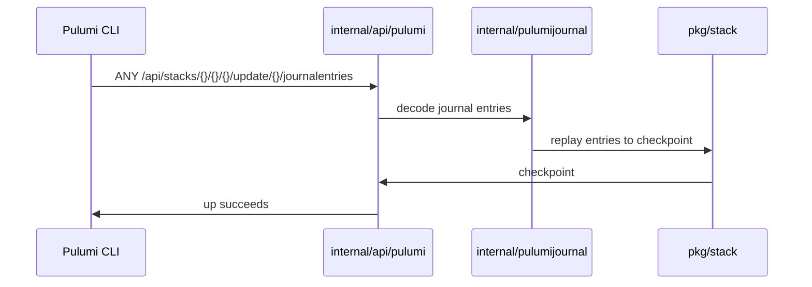
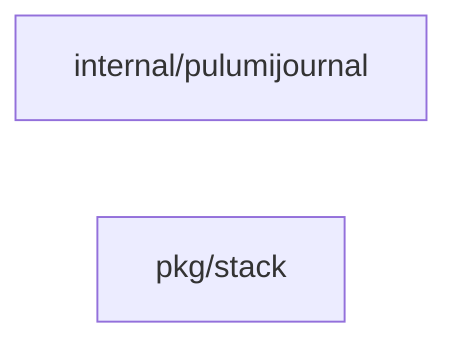

## Context

A journaled up of the issue program prints success but stores a snapshot mismatch error event after the summary. The same up with journaling off stores no such event. The suspect area is internal/pulumijournal and pkg/stack, but the cause is not proven.

## Decisions

1. **Investigate first, then fix by outcome.** Run the pinned Pulumi CLI with journaling on and off, compare the stored checkpoint with the journal entries, and name the first differing field. Fix the replay for that field only when the replay differs from the engine snapshot. Record the CLI cause and make no server change when the replay matches.

## Structure

No new type. The decoder and replayer split between internal/pulumijournal and pkg/stack stays. A failing replay test takes the place of a structure, because the journal entry shape is an external contract.

## Risks

- A replay fix changes built checkpoints of other programs with secret outputs.
- Secret values stay sealed in stored state and out of logs and stored events.

## Diagrams

After this change:

Modules that the change touches, and their imports on main:

## Quality attributes

| Attribute | Target | Unit | Scope |
| --- | --- | --- | --- |
| none affected | Bug fix keeps journal and update latency with no new limit |  |  |

## Contracts

**stack**

- Invariant: A journaled update stores the same checkpoint as a non-journaled update of the same program.
