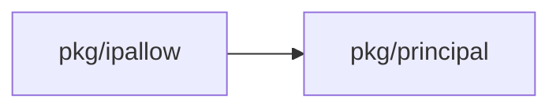
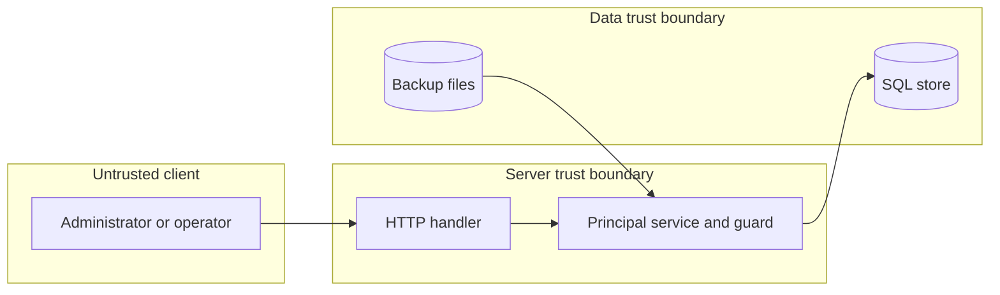

## Context

The guard must make the loss of the last working path impossible under concurrent writes. The setup must make an install with fewer than two accounts impossible to finish.

## Decisions

1. **One count function.** One function in pkg/principal counts working accounts with the four properties and the passkey or hardware key. The guard, the setup and the restore check call it. It reads the final rows of the transaction.
2. **Two rules by change kind.** Disable, delete and sweep use the rule that one enabled account must stay. Every other lowering change uses the floor of two. A change that does not lower the count, or raises it, is never refused (Owner decision, 13 Nov 2026 (queue P19)).
3. **Row lock and busy answer.** The guard locks the break-glass rows in one fixed order, the same for restore and setup finish. A lock timeout, setting breakGlassLockSeconds with default 5 shown in the settings resource, returns break-glass.busy as 409 and writes nothing. A sign-in takes no guard lock.
4. **Restore check and swap.** The restore counts the staged data per scope before the swap. The swap then takes the same locks and counts again on the staged rows in its own transaction. If the count fails there, or the swap fails half way, the transaction rolls back and the live data stays. The restore of access tables follows the setting of the other change and never skips this count.
5. **Atomic rotation.** Rotation inserts the new credential and ends the old one in one transaction. A failed insert rolls back. A second parallel rotation of the same account waits for the lock and then sees the new credential. An id that is not a break-glass account gives 404.
6. **Fresh authentication.** Rotation, add and each guarded change need a fresh authentication in the one window.
7. **Disable side effects.** Each disable writes an audit entry and notifies the other administrators. Re-enable runs the same checks as an add. Disable works in maintenance mode.

## Structure

An unexported type breakGlassSet in pkg/principal. Only its constructor loads the locked rows. Its methods requireNotLast and requireFloor return the sentinels ErrLastBreakGlass and ErrBreakGlassFloor. Each covered write takes the set from the transaction, so no write path skips the count.

## Risks

- Two parallel disables read the same count. The row lock removes the race.
- A restore of an old backup drops accounts. The restore check runs before the swap and again in the swap transaction.
- A deadlock with restore or setup finish. One lock order removes it.
- Other e2e steps fail at first setup. The shared fixture makes two accounts.
- An account expires by time and the count falls with no write. The list route computes the count at read time.

## Layers (defense in depth)

| Layer | Guard | Hostile test |
| --- | --- | --- |
| service | The service builds the set in the write transaction and returns the sentinel by change kind. | Disable the last two accounts in parallel. One request fails with 409. |
| store adapter | The store checks the count and the fence in the same SQL transaction with row locks. | Call the store directly to delete the last enabled account. The store refuses. |
| HTTP handler | The handler declares the action, requires a fresh authentication and maps each sentinel to 409. | Send a disable with a stale fresh step. The handler answers 403 before the service runs. |

## Diagrams

Modules that the change touches, and their imports on main:

States on main in the touched packages:

## Quality attributes

| Attribute | Target | Unit | Scope |
| --- | --- | --- | --- |
| Guard latency | 200 | milliseconds, 99th percentile added to a guarded write | each guarded change on one installation with up to 50 break-glass accounts |
| Lock wait | 5 | seconds, default of breakGlassLockSeconds | each guarded write and the restore swap |
| Count accuracy | 0 | commits that leave fewer than the required working paths | every covered write under parallel load in the conformance suite |

## Threat model

Data flow and trust boundaries:

| Boundary | STRIDE | Threat | Layer | Guard | Hostile test |
| --- | --- | --- | --- | --- | --- |
| Client to server | E | A caller without a fresh authentication rotates or adds a break-glass credential, or takes over the recovery account. | boundary check | The handler validates the id and the body, and rejects anything that is not a break-glass account. | Send a rotate request with a malformed id and with a non-break-glass id. Both get 404 or 400. |
| Client to server | E | A caller without a fresh authentication rotates or adds a break-glass credential, or takes over the recovery account. | authorize at point of use | The service checks the action on @server and the fresh authentication for the object. | Call the service directly with a stale fresh step. It refuses. |
| Client to server | E | A caller without a fresh authentication rotates or adds a break-glass credential, or takes over the recovery account. | fail closed | An unknown error or a missing fresh step denies and writes an audit entry. | Break the fresh-step lookup. The call is denied and the audit log records it. |
| Server to data | D | A disable, delete, sweep, revoke or restore removes the last working path and locks every administrator out. | limit | The guard counts working paths in the write transaction with row locks and refuses below the rule of the change kind. | Disable the last two accounts in parallel. One request fails with 409. |
| Server to data | D | A disable, delete, sweep, revoke or restore removes the last working path and locks every administrator out. | fail closed | A lock timeout writes nothing and answers break-glass.busy. | Hold the lock past the timeout. The second write is refused and stores no change. |
| Server to data | D | A disable, delete, sweep, revoke or restore removes the last working path and locks every administrator out. | authorize at point of use | The store checks the count again in the swap transaction of a restore. | Restore a backup with one account. The restore is refused before the swap. |
| Backup files to server | T | A restored backup brings fewer break-glass accounts, or accounts that a policy blocks. | boundary check | The restore counts staged rows per scope before it runs the swap. | Restore a backup whose accounts are all expired. The restore is refused. |
| Backup files to server | T | A restored backup brings fewer break-glass accounts, or accounts that a policy blocks. | fail closed | A failed swap rolls back and the live data stays. | Fail the swap half way. The live count is unchanged. |
| Client to server | R | A refused or accepted guarded change leaves no record of who did it. | fail closed | Each refusal, disable and sweep action writes an audit entry in the same transaction. | Refuse a disable and read the audit log. The entry names the actor and the live count. |

## Failure modes

| Step | Failure | Retry | State after |
| --- | --- | --- | --- |
| Take the row locks on the break-glass set | The lock wait passes breakGlassLockSeconds. | The caller retries the same request. The request is safe to repeat. | No change is written and the live data is the same. |
| Rotate: insert the new credential and end the old one | The insert fails or the process stops before commit. | The caller sends the rotation again. | The transaction rolls back and the old credential stays active. |
| Restore swap with a second count | The count is below two, or the swap fails half way. | The operator restores a backup with at least two working accounts. | The transaction rolls back and the live data stays. |
| First setup finish | Two finishes run together or the process stops during finish. | The administrator calls finish again after the add routes give two accounts. | Setup stays unfinished until the count is two. No half-finished setup exists. |
