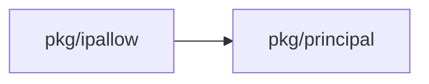
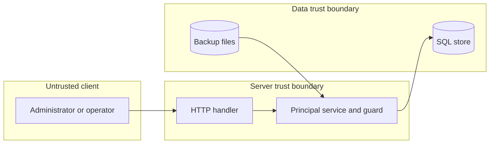

## Context

The guard must make the loss of the last working path impossible under concurrent writes. The first-setup gate is not part of this change: no setup-finish flow exists on main, and the change keep-two-break-glass-at-setup owns it.

## Decisions

1. **One count function.** One function in pkg/principal counts working accounts with the four properties and the passkey or hardware key. The guard and the restore check call it. It reads the final rows of the transaction.
2. **Two rules by change kind.** Disable, delete and sweep use the rule that one enabled account must stay. Every other lowering change uses the floor of two. A change that does not lower the count, or raises it, is never refused (Owner decision, 13 Nov 2026 (queue P19)).
3. **Row lock and busy answer.** The guard locks the break-glass rows in one fixed order, the same for restore. A lock timeout returns break-glass.busy as 409 and writes nothing. A sign-in takes no guard lock. The timeout is the installation setting breakGlassLockSeconds (whole seconds, default 5), declared in NEW file pkg/principal/breakglass_setting.go like `pkg/session/breakglass.go`. internal/cli/settings_api.go joins it into the declarations, and the settings resource in internal/api/server/settings.go shows its effective value and its source.
4. **Restore check and swap.** The restore counts the staged data per scope before the swap. The swap then takes the same locks and counts again on the staged rows in its own transaction. If the count fails there, or the swap fails half way, the transaction rolls back and the live data stays. The restore of access tables follows the setting of the other change and never skips this count.
5. **Atomic rotation.** Rotation is one transaction, in one new port method of the passkey port, not a call of AddPasskey and then RemovePasskey (internal/mfasvc/service.go:553 RemovePasskey is its own transaction, and a process stop between the two calls leaves the account with the old or both credentials but never an ended old one before a new one). The method is `RotatePasskey(ctx, personID, oldID string, next Passkey, e audit.Entry) error` on PasskeyStore in pkg/mfa/mfa.go. It locks the row of the person, inserts the new passkey, ends the old one and appends e in one transaction. The adapters are internal/store/sqlite/passkeys.go and internal/store/postgres/passkeys.go. The service method RotatePasskey in internal/mfasvc/service.go calls it. A failed insert rolls back and the old credential stays. A second parallel rotation of the same account waits for the row lock and then sees the new credential. An id that is not a break-glass account gives 404. The conformance cases of the method (pkg/mfa/mfatest/passkeys.go) are written before any adapter implements it.
6. **Fresh authentication.** Rotation, add and each guarded change need a fresh authentication in the one window.
7. **Disable side effects.** Each disable writes an audit entry and notifies the other administrators. Re-enable runs the same checks as an add. Disable works in maintenance mode.

## Actions and error codes

No new action exists. A break-glass account is a principal, so the routes reuse the actions of principals, each on the object @server (ServerObject): `server:read-principals` for the list route, and `server:manage-principals` for add, rotate, disable, re-enable and every guarded change. The action list and the role table do not change. A new action would add authorization surface and role edits for no gain, because the holders of manage-principals already manage these accounts. The fresh authentication step and the floor guard still apply to each write route.

The codes break-glass.floor, break-glass.last-enabled, break-glass.busy, break-glass.restore-refused and break-glass.not-found are new in internal/errcode/catalog_breakglass.go, with their lines in internal/errcode/testdata/catalog/break-glass.txt. The adapter maps break-glass.not-found to 404 and the other four to 409.

The RotatePasskey transaction body is one function in internal/store/passkeystore/passkeystore.go, next to RemovePasskey. internal/store/sqlite/passkeys.go and internal/store/postgres/passkeys.go call it, so the two adapters share one body.

## Structure

An unexported type breakGlassSet in pkg/principal. Only its constructor loads the locked rows. Its methods requireNotLast and requireFloor return the sentinels ErrLastBreakGlass and ErrBreakGlassFloor. Each covered write takes the set from the transaction, so no write path skips the count.

## Risks

- Two parallel disables read the same count. The row lock removes the race.
- A restore of an old backup drops accounts. The restore check runs before the swap and again in the swap transaction.
- A deadlock with the restore swap. One lock order removes it.
- An account expires by time and the count falls with no write. The list route computes the count at read time.

## Layers (defense in depth)

| Layer | Guard | Hostile test |
| --- | --- | --- |
| service | The service builds the set in the write transaction and returns the sentinel by change kind. | Disable the last two accounts in parallel. One request fails with 409. |
| store adapter | The store checks the count and the fence in the same SQL transaction with row locks. | Call the store directly to delete the last enabled account. The store refuses. |
| HTTP handler | The handler declares server:read-principals (list) or server:manage-principals (write) on ServerObject, requires a fresh authentication and maps each sentinel to 409. | Send a disable with a stale fresh step to the break-glass route. The handler answers 403 before the service runs. The fresh step lives in the HTTP layer, so the test is in internal/api/server. |

## Diagrams

Modules that the change touches, and their imports on main:

States on main in the touched packages:

## Quality attributes

| Attribute | Target | Unit | Scope |
| --- | --- | --- | --- |
| Guard latency | 200 | milliseconds, 99th percentile added to a guarded write | each guarded change on one installation with up to 50 break-glass accounts |
| Lock wait | 5 | seconds, default of breakGlassLockSeconds | each guarded write and the restore swap |
| Count accuracy | 0 | commits that leave fewer than the required working paths | every covered write under parallel load in the conformance suite |

## Threat model

Data flow and trust boundaries:

| Boundary | STRIDE | Threat | Layer | Guard | Hostile test |
| --- | --- | --- | --- | --- | --- |
| Client to server | E | A caller without a fresh authentication rotates or adds a break-glass credential, or takes over the recovery account. | boundary check | The handler validates the id and the body, and rejects anything that is not a break-glass account. | Send a rotate request with a malformed id and with a non-break-glass id. Both get 404 or 400. |
| Client to server | E | A caller without a fresh authentication rotates or adds a break-glass credential, or takes over the recovery account. | encode or contain | The store uses SQL placeholders only, and the id is a stable principal ID, never a name. | Send an id with SQL text and a name of another account. The store matches no row and returns not found. |
| Client to server | E | A caller without a fresh authentication rotates or adds a break-glass credential, or takes over the recovery account. | limit | The request body has a size limit and a rotation takes one account at a time. | Send an oversized body and a list of ids. The handler rejects both. |
| Client to server | E | A caller without a fresh authentication rotates or adds a break-glass credential, or takes over the recovery account. | authorize at point of use | The service checks server:manage-principals (server:read-principals for the list) on @server and the fresh authentication for the object. | Call the service directly with a stale fresh step. It refuses. |
| Client to server | E | A caller without a fresh authentication rotates or adds a break-glass credential, or takes over the recovery account. | fail closed | An unknown error or a missing fresh step denies and writes an audit entry. | Break the fresh-step lookup. The call is denied and the audit log records it. |
| Server to data | D | A disable, delete, sweep, revoke or restore removes the last working path and locks every administrator out. | boundary check | The service checks the change kind and the target before it builds the set. | Send a disable with an unknown change kind or a target of another scope. The service refuses. |
| Server to data | D | A disable, delete, sweep, revoke or restore removes the last working path and locks every administrator out. | encode or contain | The set loads rows by scope key with placeholders, so a change cannot count rows of another scope. | Disable an account of namespace A and check that the count of namespace B is unchanged. |
| Server to data | D | A disable, delete, sweep, revoke or restore removes the last working path and locks every administrator out. | limit | The guard counts working paths in the write transaction with row locks and refuses below the rule of the change kind. | Disable the last two accounts in parallel. One request fails with 409. |
| Server to data | D | A disable, delete, sweep, revoke or restore removes the last working path and locks every administrator out. | authorize at point of use | The store checks the count again in the same transaction, for each caller of the write path. | Call the store directly to delete the last enabled account. The store refuses. |
| Server to data | D | A disable, delete, sweep, revoke or restore removes the last working path and locks every administrator out. | fail closed | A lock timeout writes nothing and answers break-glass.busy. | Hold the lock past the timeout. The second write is refused and stores no change. |
| Backup files to server | T | A restored backup brings fewer break-glass accounts, or accounts that a policy blocks. | boundary check | The restore counts staged rows per scope before it runs the swap. | Restore a backup whose accounts are all expired. The restore is refused. |
| Backup files to server | T | A restored backup brings fewer break-glass accounts, or accounts that a policy blocks. | encode or contain | The staged rows stay in a separate area until the swap, so the live tables stay unchanged. | Refuse a restore and read the live tables. They are unchanged. |
| Backup files to server | T | A restored backup brings fewer break-glass accounts, or accounts that a policy blocks. | limit | The restore takes the same locks as a guarded write, so no write runs in the swap. | Start a disable during the swap. It waits or answers break-glass.busy. |
| Backup files to server | T | A restored backup brings fewer break-glass accounts, or accounts that a policy blocks. | authorize at point of use | The swap transaction counts again on the staged rows, whatever the first check said. | Change the staged rows after the first check. The swap refuses. |
| Backup files to server | T | A restored backup brings fewer break-glass accounts, or accounts that a policy blocks. | fail closed | A failed swap rolls back and the live data stays. | Fail the swap half way. The live count is unchanged. |
| Client to server | R | A refused or accepted guarded change leaves no record of who did it. | boundary check | The handler sets the actor and the channel from the checked identity, never from the body. | Send a body with a forged actor. The audit entry names the real caller. |
| Client to server | R | A refused or accepted guarded change leaves no record of who did it. | encode or contain | The audit writer removes CR and LF from each text field. | Send a reason with line breaks. The entry holds one line. |
| Client to server | R | A refused or accepted guarded change leaves no record of who did it. | limit | The audit entry is written in the same transaction as the change, with a size limit on its fields. | Send a very long reason. The entry is cut or refused and the change is consistent. |
| Client to server | R | A refused or accepted guarded change leaves no record of who did it. | authorize at point of use | Only the guard path writes the refusal entry, with the action of the route. | Read the entry of a refusal. It names the action and the object. |
| Client to server | R | A refused or accepted guarded change leaves no record of who did it. | fail closed | Each refusal, disable and sweep action writes an audit entry in the same transaction, and a failed write fails the change. | Fail the audit write. The change is not stored. |

## Failure modes

| Step | Failure | Retry | State after |
| --- | --- | --- | --- |
| Take the row locks on the break-glass set | The lock wait passes breakGlassLockSeconds. | The caller retries the same request. The request is safe to repeat. | No change is written and the live data is the same. |
| Rotate: insert the new credential and end the old one | The insert fails or the process stops before commit. | The caller sends the rotation again. | The transaction rolls back and the old credential stays active. |
| Restore swap with a second count | The count is below two, or the swap fails half way. | The operator restores a backup with at least two working accounts. | The transaction rolls back and the live data stays. |
